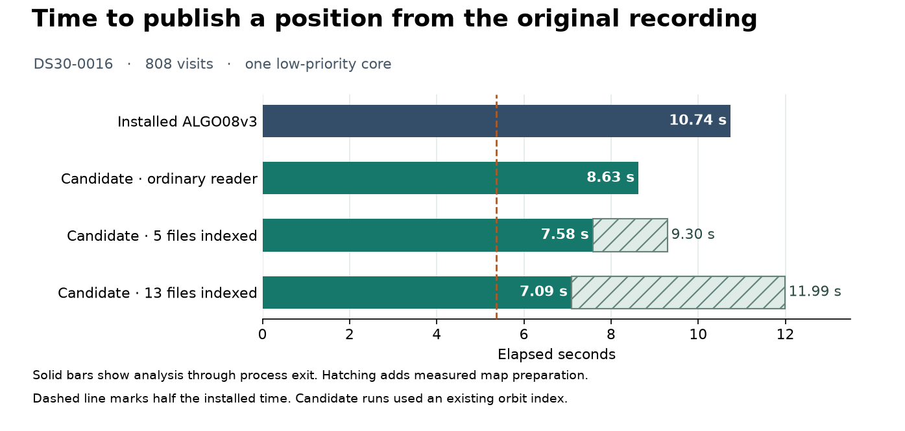

# Selective decoding on the original DS30-0016 files

Indexing **all 13 original compressed files** reduced complete analysis time to **7.093 s**, including both calibration fits and eight verified PNGs. The candidate with ordinary reads took **8.630 s**. Against the earlier installed ALGO08v3 clock of **10.745 s**, the ready speedup was **1.51×**. That leaves **0.377 s to reach 1.6×** and **1.721 s to reach 2×** on this recording. Neither detector outputs nor position or image content changed between the two candidate reader modes. [Full-recording comparison and machine receipt](https://github.com/misko/leo-tracker-reduxredux/blob/133b6374d8a449035676c0cb7766ae79c175a1de/reports/ALGO08/v3/legacy-block-all-0016.md)

The full reader authenticated all 991.7 MB of the original encoded recording and verified 545.6 MB of requested decoded data. It used eight small stored exception spans during the run and restored one dependent Huffman table. Acquisition took **2.394 s**, compared with **2.878 s** with five maps and **3.612 s** with ordinary reads. The full candidate and ordinary control ran in separate processes at different times. The resulting 17.8% reduction in through-exit time includes variation outside acquisition.

The 13-map build reused the five previously verified maps. The incremental preparation took **3.182 s**. Charging those five maps' original verification and creation as well brings the observed preparation plus first analysis to **11.993 s**. All three candidate runs used the same earlier orbit index. Building that index would add a further 4.320 s. [All-member first-use accounting](https://github.com/misko/leo-tracker-reduxredux/blob/133b6374d8a449035676c0cb7766ae79c175a1de/reports/ALGO08/v3/legacy-block-all-0016.md) · [Reproduce the figure](https://github.com/misko/leo-tracker-reduxredux/blob/133b6374d8a449035676c0cb7766ae79c175a1de/reports/ALGO08/v3/legacy_frame_figure.py)

### Paired result including the short withholding case

The same full reader and publication entry also ran on the original DS30-0107 file. All 29 visits remained in the inventory, including the partial visit and the empty visit. The normal receiver selected 19 factors and withheld both positions for insufficient curvature. The original terminal and empty product list matched. Below, the installed baseline uses the previously measured original-file clocks. The two candidate columns use fresh processes on the same recordings.

| Process through exit | Original ALGO08v3 | Candidate, ordinary reads | Candidate, full index |
|---|---:|---:|---:|
| DS30-0016 · fix | 10.745 s | 8.630 s | 7.093 s |
| DS30-0107 · withheld | 1.497 s | 0.549 s | 0.967 s |
| **Sum** | **12.242 s** | **9.178 s** | **8.059 s** |

The full candidate reached **1.53× at the paired median and 1.52× by summed time** against v3. Including map-readiness checks gives 8.068 s total. Charging the measured full map preparations as well gives **13.032 s for first use**, before any shared orbit-index construction. On the short case, selective acquisition saved too little to offset the rest of the indexed process. The indexed pair needs another 1.94 s in total for 2×, or 0.41 s for 1.6×, using through-exit clocks. The two cases come from one roof and were selected to exercise a fix and a withhold. [Matched tiny result and paired gates](https://github.com/misko/leo-tracker-reduxredux/blob/133b6374d8a449035676c0cb7766ae79c175a1de/reports/ALGO08/v3/legacy-block-all-0107.md)

On the fix, the candidate's errors against the operator reference were **490 m with fixed calibration and 980 m with fitted calibration**, versus **1,644 m and 1,661 m** for the installed baseline. The reader change preserved its own solver's positions exactly. Earlier tests with the correct region removed produced false fixes in both pipelines. Compression fidelity and these two paired decisions leave open how well the solver will localize at another physical site. [Containing and missing-region controls](https://github.com/misko/leo-tracker-reduxredux/blob/133b6374d8a449035676c0cb7766ae79c175a1de/reports/ALGO08/v3/history-risk-0016-omitted.md)

The short recording exposed an avoidable cost after withholding. Writing the final map-audit JSON imported the numerical localization engine and SciPy. In fresh writer-only processes, that step took **300–310 ms** on the real audits. A dedicated writer emitted the same bytes in **1.0–1.4 ms**. Both time and file contents were checked in opposite orders for the fixing and withholding cases. The paired pipeline clocks above predate this change. Its end-to-end effect still needs a direct measurement. [Writer comparison and exact-byte checks](https://github.com/misko/leo-tracker-reduxredux/blob/133b6374d8a449035676c0cb7766ae79c175a1de/reports/ALGO08/v3/legacy-map-receipt-writer.md)

### Which original files need exceptions?

Only **5 of the 13 original files** consist entirely of Huffman-coded literals. Those files account for **320 of 808 visits** and **393.1 of 991.7 MB** of compressed input. A decoder that falls back on the first Zstandard match can use the shortcut on 39.6% of this recording's compressed bytes. The previously studied first file qualified. Timing it alone would overstate coverage. [Complete per-file census](https://github.com/misko/leo-tracker-reduxredux/blob/133b6374d8a449035676c0cb7766ae79c175a1de/reports/ALGO08/v3/measurements/legacy-frame-coverage-0016.json) · [Frozen selection](https://github.com/misko/leo-tracker-reduxredux/blob/133b6374d8a449035676c0cb7766ae79c175a1de/reports/ALGO08/v3/legacy-frame-coverage-protocol.md)

| Original file layout | Files | Visits | Compressed bytes | Decoded bytes | Compressed blocks | Blocks containing matches |
|---|---:|---:|---:|---:|---:|---:|
| Literals only | 5 | 320 | 393,072,334 | 512,000,000 | 3,910 | 0 |
| Literals and occasional matches | 8 | 488 | 598,662,263 | 780,800,000 | 5,964 | 13 |

All 9,874 blocks use four-stream Huffman literals. The 13 exceptional blocks regenerate just 81 bytes through match instructions. Even saving the entire decoded exceptional blocks would add at most **1,703,936 bytes**, or 0.172% of the original compressed recording, before seek metadata. Four exceptional blocks introduce a new Huffman table. Only one such table is used by a later literal-only block. It has one consumer, in the recording's last member. A decoder that skips an exceptional block must establish the correct table before reading a dependent block. The frequency of exceptions and the cost of handling them can vary with the signal and encoder.

This census authenticated both original manifests and every complete encoded payload in the existing memory-backed copy. It checked residency and read only that copy. The parser classified frame headers against the declared decoded extent. It did not decode I/Q or calculate positions. The ordinary decoder's whole-frame checksum and decoded-sample checks are still required when certifying a seek map. [Census and reproduction command](https://github.com/misko/leo-tracker-reduxredux/blob/133b6374d8a449035676c0cb7766ae79c175a1de/reports/ALGO08/v3/legacy_frame_coverage.py)

### What the small receiver tests measured

On the first DS30-0016 file, the ordinary reader and detector took 393.4 and 371.8 ms in two opposite orders. Selective reads of the original compressed file reduced those times to 329.8 and 288.5 ms, saving **16.2% and 22.4%**. Both readers authenticated every encoded byte and produced all 116 ordered detector outputs. Original verification followed by writing the 34,319-byte index took 251.0 ms, including 10.2 ms to build and sync the index after verification. Both readers rejected a changed byte in an unused suffix. [Same-member timings, integrity and first use](https://github.com/misko/leo-tracker-reduxredux/blob/133b6374d8a449035676c0cb7766ae79c175a1de/reports/ALGO08/v3/legacy-block-seek.md)

The two runs saved an average of 73.4 ms per subsequent analysis. At that rate the 251.0 ms standalone preparation would pay for itself on the **fourth replay** of this member. Generating the index alongside a full verification that was already required would change that accounting. Neither figure measures a first capture-through-position run.

The first dense DS30-0008 file contained a four-byte match in one block. Its scheduled short visit ended before reaching the block. Saving that block's verified decoded bytes also allowed a subsequent request for the full visit. All 64 scheduled spans and all 64 full spans matched the ordinary reader. The sidecar occupied 165,269 bytes, including its 131,072-byte exception. The two ready comparisons timed sample acquisition and verification only. They saved 24 ms and 69 ms CPU, with considerable variation in how long it took to attach and authenticate the original input. [Dense rare-match proof](https://github.com/misko/leo-tracker-reduxredux/blob/133b6374d8a449035676c0cb7766ae79c175a1de/reports/ALGO08/v3/legacy-block-exception.md)

### Complete recording through position and PNG publication

The first complete comparison used maps on the five eligible files and verified ordinary reads on the other eight. Both runs consumed the exact original recording and used the same receiver, solver, earlier orbit index and renderer. Both reproduced the same detections, both positions and RF residuals, all 115 ordered assignments per arm, the 179-point grid and path, and all eight encoded and decoded PNGs, including their original titles.

| DS30-0016 boundary | Ordinary reads | Five files indexed |
|---|---:|---:|
| Acquisition | 3.612 s | 2.878 s |
| Raw input through position, publication and process exit | 8.630 s | 7.581 s |
| Full verification, creation of the five maps, and first analysis | — | 9.299 s |

The earlier installed-v3 process took 10.745 s. The prepared five-file result reached **1.42×** against that clock, or **1.16×** including map preparation. The earlier orbit index cost another 4.320 s to construct if it also needed building. Within the matched pair, the candidate was 1.049 s faster through exit. The ordinary process had 19 major faults and the candidate had zero. Their publication times also differed, and the two jobs ran in separate lock intervals. Both had all original waveform pages resident. These clocks establish an observed complete-run difference, with weaker attribution than the reversed single-file experiments. [Paired run, preparation and verification](https://github.com/misko/leo-tracker-reduxredux/blob/133b6374d8a449035676c0cb7766ae79c175a1de/reports/ALGO08/v3/legacy-block-raw-0016.md)

### Creating the map during the first analysis

On a different DS30-0016 file with three exceptional blocks, the same continuous decode fed the normal detector, checked the frame checksum and all sample digests, and produced a durable map for future reads. That took **268.1 and 265.6 ms** versus **279.7 and 266.3 ms** for ordinary verification and detection. Both orders produced the same 114 detector outputs. The map matched the independently constructed 427,753-byte reference exactly. An incomplete traversal, a corrupt recording or a detector failure prevented map publication. This is evidence that a first analysis can build the index at close to ordinary cost on one file. Complete-recording first-use timing for this combined method is still outstanding. [Map creation inside acquisition](https://github.com/misko/leo-tracker-reduxredux/blob/133b6374d8a449035676c0cb7766ae79c175a1de/reports/ALGO08/v3/legacy-fused-map.md) · [Three-block comparison](https://github.com/misko/leo-tracker-reduxredux/blob/133b6374d8a449035676c0cb7766ae79c175a1de/reports/ALGO08/v3/legacy-block-multi.md) · [Dependent table replay](https://github.com/misko/leo-tracker-reduxredux/blob/133b6374d8a449035676c0cb7766ae79c175a1de/reports/ALGO08/v3/legacy-table-replay.md)
