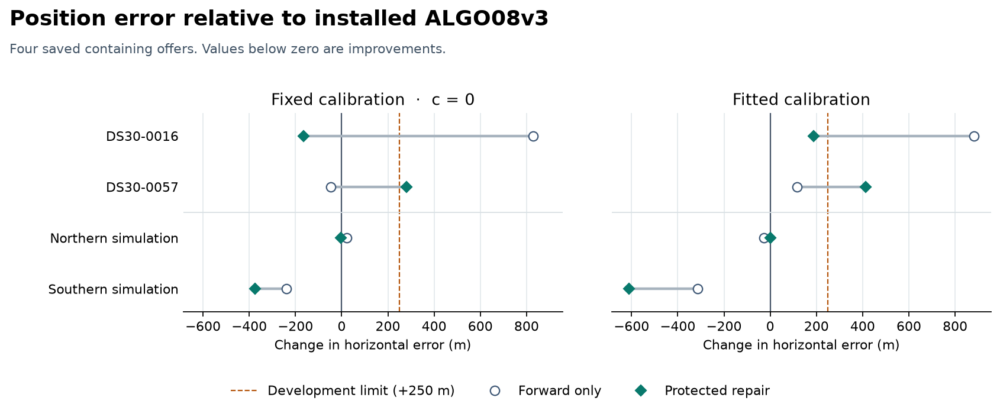

# Protected Doppler-track repair on a second physical DS30 recording

The repair recovered useful evidence on physical DS30-0016 and the public northern and southern simulations. It failed both prespecified position screens on DS30-0057. All 1,220 forward assignments retained their satellite and role, but the 138 additions shifted horizontal error from **378 to 708 m** with fixed-zero calibration and from **641 to 937 m** with fitted calibration. Installed v3 gave **426 and 525 m**. Preserving assignments solved a northern track reconstruction problem. It could not ensure that appended measurements improved the fix on a second recording from the same roof. [Frozen DS30-0057 protocol](local-future-0057-protocol.md) · [First three containing offers](local-future-repair.md)

## Saved publication results on DS30-0057

| Input and solver | Error, fixed / fitted (m) | RF RMS, fixed / fitted (Hz) | Numerical solve CPU (s) | Saved packet through exit, elapsed / CPU (s) |
|---|---:|---:|---:|---:|
| Original v3 detections, installed solver | 426 / 525 | 109.97 / 109.83 | 9.909 | 13.548 / 13.545 |
| Short detections, forward-only compact solver | 378 / 641 | 120.22 / 120.25 | 6.206 | 10.682 / 9.881 |
| Same short detections, protected repair | 708 / 937 | 121.28 / 121.31 | 6.503 | 10.106 / 10.103 |

Stock reproduced the original terminal digest and all eight archived PNG byte and pixel hashes. All three fresh runs returned two positions, completed the 179-point grid, and wrote eight verifiable PNGs. Each process used one low-priority Gauss core and a fresh tmpfs output directory with a shared warm font cache. The single execution order was forward, stock, repair. The repaired saved publication took 74.6% of stock elapsed. Raw reading, decompression, authentication and detection are outside these measurements. The forward arm had about 0.80 s more elapsed than CPU, so the lower repaired elapsed does not establish a cheaper repair. The repair actually used 0.222 s more process CPU. [Fresh receipts and phase clocks](measurements/local-future-0057.json.gz) · [Replay and independent scorer](local_future_0057.py)

Each calibration comparison within a build used the same observations, region, candidates and search budget. Fitting calibration increased repaired position error by 229 m and RF RMS by 0.025 Hz. The older unfiltered candidate on the same original short detections gave **240 / 297 m** with RF RMS **125.30 / 125.31 Hz**. Its lower position error despite greater RF residual illustrates why waveform fit and localization have to be assessed separately. [Prior matched raw result](short-raw-diagnostic.md)

## Which observations were added?

Of 225 future-supported opportunities, the repair admitted 138 observations across 12 satellites. It rejected ambiguous nominations and applied both calibration arms' existing alias, visibility, pointwise and whole-track checks. Forward and reverse selection cost 0.092 CPU s, nomination 0.049 s and refit 0.092 s. The accepted additions included 74 conditional and 64 predictive observations per arm.

| Comparison with the original full-aperture receiver and installed-v3 owners | Existing 1,220 | Added 138 |
|---|---:|---:|
| A full-receiver factor was present on the same lane and visit | 1,219 (99.9%) | 83 (60.1%) |
| Both receivers selected a rank-zero factor within two wrapped samples and 250 Hz | 1,150 (94.3%) | 45 (32.6%) |
| Stock fit assigned the same satellite | 1,141 (93.5%) | 47 (34.1%) |
| Stock fit assigned a different satellite | 41 | 26 |
| Stock fit left the observation unassigned | 38 | 65 |

Both calibration arms yielded the same witness counts. The counterfactual receiver and stock assignments were examined after the candidate published. The two receivers observe the same waveform. Stock disagreement identifies where the evidence is weaker, but cannot label individual measurements as erroneous or prove which observations caused the error. A follow-up can test full-aperture agreement as a prospective confirmation rule and account for every additional waveform read and verifier call. Neither the published stock locations nor its assigned satellites belong in that rule. [Witness census](measurements/local-future-0057-witness.json) · [Probe join and census](local_future_witness.py)

## Implications for halving time

On the mirrored public location tests, the repaired solver also returned false fixes for **both** offers that omitted the correct location by 100 m. Both 52.5 km omissions withheld before fitting, with null positions and zero figures. Both containing offers reproduced the earlier repaired outputs. The new evidence therefore preserves the far-omission behavior and leaves the near-edge ambiguity unresolved. [Matched containing and missing-region publications](local-future-omissions.md)

The physical errors rule this candidate out for a larger DS30 timing panel. The two numerical shortcuts studied alongside it also have bounded scope. In the saved dense cold search, competing assignments reused 86–92% of normalized rows for unweighted statistics, yet none of the final robust weights matched across the three leading assignments. Even granting the entire cold, salvage and post-salvage predictive stages for free leaves 17.35 s of dense solver CPU, above the modeled 16 s target. In the receiver, every audited installed-v3 candidate reaching the final fractional verifier passed the gate (80 dense and 58 weak), as did all 34 audited short weak candidates. A perfect early-rejection oracle on those confirmed lanes would skip zero work. The dense short rejection rate remains unmeasured. [Solver census](dense-assignment-reuse.md) · [Receiver ceiling](fractional-reject-ceiling.md)

To reproduce the timed version, use commit `55908f440` and run `local_future_0057.py trial FRESH_TMPFS_ROOT` using the release interpreter, research modules, Gauss lock and single-core settings in the original raw diagnostic. Run `local_future_0057.py score FRESH_TMPFS_ROOT` in that checkout's scoring environment. The later `local_future_witness.py FRESH_TMPFS_ROOT` reads the sealed products. The figure script reads the two checked-in compressed receipts. [Detection sources](measurements/short-raw-diagnostic.json) · [Figure script](local_future_transfer_figure.py)
