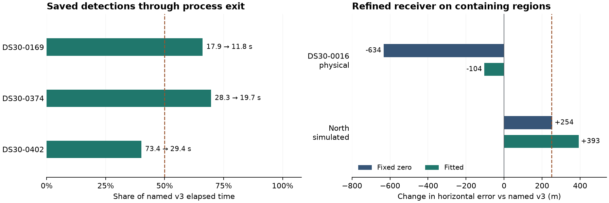

# Long-recording solver speed and location transfer of the refined receiver

The current candidate took **19.732 s** from saved named detections through process exit on the 6,770-visit DS30-0374 recording. Named v3 took **28.324 s** on the same observations. On the separate northern simulation, a complete refined-receiver run took **14.752 s** against **16.203 s** for an earlier named run. Both calibration arms on that location exceeded the 250 m position-error regression screen. The evidence supports further work on acquisition cost and observation selection before expanding the raw DS30 panel. [Long physical transfer](named-final-0374.md) · [Northern raw and missing-region transfer](raw-cfo-north.md)

The dashed lines mark half of named solver time on the left and the 250 m development allowance on the right. Each left-hand pair starts at identical saved named detector output and includes publication. The right compares positions from complete scans of physical DS30-0016 and simulated North. Negative values mean the candidate returned a position closer to the reference. [Figure from five measured comparisons](long_solver_geography_figure.py)

| Physical saved detections | Named v3 to exit | Candidate to exit | Time ratio | Scientific result |
|---|---:|---:|---:|---|
| DS30-0169, 4,219 visits | 17.893 s | 11.822 s | 0.661 | Both published positions and all 2,236 assignments per arm matched. |
| DS30-0374, 6,770 visits | 28.324 s | 19.732 s | 0.697 | The original final fit was requested. Held phase-history scores declined it. The ordinary fit lost 83 assigned observations and changed fixed/fitted error by +4.2 / −6.7 m. |
| DS30-0402, 6,773 visits | 73.351 s | 29.440 s | 0.401 | Original final fit preserved all 4,821 assignments per arm and both positions within 0.05 mm. |

The median ratio across these development comparisons is **0.661** and the ratio of summed times is **0.510**. The panels were measured in separate sessions during development. All six runs produced fixes and eight verified PNGs. Original acquisition is outside every time in this table. On 0374, two complete track spans were nominated under the correct satellite and rejected at the second gate. A third offer covered the early part of a track and overlapped only two of the 35 missing later observations. [0374 ownership and gate trace](named-final-0374.md) · [0169 and 0402 comparisons](original-final-fit-transfer.md)

## Frequency precision and position accuracy

On North, 383 of 396 matched short detections improved their estimate of the signed frequency offset. RMS disagreement with the 20 ms receiver fell from **10.602 to 1.806 Hz**. The mixed receiver also supplied **622 additional detections**. The refined candidate ultimately used 265 observations per calibration arm, versus 302 for named v3. On the containing offer the position error rose from **105.7 / 140.8 m** to **359.8 / 533.4 m** with fixed and fitted calibration. RF residual RMS after association rose from **5.41 / 5.17 Hz** to **75.60 / 77.30 Hz**. On the missing offer, both builds falsely returned a fix when the reference lay 100 m outside. The candidate solutions lay 95 m and 385 m inside the boundary. These results distinguish precision on matched waveforms from the later selection of observations and satellite assignments. [Matched data, position errors, causal inputs and PNG verification](raw-cfo-north.md)

## Receiver and failure-path changes

An oscillator re-anchored on each 32nd sample saved **24.36 ms CPU** on a 102-lane held physical batch, including native detection and the independent extended frequency check. The original and modified receivers kept every one of 159 native factors in the scheduled dense, weak and held panels, with the same timing, signed native frequency and verifier flags. Continuous scores differed at about 1.2 × 10⁻¹³. A dense saving of about **3.2 CPU s** transfers the held rates to a longer recording and remains a projection. [Exact fallbacks, scopes and measurements](anchored-phase.md)

The 555-visit DS30-0340 exposed a common crash in both raw builds. Withholding when one family's exclusion leaves zero independent calibration rows turned it into a complete raw decision in **8.024 s** on resident input. The guarded terminal and detector packet were byte-identical to their saved controls. The single fresh raw regression supplies no paired speed measurement. On DS30-0016 the option preserved both locations, all assignments, the scientific grid and all eight PNGs. [Original failure](raw-combined-0340.md) · [Saved controls](empty-family-calibration.md) · [Original-input regression](raw-empty-family-0340.md)
