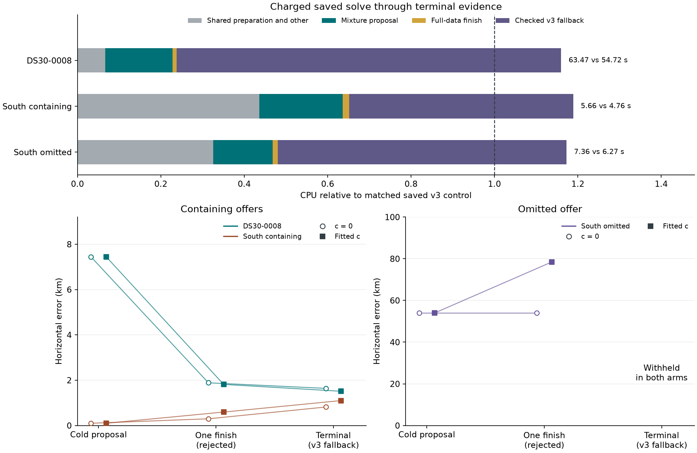

# A cold joint track mixture for ALGO08v3 position

The checked route used full v3 fallback on all three offers. It took **63.47 CPU seconds** on dense DS30-0008, versus **54.72 seconds** for the matched saved v3 control. The cold proposal erred by 7.45 km in both calibration arms. One original full-data finish brought the estimates within 1.89 and 1.82 km of the site, while its RF RMS exceeded 5.37 kHz and 19 of 98 tracks failed the original compatibility gates. The southern simulation reproduced every v3 owner when the offer contained the site. Its near-face endpoint still required fallback. The far offer also required fallback and reproduced the original withholding. [Prespecified protocol](mixture-position-protocol.md) · [Numeric summary](measurements/mixture-position-summary.json) · [Full receipts](measurements/mixture-position.json.gz)



## Search and validation

The trial replaces the staged owner, recovery and history search with one joint track proposal and one full-data fit. It uses the original saved graph inputs, physical curvature gate, screened causal satellite catalogue and supplied region. At each 5 × 5 mesh point it ranks every candidate from up to nine time-spread observations per curved track. Local refinement extends that search to 28–30 distinct nodes. The receiver starts from zero or a circular bandwidth-group offset estimate. Every track carries the best eight visible orbital candidates and three nearby signed aliases per candidate, with an unexplained-track component. The method then jointly updates receiver terms using all mixture weights. The variable projection solves each candidate's finite-prior intercept and bounded orbit-phase tangent and projects those terms out of the receiver update. Its Student-t track score yields relative weights under the fixed trial model. [Proposal](mixture_position.py) · [Numerical component tests](../../../tests/pipeline_eval/test_algo08v3_mixture_position.py)

The earlier family-profile route fixed one winner per track based on the center before comparing positions. The local time-moments route retained the full staged schedule after initial discovery, and the collapsed route began with stock discovery. The older joint mixture sampled historical IDs and shared family phase at fixed locations on a previously selected catalogue. The present trial searches the full prepared catalogue throughout the offer before judging whether fixed members can support one original finish. The near-face and off-region controls exercise the checked fallback. [Family profile](../single-core-2x/solver-family-profile.md) · [Track moments](../single-core-2x/solver-track-moments.md) · [Collapsed route](../single-core-2x/solver-collapsed.md) · [Earlier joint mixture](../../2026_09_26_joint_mixture/REPORT.md)

The finish chooses the `c = 0` inlier membership and uses the same full observation rows, satellite labels, aliases, genuine-previous orbit priors, gate rules and original solver iteration budget for both calibration arms. Each starts at its own mixture endpoint. A failed pair, a position change over 1 km or an endpoint within 1 km of an offer face invokes the full installed route on the same prepared data. Its archived terminal, arm positions, owners and science digests were verified, as was the saved ledger and original archive. [Finish](mixture_finish.py) · [Checked runner](mixture_trial.py)

## Position and frequency evidence

The first two rows for each offer are diagnostics. The terminal column uses the actual checked branch. Proposal frequency RMS uses the same time-spread observations, chosen orbit and signed alias from the zero-calibration proposal in both arms. The finish uses original full data on those chosen tracks. RMS at the terminal uses the separate accepted v3 support. The geographic reference was scored after all inference receipts were saved. [Simulated reference](../regional-release/scoring-key.json) · [Physical reference](../../2026_11_21_ds30_full/reference-audit.json)

| Offer | Stage | Horizontal error km, `c = 0` / fitted | RF RMS Hz, `c = 0` / fitted | Checked decision |
| --- | --- | ---: | ---: | --- |
| DS30-0008 | Joint proposal | 7.446 / 7.446 | 176.806 / 176.804 | Diagnostic |
| | One full-data finish | 1.886 / 1.815 | 5,377.044 / 5,393.904 | Rejected |
| | Terminal and full v3 | 1.639 / 1.512 | 129.703 / 129.663 | Returned both |
| South containing | Joint proposal | 0.100 / 0.100 | 6.652 / 6.379 | Diagnostic |
| | One full-data finish | 0.297 / 0.594 | 6.470 / 6.372 | Rejected |
| | Terminal and full v3 | 0.817 / 1.101 | 6.502 / 6.392 | Returned both |
| South omitted | Joint proposal | 53.948 / 53.948 | 111.229 / 111.348 | Diagnostic |
| | One full-data finish | 53.948 / 78.468 | 459.144 / 762.342 | Rejected |
| | Terminal and full v3 | — | — | Withheld both |

Dense fixed-zero and fitted one-shot errors increased **+0.247 / +0.303 km** against v3, with RF RMS changes of **+5,247.341 / +5,264.241 Hz** over different support. Both one-shot arms moved over 6 km from the mixture proposal and qualified only 3,231 of the 3,958 attempted points. The southern containing finish improved geographic error by **−0.520 / −0.507 km**, with RF RMS changes of **−0.033 / −0.020 Hz** on the same eventual orbit owners. Its two endpoints had only 0.32 and 0.24 km of face clearance. Disabling the gate for those endpoints would change a prespecified condition. In the far offer the fitted arm moved 25 km between opposite east-west faces and failed the stock pair gate. Full v3 withheld under `both_receivers_support_far_exterior`.

Within the dense one-shot fit, learned `c` reduced error by 0.071 km while increasing RF RMS by 16.859 Hz. On the containing simulation it lowered RF RMS by 0.097 Hz while increasing geographic error by 0.297 km. Each pair used shared membership and other priors. The dense fitted finish exceeds the 0.25 km development allowance, and the omitted finish generated two geographically wrong estimates before checking. The separate no-worse site median and P90 release gate needs independent coverage beyond these cases.

## Owners and cost ceilings

Dense search scored 4,915,080 track × satellite × node cells from 111 curved tracks, 1,476 satellite candidates and 30 positions. The graph had 4,522 curved observations. Of 4,472 eventually owned in each v3 arm, 3,574 even enter the curved-only model. An oracle reading the eventual owners could recover at most 3,502 with the eight-satellite slate, whether it chose across all evaluated grid nodes or used only the winning node. The actual shared mixture membership reproduced 2,971 owners and chose a different satellite for 508 more previously owned observations. These oracle counts use the completed v3 evidence and never inform the proposal. The southern containing slate and shared membership both matched all 266 v3 owners. Its far counterpart had no published v3 observations to match. [Per-track candidate and owner evidence](measurements/mixture-position.json.gz)

| Offer | Matched saved v3 CPU s | Shared preparation and other CPU s | Mixture CPU s | Full-data validation CPU s | Fallback CPU s | Charged CPU / elapsed s |
| --- | ---: | ---: | ---: | ---: | ---: | ---: |
| DS30-0008 | 54.720 | 3.671 | 8.819 | 0.540 | 50.441 | 63.472 / 63.485 |
| South containing | 4.758 | 2.074 | 0.952 | 0.075 | 2.556 | 5.657 / 5.691 |
| South omitted | 6.274 | 2.042 | 0.896 | 0.079 | 4.342 | 7.359 / 7.359 |

The matched clocks come from the previous v3 full-mask replays on identical packets and offers. In the current matched process, the fallback reuses the original preparation and runs the same scientific solver. Its time plus measured preparation and other work is 54.112 CPU seconds on dense DS30-0008. The current route spends another 9.360 seconds on the rejected proposal and validation. All clocks use one low-priority pinned Gauss core and one numerical thread. The actual terminal rates include evidence construction for returned v3 fixes and count the omitted withholding at its measured cost. [Matched saved controls](measurements/aperture-summary.json)

Free validation and no grid would leave the dense route at **12.49 CPU seconds**. Adding the measured one-shot finish leaves **13.03 CPU seconds** before any candidate grid or fallback. Treating both as free would permit at most **21.7%** fallback under the 24-second dense solver budget. All three tested offers invoked fallback. The full-data path through the correct checked decision does not meet the budget in this experiment. Improving the mixture alone would also leave 56.04 warm elapsed seconds for dense acquisition and publication. [Warm stage clocks](first-55/stage-clocks.csv)

## Reproduction

The runner uses the installed ALGO08v3 numerical stack and the saved aperture-study inputs. Each offer runs in a fresh process. The postfit scorer reads the verified output, the original site references and matched saved timing. Eleven component and adjacent tests passed. No raw I/Q was read. [Scoring](mixture_score.py) · [Figure](mixture_figure.py)

```sh
mixture_release=/opt/leo-algo08/bdb869682a2ea63af4b198a920b763a4c6a78c4c
mixture_payload=/opt/leo-algo08/algo08v3/payload
mixture_code="$PWD/reports/ALGO08/v3"
mixture_receipts=$(mktemp -d /var/tmp/leo-mixture-new.XXXXXXXX)

mixture_lock() {
  flock -x /tmp/leo-algo08v2-2x-bench/gauss.lock ionice -c2 -n7 nice -n15 taskset -c 2 \
    timeout 100s env OMP_NUM_THREADS=1 OPENBLAS_NUM_THREADS=1 MKL_NUM_THREADS=1 \
    BLIS_NUM_THREADS=1 NUMEXPR_NUM_THREADS=1 "$@"
}

for mixture_case in south-containing south-far DS30-0008; do
  mixture_lock env PYTHONPATH="$mixture_code:$mixture_payload:$mixture_release/src:$mixture_release" \
    "$mixture_release/venv/bin/python" -BPs "$mixture_code/mixture_trial.py" \
    "$mixture_case" "$mixture_receipts/$mixture_case.json"
done

mixture_lock env PYTHONPATH="$mixture_code:$PWD:$PWD/src" python "$mixture_code/mixture_score.py" \
  "$mixture_receipts" "$mixture_receipts/complete.json.gz" "$mixture_receipts/summary.json"
mixture_lock python "$mixture_code/mixture_figure.py" \
  "$mixture_receipts/summary.json" "$mixture_receipts/mixture-position.png"
```
