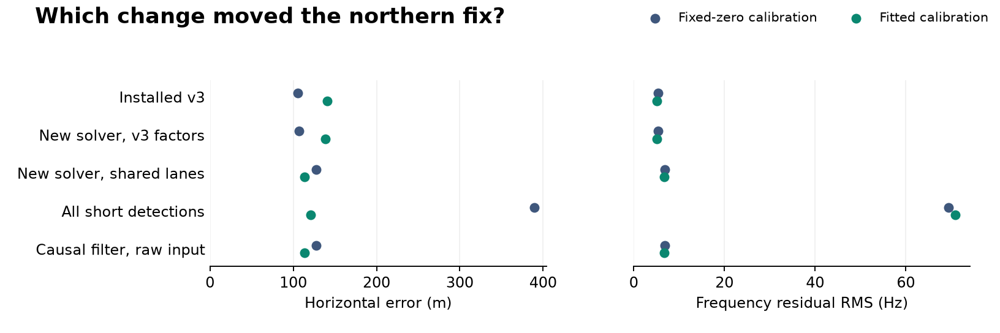

# Carrier history restores northern position accuracy on the short receiver

On a northern simulated recording, the 12 ms receiver preserved all 456 lanes selected by installed ALGO08v3 and admitted 622 others. Filtering the short measurements using the repository's existing per-radio frequency history reduced fixed-zero position error from **390 to 128 m** and frequency residual RMS from **69.4 to 6.9 Hz**. The complete raw run took **12.39 s** versus **18.51 s** for v3, a **1.49×** speedup on this recording. Both the original and revised candidates returned a position when the site was 100 m outside the search region.

On weak physical DS30-0016 the same filter raised horizontal error by **829 / 881 m** versus installed v3. This exceeds the 250 m development limit in both calibration arms. The northern recovery consequently does not qualify this configuration for the four-recording timing stage.

## What changed the fix?

| Northern containing offer | Factor count | Fixed-zero / fitted position error | Fixed-zero / fitted RF RMS | Raw through exit |
|---|---:|---:|---:|---:|
| Installed ALGO08v3 | 456 | 106 / 141 m | 5.41 / 5.17 Hz | 18.514 s |
| Combined solver on the original v3 factors | 456 | 107 / 139 m | 5.41 / 5.17 Hz | Saved solve only |
| Combined solver on short factors at the 456 shared lanes | 456 | 128 / 113 m | 6.88 / 6.76 Hz | Saved solve only |
| Combined solver on all short-receiver factors | 1,078 | 390 / 121 m | 69.40 / 70.86 Hz | 12.872 s |
| Combined solver with causal short-receiver selection | 456 | 128 / 113 m | 6.88 / 6.76 Hz | 12.388 s |

Changing the solver alone shifted either error by about 2 m or less. Holding the short-receiver measurements on the shared lanes fixed and then admitting the other 622 raised the fixed-zero error by **262 m** and the fitted error by **7 m**. The corresponding RMS increases were **62.5 and 64.1 Hz**. These are conditional comparisons on one recording. The errors can respond differently to calibration. [Matched raw pair](measurements/north-combined.json) · [Saved interventions](measurements/north-factor-swap.json)

The candidate's median fractional verification margin was 0.916 on the 456 shared lanes and 0.046 on the 622 added lanes. All 456 shared CFO measurements agreed within 250 Hz, with median absolute difference 8.75 Hz. The solver assigned **47 of the 622 added factors** and 300 shared factors in each calibration arm. Requiring a history of compatible measured frequencies on the same radio and RF recovered exactly the shared 456 lanes on this simulation, with every original opportunity kept in order. The causal implementation uses only the candidate's measurements. The shared-lane diagnostic also consumed the stock packet. [Selection rule](../../../tools/pipeline_eval/variants/carrier_continuation.py) · [Raw receiver adapter](causal_short_receiver.py)

## Search-region decisions and runtime

The northern reference is 100 m inside the offered face. The raw causal run passed the tolerance of 250 m added error in both arms and produced the same terminal, assignments and eight PNG bytes and pixel hashes as its saved replay. Both the unfiltered and causal short candidates withheld on the **52.5 km omission**, as v3 did. All three published on the **100 m omission**. With the causal receiver those false publications had errors of **153 / 102 m**. The omissions reused the same authenticated detector packet. [Raw and missing-region results](measurements/north-causal-transfer.json)

The unfiltered candidate, installed control, and causal candidate used 12.82, 18.48 and 12.34 CPU s respectively. Each used one low-priority Gauss core, the same northern tmpfs input, output filesystem, warmed font cache, supplied region and causal archive. The first two raw launches formed a pair. The causal raw run followed the saved diagnosis and used the earlier installed clock as its comparator. This gives one elapsed fraction of **0.669** for the revised candidate. The qualification threshold is 0.500. The experiment used a previously published development simulation. [Protocol and order](north-combined-protocol.md)

## Transfer of the same selection rule

| Containing offer | Short factors before → after | Installed v3 error, fixed / fitted | Unfiltered short error, fixed / fitted | Causal short error, fixed / fitted | Causal RF RMS, fixed / fitted |
|---|---:|---:|---:|---:|---:|
| Northern simulation | 1,078 → 456 | 106 / 141 m | 390 / 121 m | 128 / 113 m | 6.88 / 6.76 Hz |
| Southern simulation | 703 → 456 | 817 / 1,101 m | 454 / 515 m | 577 / 788 m | 7.98 / 7.93 Hz |
| DS30-0016 physical | 475 → 356 | 1,644 / 1,661 m | 1,311 / 1,694 m | 2,473 / 2,542 m | 115.88 / 115.36 Hz |

The two transfer checks ran from saved signed detections, with the identical filter, native regional likelihood and solver configuration. Both returned both fixes and eight decoded figures. The southern case passed the tolerance relative to v3, while its unfiltered short solution was more accurate. On the physical recording the filter reduced RF RMS from 121.53 / 120.29 Hz to 115.88 / 115.36 Hz while horizontal error increased by 1,162 / 848 m relative to the unfiltered candidate. These divergent outcomes rule out using the unchanged filter as a general replacement. [Transfer receipts and calibrated evidence](measurements/causal-selection-transfer.json) · [Saved transfer runner](causal_selection_transfer.py)

## Two other proposed savings

The receiver worker screened a carrier-centered lower-rate verifier. Under ideal centering, 2.5 MS/s retained 97.8–97.9% of coherent pilot power and 88.5% for the weakest verifier symbol. With the current dense solver and the complete dense acquisition as the source clock, making **all** native waveform calls free still projects to **0.661 median / 0.631 summed** elapsed across the frozen first four. Both must reach 0.500. These are conditional estimates from measured stage costs. Signed factor parity at the lower rate remains untested. [Verifier and acquisition ceilings](multirate-verifier-envelope.md)

The solver worker measured **zero duplicate normalized design rows among 3,661 observations in 82 noise groups** in a dense robust fit. Six location-independent hardware columns distinguish the observations within their groups across the fixed-support grid. The proposed exact combination of duplicate rows saves zero products there. Even erasing the measured 1.931 CPU s spent on all native grid exports would leave about 10.1 s of the modeled four-recording shortfall. [Solver profile](dense-row-repetition.md)

## Reproduction

Use the Gauss environment and exclusive CPU 2 lock from the [matched physical comparison](weak-combined-raw.md). The [northern raw driver](north_combined.py) takes `run ROOT SHORT_LIBRARY GEOGRAPHIC_LIBRARY REGIONAL_LIBRARY`, then `score ROOT NEW_JSON`. Use the three pinned libraries from the [regional study](regional-track-scores.md). Keep its prepared font cache for subsequent launches.

Run the [saved diagnostic driver](north_factor_swap.py) for `stock-packet`, `intersection` and `continuation` in that order using the installed payload first on the worker search path. Then run the [causal raw driver](north_causal_transfer.py) with the previous two outputs and a fresh output directory. Each scorer reads back the signed packets, terminal and decoded artifacts. The first attempt at the saved diagnostic initialized a production import before its cold-start hook and stopped before fitting. The completed runs validate inputs in a parent and start the solver in a fresh interpreter. [Figure script](north_combined_figure.py)
