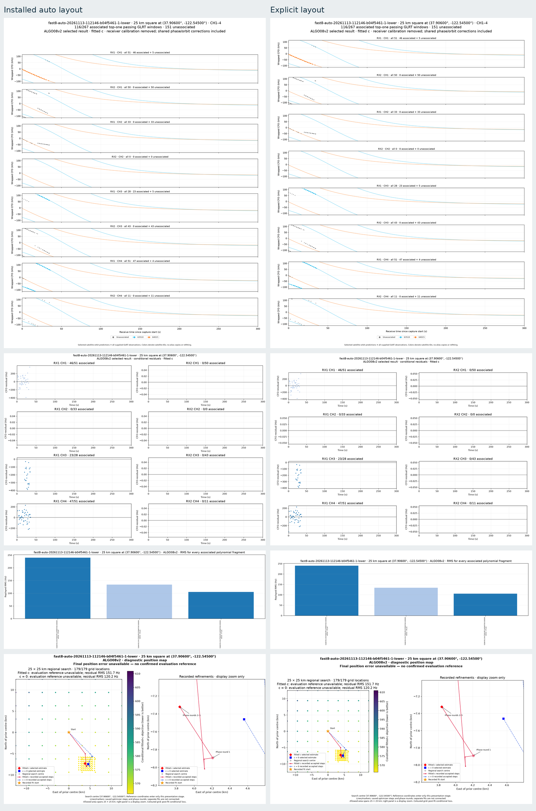

# Explicit layout for the eight web PNGs

The prototype rendered the eight DS30-0016 web figures with **15.4% less CPU** at the paired median. Median render and encode time was **1.434 s installed and 1.188 s explicit**. The candidate retains the same chart data, text and original image dimensions. The complete raw receiver was outside this timing. [Frozen source and five matched pairs](measurements/one-pass-web-png-DS30-0016.json.gz)

The released control already shares the orbit rasters, memoizes ticks and encodes with libdeflate. The candidate supplies subplot margins and spacing to the same Matplotlib artist constructors. It draws each residual, track and position figure once. The four orbit PNGs still come from two base rasters and their original overlays. Rotated track labels reserve space from their measured glyph heights. The orbit legend has a separate footer band, and the map colorbar stays within the square grid's vertical bounds. [Renderer](one_pass_web_png.py) · [Earlier layout prepass](saved-publication-layout.md) · [Lossless encoder](../single-core-2x/lossless-png.md)

| Eight PNGs from one saved plotting packet | Installed | Explicit |
|---|---:|---:|
| CPU median and range | 1.434 s (1.390–1.527) | 1.188 s (1.130–1.253) |
| Elapsed median and range | 1.434 s (1.390–1.527) | 1.188 s (1.130–1.253) |
| Encoded PNG bytes | 2,619,706 | 2,593,567 |

The stopwatch covers artist construction, layout, Agg drawing and PNG encoding. It excludes saved numerical reconstruction and artifact verification. All five pairs ran on Gauss CPU 2 with nice 15, best-effort I/O priority 7 and one numerical thread. Every pair favored explicit layout. The earlier pilot timing ranges varied with host load. The final paired median CPU and elapsed ratios were both 0.846. The measured saving was about 0.25 s across the entire figure bundle. [Protocol](one-pass-web-png-protocol.md) · [Runner](one_pass_web_png_trial.py)

## Chart and publication checks

The active warm physical run supplied the stored detections, original causal archive, installed track graph and offered region. An ordinary saved publication restored both calibration arms, the same ordered observation owners and roles, the 179-point conditional grid and recorded optimizer path. The original renderer reproduced all eight archived PNG byte hashes in every timed repeat. Each candidate figure reproduced its own byte hash in every repeat.

The untimed audit compared visible artist data and order, axis ranges, titles, labels, units, legends and long track identifiers. It found no clipping of the audited labels or overlap with the adjacent figure legends and position colorbar. A visual comparison checked representative orbit, residual, bar and map panels. The official store published and decoded all eight RGBA images for both methods. Both retained identical dimensions, DPI and metadata. The eight images comprise four **2400 × 3022** orbit panels, two **1875 × 1375** residual panels, the **2000 × 750** track plot and the **1680 × 960** position map.

The manifest matched the original in every field outside the image inventory. Grid and path matched in every field except the `position_png_sha256` binding, which each store linked to its own verified map. Publication used the existing write, sync and atomic visibility behavior. No RF samples were read. This benchmark covers one physical recording. The moved-frame synthetic test exercises a different region without providing independent field or performance evidence. [Sealed comparison](measurements/one-pass-web-png-DS30-0016.json.gz) · [Component tests](../../../tests/pipeline_eval/test_one_pass_web_png.py)

## Setup notes

Visual inspection rejected an earlier template where the orbit x-axis label grazed the legend and the map title crossed the colorbar. The final renderer has regression tests for both placements. Earlier setup and verification runs also hit a conservative character-count fallback, an XFS wait before rendering, a missing temporary publication root, and overly strict comparison of the expected changed map binding. The successful run used tmpfs scratch and the original publication API. Twenty-two focused tests passed.

To reproduce, load the frozen release interpreter and payload before the worktree Python modules. Run `one_pass_web_png_trial.py NEW_TMPFS_OUTPUT` as the recording inventory's service account under the shared low-priority Gauss lock. The runner authenticates the saved combined physical publication before entering its ordinary saved-analysis path.
