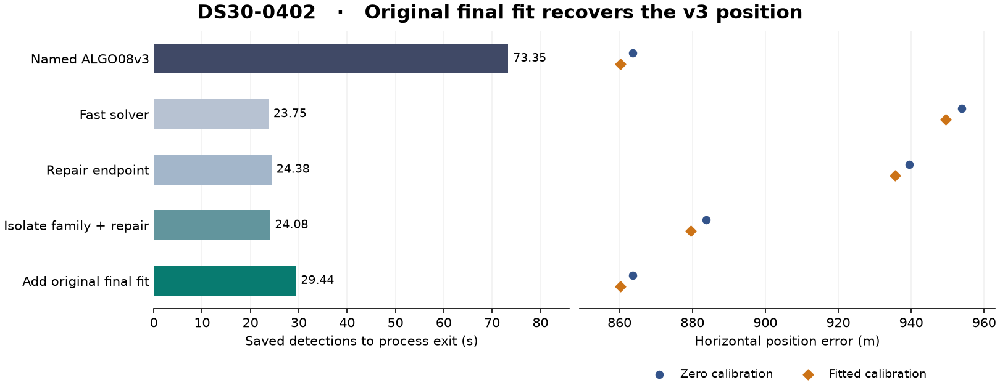
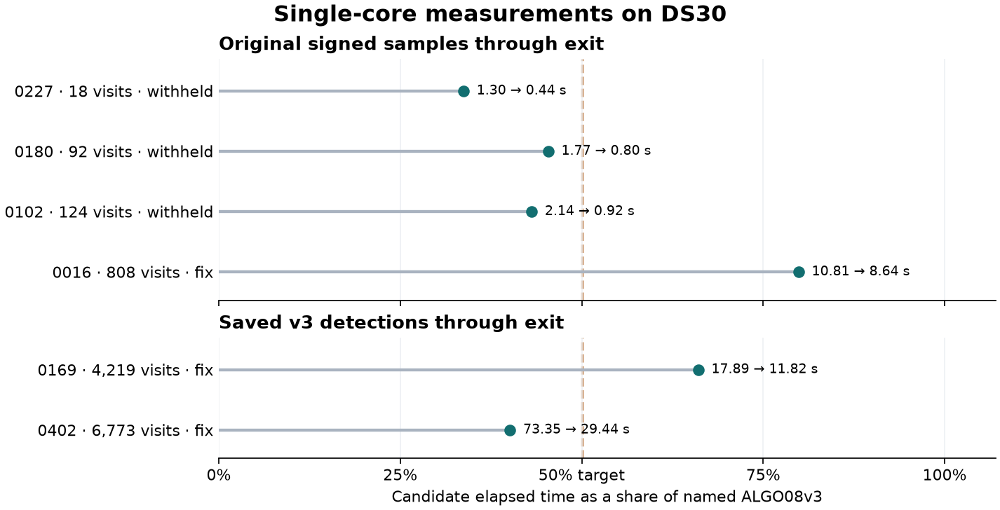

# Original position accuracy on the fast solver

Fast discovery followed by the original signed continuous fit reproduced the named ALGO08v3 locations on two physical DS30 recordings. On DS30-0402 this recovered the remaining **20.3 / 19.4 m of position displacement** in the two arms. On prospectively selected DS30-0169 the published coordinates were exactly equal. These comparisons start at the same saved named-v3 detections for both builds. They include the numerical grid, figures, publication and process exit.

| Saved named detections | Named v3 | Combined solver | Speedup | Zero / fitted horizontal error, both builds to shown precision |
|---|---:|---:|---:|---:|
| DS30-0402, development | 73.351 s | 29.440 s | 2.49× | 0.864 / 0.860 km |
| DS30-0169, independent physical recording | 17.893 s | 11.822 s | 1.51× | 0.506 / 0.348 km |

The two saved comparisons have a summed time ratio of **0.452** and a median paired ratio of **0.531**. All **4,821 / 2,236** observation assignments respectively matched named v3 in order in both arms. The original final fit accounted for the discrepancy that had persisted when the assignments already agreed. On 0402, coordinates matched within 0.050 mm and 0.014 mm. The complete 179-node score grids agreed within 1.73 × 10⁻⁶ after accounting for one constant normalization term from an inactive parameter. On 0169, the path was identical and the maximum score difference on the 179-node grid was 3.64 × 10⁻¹². All eight images were verified per publication; the research renderer can produce different pixels. [Final-fit evidence](named-survivor-fit-0402.md)

DS30-0169 was selected by issued visit count and signed input availability before scoring. Fresh named v3 reproduced its archived result. The combined terminal was byte-identical, and both original signed arm fits completed. This recording never activated the isolated-family or endpoint repairs. [Independent enrollment, results and timing](family-endpoint-transfer-0169.md)

The opt-in research launcher accepts `--named-survivor-finish` on the normal raw command with its supplied recording, region, causal archive and verified numerical libraries. The same switch is available on the `cumulative_grid_projection.py worker` saved entry. It enables isolated satellite-family and endpoint repair before the named signed fit. The ordinary paired solution remains available if qualification fails. [Raw research launcher](unified_short_bootstrap.py) · [Saved worker](cumulative_grid_projection.py)

On DS30-0016 we tested both settings using the actual signed 475-factor output of the mixed receiver. The option ran its original final fit in both arms. The ordinary warm optimizer also reached its cold fallback. Both settings produced exactly the same positions, RF RMS, owner digests, numerical grids and paths, terminal digest and eight images. Complete saved elapsed was **5.372 → 5.414 s**, ordinary to option. The mixed receiver's horizontal errors of **1.311 / 1.694 km** therefore carry through the new option on this recording. Original raw v3 had **1.644 / 1.661 km**. Solver agreement on the same packet cannot eliminate the accuracy effect of changing the receiver packet. [Weak matched receipt](measurements/named-finish-cli-0016.json.gz) · [Original raw pair](unified-short-layout.md)

## Remaining acquisition budget

The table subtracts each measured candidate saved process from half of the corresponding historical named raw process. This gives a planning allowance with the full saved startup and publication charged. It assumes the new raw receiver yields a packet with equivalent solver cost and accuracy. Storage residency and shared startup affect the eventual complete comparison.

| Recording | Historical raw v3 / half time | Candidate saved time | Remaining time for acquisition | Required rate including decode, verification and detection |
|---|---:|---:|---:|---:|
| DS30-0402 · 8,177 MB, original pages resident | 121.438 / 60.719 s | 29.440 s | 31.279 s | 261.4 MB/s |
| DS30-0169 · 5,190 MB, original pages cold | 73.673 / 36.836 s | 11.822 s | 25.014 s | 207.5 MB/s |

The next useful check is a real receiver prefix on the same original recording, retaining the number of missing and extra signed factors. A full fixed-position recording must eventually satisfy both whole-process timing gates and preserve both calibrated positions on its own raw output. [Historical stage clocks and input sizes](measurements/acquisition-throughput.json)

The direct fixed-basis timing search exceeded its operation budget on both pilot edges. Reusing filtered 12 ms samples when an uncertain lane expands to 20 ms preserved signed factors but saved only about 66 µs per escalation over restarting. Neither result warrants a larger waveform campaign. The isolated-family and endpoint solver on simulated South retained the containing fix and repeated v3's false fix 100 m outside the offered region. That geography used the preceding warm final fit. [Pilot timing ceiling](timing-rank-ceiling.md) · [Escalation study](incremental-escalation.md) · [Geographic comparison](isolated-salvage-south.md)

Two complete warm original recordings now clear half-time with the time-support proof. The 92-visit development recording took **1.772 → 0.805 s** and the prospectively selected 124-visit recording **2.136 → 0.921 s**. Both withheld on both releases, so their **2.26×** summed speedup quantifies short-withdrawal latency. Substituting these two observations alongside the earlier 18-visit withdrawal and 808-visit fix gives a **0.443 median** and **0.674 summed** elapsed ratio. That four-case calculation combines different executions of the evolving candidate and includes only one position fix. It does not qualify a release. [Development raw recording](short-time-proof-0180.md) · [Prospective raw transfer](short-time-proof-0102.md)

The upper panel uses the time-support proof on 0180 and 0102 and the earlier mixed receiver with the count proof on 0227 and 0016. The lower panel uses the original signed final fit. Times on the figure are named v3 followed by the candidate. [Figure from the six measurements](final_fit_figure.py)
