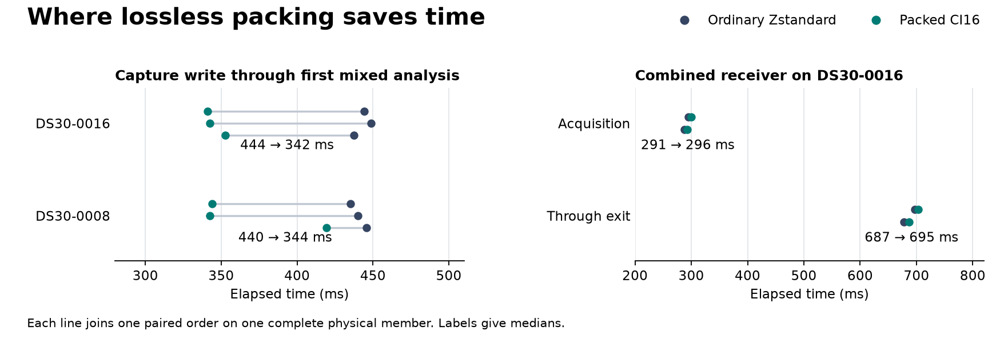

# Does the faster sample reader speed up the position pipeline?

Lossless packing sped up capture write through first mixed analysis on two physical DS30 members. The same packing ran **5–10 ms slower through exit** when connected to the current guarded receiver on DS30-0016. Both builds recovered identical native measurements, executed the same seven frequency-offset refinements and made the same short-recording withholding decision in both calibration arms. The end-to-end comparison uses one 64-visit member. [Full receiver experiment](packed-combined-input.md)

| Measurement | DS30-0016 | Independent DS30-0008 |
|---|---:|---:|
| Capture write through first mixed analysis, median ordinary → packed | 444 → 342 ms | 440 → 344 ms |
| Median saving within matched orders | 103.37 ms | 90.94 ms |
| Reduction in persisted size | 2.45% | 1.29% |
| Ordinary vs packed verified acquisition in the actual combined receiver | Packed 4.93 and 5.19 ms slower | Unmeasured |

The mixed-analysis reader can skip decoding unused tails. The guarded receiver currently verifies every original CI16 window, including every tail. On the weak member, signal processing actually needed 58 prefixes and 12 tails, totaling 63.36 MB, while original-window verification covered all 102.40 MB. A prospective capture format could authenticate the relation between encoded blocks and original windows at capture. The test under the existing input contract receives speed credit for zero skipped bytes. [Weak capture test](ci16-packed-storage.md) · [Dense capture test](ci16-packed-storage-0008.md) · [Exact block demand and integrity alternatives](packed-combined-demand.md)

## Where the other seconds went

| Experiment | Observed consequence |
|---|---|
| Finish only the first-ranked assignment | On weak, medium and dense saved DS30 cases, all competitors together cost **0.016–0.284 CPU s**. The largest generous saving after paying rank and winning refinement was **0.353 s**. [Four saved comparisons](cold-incumbent-ceiling.md) |
| Defer second-signal cancellation | Only full anchors execute it. On weak, medium and dense, the *entire* full-anchor path cost 0.491, 1.449 and 4.716 CPU s respectively, including required primary work. Earlier interventions changed subsequent primary selections. [Measured limits and ownership](anchor-cancellation-ceiling.md) |
| Share calibration drawing across figures | Current code already draws both arms on one position image. All eight PNGs cost 483 ms on saved weak data. Even eliminating every non-orbit figure and its associated work would recover only 204 ms. [Publisher review](publisher-calibration-reuse-bound.md) |
| Interpolate the expensive position uncertainty grid | Independent check points rejected the approximation on dense, weak and both South offers. The unchecked dense approximation moved contours by up to 762 m. Only two of 128 held dense cells met the tolerance in both arms, worth at most 0.063 CPU s if identified for free. [Full-grid experiment](grid-control-variate.md) |
| Reuse decoded memory buffers | The default allocator already recycled five addresses across the 64 visits. Changing its allocation threshold saved 6.63 and 0.51 ms of acquisition CPU in reversed orders. [Physical test](decoded-allocation.md) |

## Geographic control and graph stability

With identical South waveform measurements and owner digests, moving the operator region 200 m turned a valid fix into a false publication on the offer that excluded truth by 100 m. The two estimates moved less than a metre. The omitted run's system CPU was 4.891 s versus 0.560 s on the containing run; their user CPU differed by 0.251 s. Both input inventories were fully resident. The smaller allocator trial did not explain the process-wide system CPU difference. [Both search regions](south-raw-offer.md)

A separate four-way crossed comparison isolated the South loss of four observations between the earlier all-paid and guarded receivers. Two equivalent quadratic track proposals claimed the same 19 observations. For four of them, a change of one floating-point step in the wrapped frequency residual decided which proposal survived. Removing duplicates restored the earlier 294 ordered assignments per arm. Against the guarded candidate, South fixed-zero error rose **4.91 m** and fitted error fell **12.96 m**. On North all published outputs and the eight figures matched the guarded control despite a change to the intermediate graph. The duplicate check cost under 0.21 ms, and both localization comparisons started from saved data. [Crossed graph diagnosis](south-graph-sensitivity.md) · [Full saved localization](duplicate-graph-accuracy.md)

Frozen ALGO08v3 remains the timing baseline. The complete containing simulated fixes still stand at **1.55× North and 1.34× South**. The strongest physical end-to-end result with the current combined build remains the **3.01× short withhold**. Both time gates and representative physical-fix accuracy remain open. The missing DS30-0016 source extent check found zero resident pages among 217,573 pages. The first and last members of three other historical DS30 positives also had zero resident pages out of 83,104. These checks read no waveform and triggered no new staging. [Raw baselines](combined-raw.md) · [Missing-page measurement](measurements/0016-missing-page-cache.json.gz) · [Three alternate physical recordings](end-member-admission.md)
