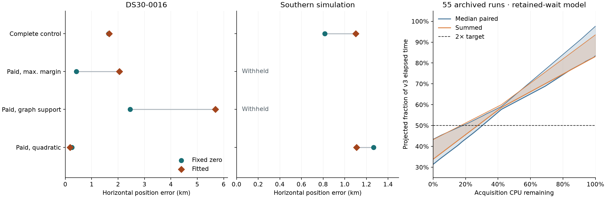

# What the position solver can recover from one third of the stereo visits

A quadratic track model recovered a physical fix and a southern simulated fix from independently verified waveform peaks on every third stereo visit. It correctly withheld on the displaced southern offer. On DS30-0016 its fitted horizontal error fell from 1.661 km to 0.182 km. On the southern containing offer the fitted error rose by 8 m, and the fixed-zero error rose by **449 m**, exceeding the frozen 250 m tolerance. That result stops escalation to raw or held-out evaluation. [Initial selector protocol](paid-graph-protocol.md) · [Follow-up quadratic protocol](paid-quadratic-protocol.md)

## Two recordings, three geographical offers

The original archived two-scan receiver predates ALGO08v3. Its complete selected packet provides a matched reference for testing signal selection. Every reduced arm paid for the same stereo visits on every RF and could inspect verified factors only on those visits. Each cold solver used the supplied region and capture-era orbit archive. The location references were used for postfit scoring on these public development inputs. [Scored calibration arms and timings](measurements/paid-quadratic.json) · [Sealed runs](measurements/paid-quadratic.json.gz)

| Recording and offer | Receiver and graph | Position error, zero / fitted (km) | Frequency-fit RMS, zero / fitted (Hz) | Saved solve CPU (s) |
|---|---|---:|---:|---:|
| DS30-0016, containing | Complete control | 1.644 / 1.661 | 109.375 / 109.479 | 3.779 |
| Same | Highest-margin paid peak | 0.417 / 2.053 | 121.502 / 120.688 | 2.508 |
| Same | Paid peak with greatest graph support | 2.461 / 5.690 | 140.839 / 140.237 | 2.905 |
| Same | Highest-margin paid peak, quadratic graph | **0.247 / 0.182** | 121.482 / 121.379 | 2.968 |
| Southern simulation, containing | Complete control | 0.817 / 1.101 | 6.502 / 6.392 | 4.887 |
| Same | Highest-margin or greatest-support paid peak | Both withheld | — | 0.055 |
| Same | Highest-margin paid peak, quadratic graph | **1.266 / 1.109** | 6.388 / 6.322 | 3.568 |
| Southern simulation, far omitted | Complete control | Both receivers support exterior | — | 7.863 |
| Same | Highest-margin or greatest-support paid peak | Withheld before orbit search | — | 0.057 |
| Same | Highest-margin paid peak, quadratic graph | Both receivers support exterior | — | 6.801 |

The complete physical packet contained 440 selections. Its 476 paid antenna lanes had 254 accepted peaks across 173 nonempty lanes. Looking at the length of a peak's Doppler track switched 33 of 81 ambiguous choices and increased the final assignment count from 29 to 63 per arm. Horizontal error still rose for both calibrations. The simpler quadratic route assigned 36 observations per arm. Its improved physical position coincided with a higher RF residual than the complete control. The reverse happened for fixed-zero calibration at the southern site. [Matched peak routing and RF scores](measurements/paid-graph.json)

The southern complete graph assigned 423 of 456 observations to 30 tracks. Fourteen exceeded the original 20 s duration and 250 Hz departure from a straight line. The sparse packet contained 179 accepted observations but the original graph constructed zero tracks. There were no competing peaks at the paid epochs, so both initial selectors produced identical inputs and shared a single measured solver result per offer. The follow-up capped the polynomial degree at two, required six measurements and kept two observations per coefficient. It retained the 20 s and 250 Hz curvature tests. From the same 179 waveforms, it assigned 132 measurements to 18 tracks, 16 of which passed the curvature test. The containing solver then published 118 satellite assignments per arm. [Complete and sparse graph attribution](measurements/paid-graph-curvature.json) · [Quadratic graph counts](measurements/paid-quadratic-graph.json)

## What the CPU savings cover

DS30-0016 used 1.505 of 4.631 archived native detector CPU seconds. The southern recording used 2.128 of 6.357. Holding the rest of the archived acquisition cost fixed and adding the measured quadratic solve gives **6.43 versus 10.37 CPU s** for the physical input and **8.76 versus 14.31 CPU s** for the southern containing offer. These are component projections on the older receiver. Both exclude publication, and neither is a measured raw-to-exit comparison. [Native-call charges and archived complete acquisition](measurements/sparse-consensus-summary.json)

## How fast acquisition would have to become across DS30

We applied a separate budget calculation to the original first 55 paired DS30 assignments. There are 52 successful ALGO08v3 runs with launch-to-detections, detections-to-terminal and terminal-to-exit clocks. The two failed runs and one withholding retain their original elapsed charges. The calculation assumes the dense pruned solver CPU fraction, 25.661/60.966 = 42.1%, transfers to every successful solve. Publication retains its full cost. This is a sensitivity analysis. No new recording went through the full service for this calculation. [Measured dense solve](certified-salvage.md) · [Stage clocks](first-55/stage-clocks.csv) · [All recording and failure charges](first-55/recordings.csv)

| Archived runs | Count | Maximum acquisition fraction if elapsed scales directly | Maximum acquisition CPU fraction if original waits persist, favorable / unfavorable allocation |
|---|---:|---:|---:|
| All assignments | 55 | 49.0% | 27.4% / 16.9% |
| Initially over 95% resident | 12 | 52.4% | 51.9% / 50.2% |
| Initially under 20% resident | 31 | 51.1% | 25.3% / 10.0% |

Each entry is the largest acquisition fraction that passes **both** the median paired and summed elapsed target. For the retained-wait calculation, total elapsed minus total CPU is distributed among the three stages, bounded by each measured stage duration. The attainable-range endpoints allocate the waits in the most and least favorable orders for the proposed CPU cuts. The data do not resolve how much of that time was storage, scheduling or other stalls, or how much would disappear on a new build. The figure shows the two timing-gate ranges separately. With acquisition CPU halved, the projected summed ratio is still **0.620–0.646** if the measured waits persist. Improving cold input throughput or removing bytes from the critical path matters alongside receiver and solver arithmetic. [Recorded rows and conditional budgets](measurements/retained-wait.json) · [Allocation calculation](retained_wait.py)

## Reproduction

Use the single-core low-priority Gauss wrapper and pinned release environment from the [preceding paid-factor replay](sparse-consensus.md). Run `paid_graph_trial.py CASE margin OUT/CASE-margin.json` and then `paid_graph_trial.py CASE graph OUT/CASE-graph.json --prior OUT/CASE-margin.json` for DS30-0016, south-containing and south-far. Use a fresh output directory. Run `paid_quadratic.py south-containing OUT/south-containing-margin.json OUT/eligibility.json --graph-only` before running `paid_quadratic.py CASE OUT/CASE-margin.json OUT/CASE-quadratic.json --eligibility OUT/eligibility.json` on the three offers. Score all receipts together with `paid_graph_score.py OUT OUT/score.json --include-quadratic` in the checkout environment. The scorer checks packet equality across the two quadratic and ordinary maximum-margin runs. [Receiver and graph selector](paid_graph.py) · [Solver adapter](paid_quadratic.py)
