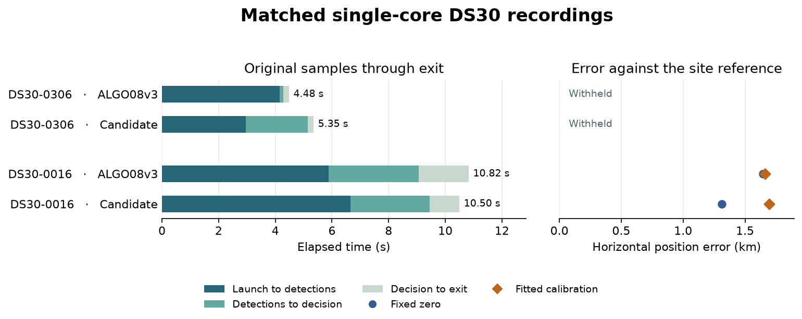

# One receiver build on 405- and 808-visit DS30 recordings

The frozen mixed-aperture candidate took **15.847 s** across the two original recordings. Named ALGO08v3 took **15.306 s**. The median of the per-recording elapsed ratios was **1.082** and the ratio of summed time was **1.035**, against targets of 0.500 on both. Each returned one fix and withheld once. This small diagnostic combines two different capture lengths on the same physical roof, using identical candidate sources, route flags, libraries, single-core settings and named release across both pairs. [Machine-readable comparison](measurements/paired-405-808.json)



| Original recording | Named elapsed | Candidate elapsed | Fixed-zero error, named → candidate | Fitted error, named → candidate |
|---|---:|---:|---:|---:|
| DS30-0306 · 405 visits | 4.482 s | 5.349 s | Both withheld | Both withheld |
| DS30-0016 · 808 visits | 10.824 s | 10.497 s | 1.644 → 1.311 km | 1.661 → 1.694 km |

Both children ran with resident waveform pages in each pair. Separate input conditioning took 3.159 s for 491 MB on 0306 and 7.266 s for 992 MB on 0016. Launch order alternated by case. The 405-visit recording was the unique member of a predeclared 384–511 visit band. An earlier outcome became visible after assignment. Its 398 admitted stereo visits yielded 435 signed factors in v3 and 529 in the candidate. The candidate reached the detections file **1.189 s sooner**, then spent **2.048 s more** between detections and the decision. Both withheld for lack of active curvature. The 808-visit recording was an existing development case with 713 admitted stereo visits. Both built the required numerical evidence and eight verified images. [405-visit enrollment and full pair](raw-band-pair.md) · [808-visit full pair](raw-0016-best.md)

## What moved the positive fix

We reran the installed solver using controlled substitutions on DS30-0016's saved detections. Keeping the candidate's 475 detections and replacing only the signed frequency for its 306 close-matched short measurements changed fixed-zero error from **1.311 to 1.235 km** and fitted error from **1.694 to 1.533 km**. All 116 final ordered observation owners in each arm stayed identical. Replacing the complete measured tuples lowered error further to **1.160 / 1.459 km**. Restoring the original margins changed which estimated radio-noise model passed its existing BIC threshold; the two restored versions had identical track arrays. These substitutions used the original 20 ms receiver's answers, so they measure potential recovery with better observations. [Signed input and ownership study](full-short-factor-contrast.md) · [Frequency-only test and noise-model check](full-short-cfo-only.md)

At equal retry count, a candidate short-spectrum confidence rule selected almost exactly as much correctable squared frequency discrepancy as uniform selection on weak DS26 lanes (32.54% versus 32.35%). Directly verifying the eight PNGs with the guarded native decoder saved 285 ms on the decoded images in isolation and 60 ms in a complete saved process comparison. Bounded incremental input moved the first stereo detector result 39.9 ms earlier on a staged 0169 member, with an 11.4–13.6 ms gain through the verified seal. None of those stage measurements adds an independently measured saving to the two raw process clocks above. [Retry selection](peak-shape-retry.md) · [Positive-fix publication](positive-fix-census.md) · [Incremental verified input](incremental-ingress.md)

On a geographically separate South simulation, the current saved solver and named v3 returned the same positions and 266 owners per arm for both the containing offer and the offer that missed truth by 100 m. Both falsely published the latter. Its estimated endpoints lay 242 m and 183 m inside the offered face, so merely detecting a clipped solution could not identify this mistake. This simulation used original detector inputs and does not validate a modified physical receiver at a second site. [South transfer](named-south-transfer.md)

To compare further verified raw receipts from the same build, run the reducer on the sealed per-case JSON files. It checks runtime identity, input opportunities, clock ordering, fix evidence and independent enrollment before calculating the two timing ratios. The figure command accepts its JSON output.

```sh
cd reports/ALGO08/v3
python3 same_build_raw_panel.py measurements/raw-0016-best.json.gz measurements/raw-band-pair.json.gz > /tmp/paired-ds30.json
python3 raw_panel_figure.py /tmp/paired-ds30.json /tmp/paired-ds30.png
```
