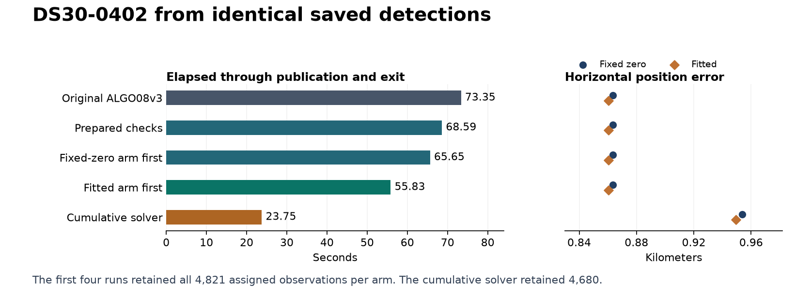

# Recovering solver time while keeping the original DS30-0402 position

The fastest solver that reproduced the entire named DS30-0402 publication took **55.830 seconds versus 73.351 seconds for ALGO08v3 (1.31×)**, from identical saved detections through exit. It prepared repeated numerical checks once and stopped an alternative satellite assignment as soon as its completed fitted-calibration arm failed a mandatory track check. Both published arms kept all 4,821 original ordered assignments and roles, positions and RF residuals, the 179-point grid and path, and identical bytes and decoded pixels for all eight figures. This was one development recording with an unusually long solve. The faster arm order was chosen after profiling it. [Fixed-zero-first protocol](constrained-pair-veto-protocol.md) · [Fitted-first trial and receipt](constrained-pair-arm-order.md) · [Historical timing context](phase-route-challenge.md)

| Saved DS30-0402 process | Whole elapsed s | Numerical CPU s | Constrained phase fits | Optimizer visits | Fixed / fitted error km | Associated observations per arm |
|---|---:|---:|---:|---:|---:|---:|
| Original named ALGO08v3 | 73.351 | 68.774 | 10 | 393 | 0.864 / 0.860 | 4,821 |
| Reuse fixed numerical inputs in the original checks | 68.589 | 64.041 | 10 | 393 | 0.864 / 0.860 | 4,821 |
| Same reuse, then stop a trial after a terminal fixed-zero failure | 65.646 | 61.179 | 5 | 335 | 0.864 / 0.860 | 4,821 |
| Same reuse, then stop a trial after a terminal fitted-calibration failure | 55.830 | 51.471 | 5 | 58 | 0.864 / 0.860 | 4,821 |
| Earlier cumulative solver with different observation selection | 23.749 | 20.405 | — | — | 0.954 / 0.949 | 4,680 |

Each row uses the original named 20 ms detector output. The first and last are the original matched replay. The middle three are separate subsequent candidate launches on the same staged inputs. Each timed process includes its own Python startup, numerical solution, durable tmpfs publication and verification. The I/O cache state and process order differed across launches. [Original and cumulative pair](prospective-0402-solver.md) · [Exact gate reuse](stock-exact-gate-0402.md) · [Figure generator](paired_veto_figure.py)

## Why the second change saved 2.94 seconds

The family-reassignment policy tries to explain a group of tracks with a different satellite. A proposed change can win only if both calibration arms pass the original checks. One proposal qualified for constrained optimization. After five complete optimizer rounds its fixed-zero result failed two conditional track gates. The second arm could no longer make that proposal eligible. The prototype returned the measured rejection, skipped the second constrained fit, and let the original policy examine both remaining alternatives. All three were rejected and the same previously fitted pair was published.

Fixed-zero needed **335** unique optimizer visits. The omitted fitted arm originally used just **58**, so halving the number of constrained phase fits saved **14.8% of visits**. Actual residual screens fell from 82,137 to 70,015, and the timed constrained scope from **15.128 to 12.766 CPU s**. The additional saved-process reduction beyond the prepared checks was **2.943 s elapsed** and **2.938 s CPU**. Through all changes, the original numerical solve saved **7.594 CPU s** and the process **7.705 s elapsed**. The cumulative solver in the table is a separate accuracy trade.

The rule depends only on the completed, original track gates. A trial whose first arm passes still runs the second arm. The partial rejected trial records the actually evaluated arm. An exception that would arise only in omitted work is consequently unobservable. Tests exercise a later successful alternative, passing and failing track lists, an unfinished first arm, propagation of executed numerical failures and restoration of the original functions. The physical replay verifies complete selected outputs and mandatory gates for this rejection. A different recording that actually accepts a reassignment remains a transfer check. [Implementation](constrained_pair_veto.py) · [Component tests](../../../tests/pipeline_eval/test_constrained_pair_veto.py)

The original 0402 recording took 121.438 s from raw I/Q through exit, so its individual half-time budget is **60.719 s**. The fitted-first saved run leaves just **4.889 s** for 8.177 GB of original input if those separate process costs are added. That would take roughly **1,670 MB/s** through detection. The historical original acquisition took **50.741 s**. Startup may overlap in an integrated build, and both release gates are panel statistics. This budget points toward recovering v3-quality observations at a cost much closer to the cumulative solver's. [Original raw and saved boundaries](phase-route-challenge.md)

## Which historical reassignments really needed both arms?

An independent historical check replayed both orderings on the archived equal-prior DS23 policy. Among **410 recordings**, 95 had at least one proposed reassignment. All **101 of 137** paired-valid proposals passed both arms' track checks. In the remaining **36**, both arms had a failed track. Either order reproduced all 410 published decisions, including **74 recordings that actually accepted a replacement**. The check uses the reported final gates, RF scores and assignment identities. The archive omits the per-arm constrained timing and a per-trial rescue flag, so the 36 rejected trials cannot all be counted as opportunities for this scoped optimization. This verifies decision logic on archived final evidence. It supplies no additional raw or solver timings. [Historical benchmark](../../2026_10_22_ds23_family_cavity_full_assessment/README.md) · [Reproduce the audit](paired_veto_history.py)

To test whether the visit imbalance transfers, we froze eight of those recordings before reading their detailed fit histories. Twelve original proposals produced **two constrained rescues**. On **DS23-0047** the rescue passed both arms and ultimately lost on RF score. Both orders must pay its 111 visits. On **DS23-0068** both arms failed a required track. The recorded five-round counts were **286 fixed-zero visits and 104 fitted visits**. Applying the same terminal rule to the logged histories would charge **397 fixed-zero-first or 215 fitted-first visits in total**, versus the original 501. The other ten proposals bypassed the constrained branch entirely. This is a second physical recording on which fitted-first wins the visit comparison. These are historical operation counts from an earlier pipeline on the same roof, with no live timing or geographic transfer inferred. [Frozen eight-recording selection](rescue-visit-transfer-protocol.md) · [Original record digests, counts and decisions](measurements/rescue-visit-transfer.json) · [Reproduce from saved metadata](rescue_visit_transfer.py)

## Reproduction

The timed worker used commit `0036cd0c0`, the exact prepared gate from `aa6a0b01d`, and the previously staged stock request, detector and 48-snapshot causal archive bound by the runner. Both the original request and prior complete named reference are digest checked. Run `paired_veto_0402.py launch NEW_TMPFS_ROOT` in the same environment and Gauss CPU 2 low-priority lock as the standalone experiment. Then run `paired_veto_0402.py evaluate NEW_TMPFS_ROOT NEW_RECEIPT`. The first launcher attempt stopped at import in a sparse checkout missing the repository's qualification tools. After the successful run the scorer needed the checkout's publication verifier on its import path. Correcting that import used the existing completed output. The uncompressed scored receipt SHA-256 is `b0ec53ec483bdcfca8f316a5231b64fd405eab288596ec1deff917bc92c8f2e4`. [Wrapper and scorer](paired_veto_0402.py)
