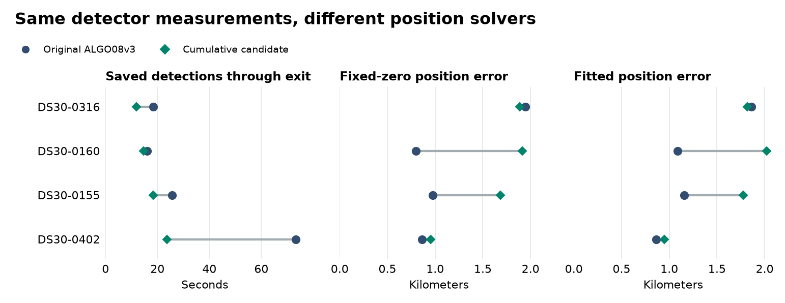

# The phase-history check on a later-ranked satellite assignment

On DS30-0402, the cumulative solver completed a saved publication in **23.749 s** versus **73.351 s** for named ALGO08v3. Both chose the same second-ranked initial satellite assignment and published a fix. The cumulative solver retained 4,680 of the named solver's 4,821 observations in each calibration arm. All retained observations kept the same satellite and role. The loss of 141 observations coincided with about **90 m** more horizontal error in both arms. Both full grids and eight figures were verified. The comparison began at the same sealed named 20 ms detector output. [Frozen case](prospective-0402-solver-protocol.md) · [Measured transfer](prospective-0402-solver.md)

## Prediction and timing cost

The cumulative solver can use a signed phase correction inferred from historical orbit data. On the three development cases, its qualification flag happened to distinguish the one case where both cumulative position estimates improved. Before the 0402 cumulative result was opened, the prediction was frozen: a qualified correction should predict two errors no larger than v3's. Using only this flag would choose the fast solver for 0402. The correction qualified and the solver accepted it, yet the errors increased **90.3 m at fixed zero and 89.2 m with fitted calibration**. Both changes fit the looser 250 m development tolerance. The check validates an orbital phase correction. The failed prediction rules it out as a sufficient accuracy guarantee for changing the localization solver. [Preregistered rule](phase-route-challenge-protocol.md) · [Scores and timing arithmetic](measurements/phase-route-challenge.json)

| Physical recording | Signed correction qualified | Change in error, fixed / fitted | Named / cumulative saved elapsed | Evaluation role |
|---|---|---:|---:|---|
| DS30-0155 | No | +713 / +620 m | 25.571 / 18.271 s | Development |
| DS30-0160 | No | +1,117 / +933 m | 15.999 / 14.612 s | Development |
| DS30-0316 | Yes | −57 / −44 m | 18.358 / 11.946 s | Development |
| DS30-0402 | Yes | +90 / +89 m | 73.351 / 23.749 s | First prospective challenge for the rule |

All four cases come from the DS30 roof. Their candidate revisions differ in research preparation and rendering options. The corrected 0160 time was measured separately after its original candidate encountered an audit error. Each row compares the same original receiver measurements within that case. Together the cumulative saved processes took **68.577 s**, versus **133.279 s** for named v3. The median paired elapsed ratio was **0.683**, and the ratio of total saved times was **0.515**. Only 0316 improved both surveyed errors. These saved-packet results do not establish either raw-to-exit timing gate. [0155](prospective-0155-solver.md) · [0160](prospective-0160-solver.md) · [0316](prospective-0316-solver.md)

Even granting a free decision, choosing v3 when the phase correction fails qualification gives **77.264 s** of saved work, with median/summed ratios **0.825/0.580**. An illustrative implementation that finishes the cumulative numerical solve before running a fresh named job on the two disqualified cases would spend **104.107 s**, with ratios **1.124/0.781**. Actual routing overhead depends on where history preparation and the check run. The four-case comparisons grant no benefit for an unmeasured early handoff. On the retrospective India simulation this check also qualified. The candidate worsened the containing-offer estimates by about **18/15 m** and both solvers published a false fix on the offer missing the receiver by 1.5 km. The two offers share one synthetic recording. [Numerical India control](india-cumulative-transfer.md)

## What a complete 0402 run still has to pay for

The historical warm v3 recording took **121.438 s** end to end. Half leaves **60.719 s**. Charging the full candidate saved-publication clock gives **36.970 s** for acquisition of the original 8.177 GB, or about **221 MB/s** including verification and detection. Historically v3 took **50.741 s** to reach detections on this recording. Combining those two existing clocks illustratively gives **74.490 s**, or **1.63×**, before accounting for shared or duplicated startup. A measured original-input pair would have to demonstrate that the acquisition change closes the remaining gap and protects the evidence used for the fix. [Historical stage receipt](measurements/acquisition-throughput.json) · [Current complete comparison](prospective-0402-solver.md)
