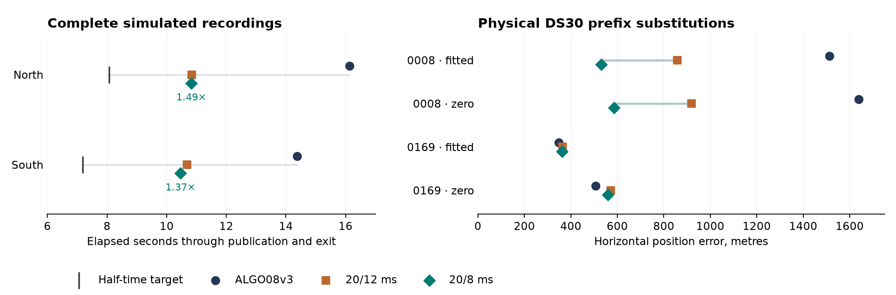

# All-visit 8 ms receiver across two simulated locations and two physical interventions

The same research receiver completed the original North and South simulated recordings in **10.828 and 10.466 s**. Installed ALGO08v3 took **16.133 and 14.370 s** on those recordings. The median paired elapsed fraction is **0.700** and the fraction of total elapsed time is **0.698**, about **1.43×** by either measure. The release target is at most **0.500 on both** over a physical recording panel. The two complete containing runs used one Gauss core, returned both calibration arms, and produced eight verified images each. [North receiver](eight-ms-native-live.md) · [Fresh North baseline](all-visit-physical-budget.md) · [South receiver and omission](eight-ms-south-transfer.md)

The left panel uses original I/Q through process exit. In the right panel only the first 192 of 6,772 visits on DS30-0008 and first 64 of 4,219 on DS30-0169 change between the orange and green markers. The rest of DS30-0008 uses mixed 20/12 ms. The remaining 4,155 visits of DS30-0169 use the released receiver measurements for both interventions. Navy shows the full ALGO08v3 solution. The physical error references are the operator's recorded site authority. None of these comparisons provides a distribution across independent real receiver locations. [Figure calculation](physical_transfer_figure.py) · [Dense intervention](dense-8ms-prefix.md) · [Independent physical recording](independent-8ms-0169.md)

| Recording and workload | Comparison | Horizontal error in metres, zero / fitted calibration | Speed or transfer result |
|---|---|---:|---|
| South, original simulated I/Q | Named v3 → live 20/8 ms | 817 / 1,101 → **325 / 363** | **14.370 → 10.466 s** elapsed. RF RMS rose from 6.502 / 6.392 to 10.213 / 10.108 Hz. All 266 named assignments survived, with 38 additional assignments per arm. |
| South, identical 8 ms detector packet, region misses truth by 100 m | Saved omitted offer | **325 / 363** | Both arms published a false fix. They placed the receiver 220 / 251 m inside the offered face. Both kept the same 304 assignments as the containing solution. |
| DS30-0008, first 192 visits | Matched 12 ms → 8 ms ordinary measurements | 919 / 857 → **587 / 530** | Saved publication grew from 26.947 to 27.699 s. The independent single-member acquisition test saved 16–21 CPU ms in the two orders. |
| DS30-0169, first 64 visits | Matched 12 ms → 8 ms ordinary measurements | 571 / 364 → **560 / 362** | Saved publication used **11.902 → 11.906 CPU s**. Elapsed fell 12.366 → 11.909 s under different page-fault loads. Full named v3 remains at **506 / 348 m**. |

On DS30-0169 the 8 ms collector used 261.1 ms of CPU compared with 297.6 ms for the earlier 12 ms collector on the same member. Both found 56 factors across 102 antenna opportunities. Five assigned observations dropped within the changed member. The other 2,254 assignments kept their satellites and roles. The fixed and fitted RF residuals rose by 0.47 and 0.50 Hz. The original signed finish, regional decision, 179-point grid, bound path and eight images verified independently in each publication. These outcomes support another physical transfer test and keep the original full-length timing question open. [Physical clocks and evidence](independent-8ms-0169.md)

Even making every full-anchor and short-primary native detector call free would leave about **8.141 s North and 7.867 s South**, assuming every saved CPU second reduces elapsed by one second and all other work stays fixed. Their individual targets are 8.066 and 7.185 s. The combined remaining gap in that optimistic scenario is **0.756 s**. The current 12 ms prototype takes two initial timing measurements and expands the timing search when the peaks compete. It saved **18.6% and 14.7% of native short-search CPU**, with exact signed output on all 212 dense and held weak short lanes. This is a viable component to transfer into the 8 ms receiver. The complete 8 ms benchmark still needs savings in reading, solving or publication as well. [Physical timing-scout experiment](cross-lag-timing.md)

## How far an early receiver change travels

For DS30-0008 we joined every changed final assignment back to its signed receiver opportunity. Of **286** added, removed or reassigned observations, **276** were outside the first 192 visits. All **222** changes of satellite on shared observations went from NORAD **67511 to 63478**. The measurements on those rows were identical in the two runs. The switches were on one antenna at four tunings, beginning at visit **3,508** and ending at **5,571**. Revisiting even the first 4,288 visits while keeping later assignments fixed would leave **183** switches unreachable. Both calibrations gave the same census. The result describes the scope needed to reproduce this assignment update. It does not establish which satellite transmitted the signal or that the swap alone caused the better position. [Assignment audit](prefix_owner_reach.py) · [Counts by update horizon](measurements/prefix-owner-reach.json)

Both fits picked their first-ranked cold branch. The early receiver intervention raised cold discovery from **5.555 to 6.394 CPU s**. Its first ordinary fit then failed a gate, and preparing and fitting the repair cost **0.738 CPU s**. Those costs are inside the pre-evidence stage, which grew from 10.985 to 12.285 CPU s. Signed finishing and numerical evidence became slightly faster. Candidate selection, repair and publication must be timed together when judging a cheaper receiver. [Matched solver and receiver clocks](dense-8ms-prefix.md)

An actual pre-finalist replay found that the earlier regional ranking never put both competing satellites together on an affected track within any one association pass. Taking the union across states recovered the pair on the three conditional tracks (143 observations), while neither satellite appeared on the four predictive tracks (79 observations). Shared receiver calibration connects all 112 dense tracks and all 39 tracks of the independent medium recording. A separate three-time curvature test safely excluded zero of 165,312 dense catalogue-by-track slots under the allowed smooth receiver drift. A heuristic top-32 list dropped the later alternative on one of the three conditional tracks. Both studies keep the genuine alternative available in the original fallback. [Observed assignment dependencies](conflict-components.md) · [Exact ceiling and held South ranking](curvature-filter.md)

Fresh weak-case profiling found 0.774 CPU s in first imports and 0.214 s in eight required PNG decodes. Only 78 ms remained in the rest of the previously unattributed interval. Deferring an unused detector import saved 104 ms in the scanner import, yet the complete positive saved process took 4.200 vs 4.166 s. Carrying immutable orbital transition results from the weak recording into the medium recording hit on just 82 of 9,040 transitions and added 40.5 ms of forecast CPU across both requests. Neither change earns runtime credit in the pipeline benchmark. [Publisher attribution](weak-publisher-attribution.md) · [Import experiment](weak-positive-import.md) · [Chronological orbit preparation](persistent-orbit-updates.md)

## Could pilot arrival break the tie cheaply?

We tested this on the actual 222 shared signed rows at the region center and four corners. Both satellites received the same causal element catalogue, three orbit-time offsets and one clock-rate fit per tuning. The final third of elapsed time in each tuning was reserved for scoring. The candidate pairs and observations were provided by the two finished solutions. [Frozen test](prefix-owner-epoch-protocol.md) · [Implementation](prefix_owner_epoch.py)

| Channel | Train / held intervals | Clock only | Positive delay, 67511 / 63478 | Reflected delay, 67511 / 63478 |
|---|---:|---:|---:|---:|
| 1 | 21 / 10 | 44.69 | 85.88 / 82.48 | 1.66 / 1.79 |
| 4 | 54 / 24 | 103.92 | 203.75 / 209.71 | 10.99 / 10.40 |
| 5 | 44 / 37 | 76.34 | 148.94 / 144.52 | 47.96 / 46.00 |
| 6 | 10 / 6 | 19.61 | 44.81 / 43.44 | 6.24 / 4.77 |

Values are held arrival residual RMS in samples at the supplied region center. **Zero of 20** channel-by-location comparisons passed the frozen positive-delay test against the clock and reflected controls. Even the winning positive-delay satellite differed across channels. The numerical score for both alternatives and all five locations took **0.044 CPU s** after input preparation and catalogue election. Cheap evaluation cannot justify removing either satellite here. The reflected sign also won on other physical recordings in the earlier code–carrier study. The present test has no independent satellite truth. [Full regional results](measurements/prefix-owner-epoch.json) · [Earlier physical and simulated sign controls](../single-core-2x/arrival-observability.md)
