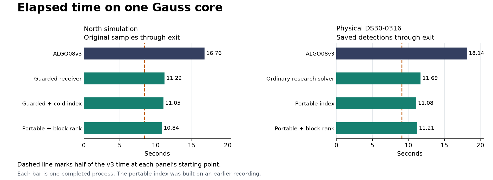

# What the orbit index preserves when the physical site is outside the offer

The corrected portable solver ran the original geographic check and preserved both position estimates on DS30-0016. Starting from identical saved detections, it took **4.187 s versus 4.369 s** for ordinary preparation on the containing offer. On a second offer whose centre was **170.453 km from the operator site reference**, **both published false fixes**. Their fixed-zero/fitted horizontal errors were **181.829/181.688 km**. Passing the implementation comparison exposes a geographic limitation of the current solver. These trials use one physical recording, a 25 km offer, the original causal archive and two calibration fits. [Frozen physical trial](portable-omitted-region-protocol.md)

| DS30-0016 saved input and preparation | Elapsed through exit, s | Both geographic checks agree | Terminal, ordered owners per arm | Fixed-zero / fitted error, km |
|---|---:|---|---|---:|
| Containing, ordinary → repaired portable | 4.369 → 4.187 | Yes. 24 projected positions, six blocks, zero fallback | Both fixed, 116 / 116 | 0.976 / 1.452 |
| Omitted, ordinary → repaired portable | 4.795 → 4.412 | Yes. 48 projected positions, twelve blocks, zero fallback | Both falsely fixed, 100 / 100 | 181.829 / 181.688 |
| Omitted, ordinary → earlier portable | 4.997 → 4.572 | No. The earlier indexed run encountered an orbit-type error | Ordinary falsely fixed; earlier portable withheld | 181.829 / 181.688 for ordinary |

The search centre and screening centre both moved two degrees east. Their original offset and the width remained intact. Each fresh process received the same signed physical detector packet and authenticated its orbit inputs. The frozen 2.69 MB source index came from the earlier DS30-0008 recording. The two repaired pairs matched all scientific values in the position grid, path, terminal, owners, and encoded and decoded images. The full grid document has a distinct elapsed-time field per publication. The comparison checks that field separately from the scientific values. Geography was scored after prediction against the existing operator site reference. There was no independent GNSS survey or new receiver location. [Containing pair](measurements/portable-omitted-region-repaired-containing.json.gz) · [Omitted pair](measurements/portable-omitted-region-repaired-translated.json.gz)

**Frozen ALGO08v3 also falsely published.** Its original complete 20 ms detections produced fixed-zero/fitted errors of **179.490/183.656 km** on the translated offer, versus **1.644/1.661 km** on the containing offer. The 90 observations retained on the translated offer all came from its original fix, and every one changed satellite assignment. The recording supports substantially different assignments in these two offered regions. Matching a large set of observations alone does not establish which region is correct. The translated named process took 6.108 s from its own saved detections through exit and produced all eight verified PNGs. [Frozen v3 publications, assignments and RF fit](named-0016-translated.md)

The earlier index returned text-line pairs before one regional consumer had received the native SGP4 objects it needed. It therefore lost the geographic evidence and took a different path. In the translated test with family calibration guarded, the indexed path retained a single family and withheld because zero independent rows remained for the calibration. Without the guard, that path stopped at the empty calibration mask after 4.836 s. On the ordinary path, 100 observations per arm survived on the wrong region. A separate first attempt at collecting the guarded timing pair wrote both terminals, then failed gathering process metadata because a thread-setting variable was absent. That attempt took 4.364/4.687 s portable/ordinary. The table uses the completed pair after setting all five numerical thread counts to one. A repeat of the read-only scorer verified the existing child results. [Earlier indexed pair](measurements/portable-omitted-region-original.json.gz)

The repair constructs real orbit objects before either regional consumer sees the catalogue. The strengthened scorer now checks the actual proof results, catalogue handoff and native projection counts, alongside all position products. It rejects a matched pair of identical diagnostic errors. The original full-run index speed claims on the positive physical cases have been withdrawn. [Corrected North raw audit](north-orbit-index.md) · [Corrected physical DS30-0316 audit](portable-orbit-0316.md)

## Progress toward half of ALGO08v3 time

| Experiment | Observed result | Implication |
|---|---|---|
| Complete North simulated fix with repaired cold index | **16.761 s v3 → 11.051 s**, 1.52×. The guarded receiver without the index took 11.224 s in an earlier run. The corrected result preserved both positions, all 304 owners per arm, 137 grid points, the 25-probe regional decision and all eight figures from the latter run. | **2.670 s** remain to the 8.381 s target on this fixture. [Raw timing and receipts](north-orbit-index.md) |
| Complete North simulated fix with portable index and block ranking | **16.761 s v3 → 10.835 s, 1.55×**. The index producer preceded the recording by over 22 hours. All 256 profile calls used the new scorer. Both positions, owners, grid, regional proof and figures matched the corrected cold-index run. | **2.454 s** remain to half time. On physical DS30-0107 the same entry correctly withheld in **0.487 s against 1.466 s for v3**, before either solver optimization was needed. [Complete combined raw runs](combined-raw.md) |
| Medium physical DS30-0316 from saved detections | **11.695 → 11.083 s** ordinary vs repaired portable; both used 24 projections. Preparation saved **0.381 CPU s**. Building the earlier index cost 1.231 s, taking first use to 12.314 s. | Useful for repeated analyses with shared orbit bulletins. The earlier frozen v3 saved-detection process took 18.140 s. Acquisition is outside all three clocks. [Medium scientific comparison](portable-orbit-0316.md) |
| Entire catalogue blocks rejected by a conservative bound | **1.323 → 1.210 CPU s** for the medium rank and **4.303 → 3.919 CPU s** for the dense rank. Both kept the full rank order, signed aliases and all diagnostics. | This saves **0.113 and 0.384 CPU s** respectively at the measured stage. The original bias calculation still uses all rows. [Grouped ranking](catalogue-block-bound.md) |
| Catalogue blocks plus the portable index, same physical DS30-0316 saved input | The complete combined process took **11.209 s**, versus **11.083 s** portable alone and **11.695 s** ordinary. It retained all 2,002 owners per arm, six ranked branches, 24 geographic probes and eight figures. | The stage improvement did not produce a faster full process than the portable-only control in this comparison. [Combined publication](catalogue-block-portable-0316.md) |
| Receiver shortlist using independent time and frequency slices | Even granting every empty lane for free and charging zero for the shortlist, the dense projection saves **3.092 CPU s against 3.490 s required**. | Stop this 16-line shortlist. It missed most short positives, particularly on cancellation. [Physical waveform study](joint-pilot-holdout.md) |
| Future capture layout splitting the short aperture from its tail | A median **2.72 ms** saving from capture through first use on one physical member at Zstandard level 1. Fast level −1 saved **51.77 ms** on tmpfs and increased storage by 30.32%. | No change to the recording format. The extra write and first read can erase the faster-codec gain. [First-use experiment](future-capture-storage.md) |
| Preloading imports for two saved requests | The full two-request sequence saved **0.188–0.597 s**, including parent startup and exit. The first response was slower by **0.111–0.298 s**. | Useful only when a resident service can amortize startup and about 148 MiB of proportional resident memory. [Both request orders](preloaded-saved-worker.md) |

None of the physical saved-stage clocks measures original I/Q through exit on a positive fix. Keep the paired physical end-to-end gate open. The earlier full physical withhold cleared half time. The next comparison needs the same guarded receiver and repaired solver on an original positive, including every figure and the regional evidence. [Matched original-input benchmark](same_build_raw_panel.py)

A bounded staging opportunity for DS30-0016 ended after **14 min 54 s** with zero backing reads. Storage pressure stayed high. All 102.77 MB already staged were reverified; 891.16 MB remain. Within the 100–2,000-visit physical roster, each of the six smaller recordings (124 through 555 visits) also failed to produce a position with either method in the historical algo07v5/compact comparison. DS30-0016 is the smallest double-positive in that roster. This makes it a better target for the first physical fix comparison than another smaller recording. [Idle staging receipt](guarded-cfo-0016-stopped-stage.md) · [Signed size roster](measurements/small-raw-passive-residency.json.gz) · [Historical fix decisions](../../2026_11_21_ds30_full/paired.csv)

**What the physical weak fix would require.** The earlier matched v3 raw process took 10.824 s on DS30-0016, giving a target of 5.412 s. Decision and publication alone took 3.012 s in the repaired portable containing run. If that stage transfers unchanged and every remaining overhead is free, the receiver has **2.400 s for 991.73 MB, or 413 MB/s**. The actual first 78.55 MB member ran at **271–275 MB/s**. This is an optimistic allowance conditional on the saved-stage clock, and the first member does not measure the other twelve. It points to a larger acquisition improvement or a materially cheaper position solve even if the complete stage becomes available. [Matched earlier full process](raw-0016-best.md) · [New first-member acquisition](continued-cfo-first-0016.md)

The shorter 8 ms receiver plus signal-history selection retained the same 456 signed lanes as 12 ms on North. Its measured short-primary saving was 0.343 CPU s on North. Information-weighted whole-visit blocks retained more signed factors than uniform sampling, but even giving away the affected warm-start work on dense yielded only 1.499 CPU s before verification. Neither result establishes equivalent positions for a new complete estimator. [Approximate-route tradeoffs](approximate-route-pareto.md) · [Information-weighted visit budget](visit-information-warm-start.md)
