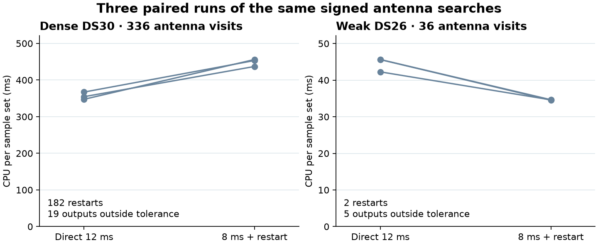

# Can an 8 ms first look pay for a 12 ms retry?

On the dense DS30 sample the confidence-triggered restart took **453.32 ms**, versus **354.58 ms** for direct 12 ms searches on the same 336 nonanchor antenna visits. It still returned 19 results outside the prespecified comparison tolerance. On the weak DS26 sample it saved 11.00 ms but accepted all five factors that disagreed with the 12 ms result. The same confidence rule failed in opposite ways on the two samples. [Frozen procedure](progressive-primary-protocol.md) · [All timings and discrepancy counts](measurements/progressive-primary.json)



| Paired resident samples | Direct 12 ms CPU | 8 ms plus conditional restart CPU | Restarts paid | Discrepancies remaining |
|---|---:|---:|---:|---:|
| Dense DS30-0008, 336 nonanchor antenna visits | 354.58 ms | 453.32 ms | 182 | 12 changed factors and 7 new factors |
| Weak DS26, 36 antenna visits from five recordings | 45.62 ms | 34.62 ms | 2 | 5 changed factors |

The receiver starts with the signed 8 ms primary on each antenna. It accepts the result when its verified fractional margin reaches 0.050. Otherwise it pays for a complete 12 ms primary on that antenna. Fixed 20 ms two-scan anchors would use identical code in both pipelines. The dense prefix's 48 anchor calls previously cost 126.22 ms. These timings cover the variable part of the receiver. The comparison accepts the same rank within two wrapped samples and 250 Hz, or two empty results. The location and satellite identity never enter the rule. The 12 ms parent supplies the reference factor for this experiment. Recovery of a true signal and resulting position accuracy require separate evidence. [Aperture geometry and reference signal comparisons](eight-ms-primary.md)

## Price of a perfect retry decision

On dense, even a selector given all the answers in advance would have to repeat **59** searches to match the 12 ms output at the stated tolerance. Summing the actual 8 ms native clocks and the measured 12 ms native clock on precisely those lanes gives **356.13 ms** median, against **353.18 ms** for native 12 ms alone. The paired differences were −10.28, +11.37 and −9.42 ms. They span zero. On weak, the corresponding costs were **39.40 versus 45.39 ms**, giving an optimistic saving there. These are counterfactual native CPU costs computed from the same three runs. The real selector timings in the table include dispatch and every executed retry. A resumable implementation that preserved intermediate work would have a different cost.

The live calls on all three repeats reproduced the archived signed outputs of both native binaries. The screen stopped before position fitting and complete-recording timing. [Prototype](progressive_primary.py) · [Component tests](../../../tests/pipeline_eval/test_progressive_primary.py)

## Reproduction on Gauss

Use the numerical release environment, the original aperture libraries in the [build receipt](measurements/eight-ms-primary.json.gz), the DS26 signed sample ZIP, and a fresh output path. The runner checks all sample and binary identities before accepting results.

```bash
release=/opt/leo-algo08/bdb869682a2ea63af4b198a920b763a4c6a78c4c
weak=/home/mouse9911/gits/leo-tracker-reduxredux/reports/2026_11_20_single_scan_glrt/satellite-reference.zip
sudo -n -u leo flock -x /tmp/leo-algo08v2-2x-bench/gauss.lock ionice -c2 -n7 nice -n15 taskset -c 2 \
  env PYTHONPATH="$PWD/reports/ALGO08/v3:$PWD:$release/src:$release" \
  OMP_NUM_THREADS=1 OMP_THREAD_LIMIT=1 OPENBLAS_NUM_THREADS=1 MKL_NUM_THREADS=1 BLIS_NUM_THREADS=1 NUMEXPR_NUM_THREADS=1 \
  "$release/venv/bin/python" -BPs -m reports.ALGO08.v3.progressive_primary "$weak" "$release/assets" "$fresh_output"
```
