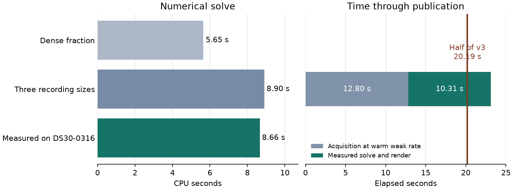

# DS30-0316 solver transfer on the same named-v3 detections

On the identical full-20 ms named ALGO08v3 receiver packet, the cumulative solver and exact Graph completed saved publication in **11.946 s** versus **18.358 s** for installed v3. Numerical solve CPU fell from **14.640 to 8.659 s**. The cumulative solve still took **3.195 s longer** than the 5.464 s predicted by transferring the dense exact-Graph ratio. Both jobs returned complete fixes with all eight verified PNGs. The prospective raw admission remains closed. [Frozen protocol at `ef0d53db4`](prospective-0316-solver-protocol.md) · [Full paired receipt](measurements/prospective-0316-solver.json.gz)

| Stage | Named v3 | Cumulative plus exact Graph |
|---|---:|---:|
| Fresh process elapsed through exit | 18.358 s | 11.946 s |
| Fresh process CPU through exit | 18.353 s | 11.938 s |
| Numerical solve elapsed | 14.643 s | 8.662 s |
| Numerical solve CPU | 14.640 s | 8.659 s |

The elapsed ratio was **0.651** and the numerical CPU ratio **0.592**. Both fresh children exited zero and were charged zero filesystem input and output blocks. The measured saved boundary includes source validation, handoff, rendering, live standard publication and output verification. The verified staging of 46 original TLE snapshots and one detector packet took **6.858 s elapsed and 0.493 CPU s** once, before either launch. Both processes used the same tmpfs TLE archive, original offer and warm font cache. Each outer clock was sealed immediately after exit and before paired scoring. [Driver](prospective_0316_solver.py)

## Matched input and calibration arms

The same published named detector digest, raw authority and all 5,404 ordered probe rows were verified in both output workspaces. The worker fails closed if the waveform reader or detector is invoked. The original 25 km offer and the pre-RF cutoff, `1795004116151008905` UTC ns, bind the same causal archive and capture on both sides. The cumulative path entered its active numerical solve after the exact empty-graph check declined. The regional proof evaluated 24 probes, stopped at `eligible_exterior_separation` and continued to the complete fit. Exact Graph retained 33,588 ordered edges and 91 tracks, with 708 reused best-piece results in 1,113 calls. The numerical evidence reached **179 complete grid points** in both outputs. Objective replay error was zero in both calibration arms on both paths.

| Calibration | Horizontal error, named → cumulative | RF RMS, named → cumulative | Owners, named → cumulative |
|---|---:|---:|---:|
| `c = 0` | 1.945 → 1.888 km | 99.232 → 99.592 Hz | 1,976 → 2,002 |
| fitted `c` | 1.863 → 1.819 km | 99.054 → 99.434 Hz | 1,976 → 2,002 |

The surveyed horizontal error fell by **57.1 m** for `c = 0` and **44.3 m** for fitted `c`. RF fit residual increased in both arms. The cumulative solver kept every named owner with the same NORAD and role, and added **26 conditional observations** per arm. All 533 predictive observations per arm retained their existing roles and owners. The receipt retains the exact added IDs and original ordered owner rows. Fresh named v3 reproduced the original named terminal, numerical path and grid, owner digests and all eight encoded PNGs. Across the fresh comparison, all image dimensions agree and all eight encoded hashes and decoded RGBA hashes differ. Each path and grid sidecar independently binds the position image it actually published. [Original signed comparison](measurements/signed-short-DS30-0316.json)

## Comparison with the earlier signed result and dense projection

The earlier same-detector signed run used **12.341 CPU s** for the numerical solve and **16.001 s** through exit in its archived session. Its two owner digests match the current cumulative digests. It scored **1.917 and 1.834 km** horizontal error and **99.594 and 99.435 Hz** RF RMS for fixed-zero and fitted `c`. The new numerical outputs move the errors by another **29.1 and 14.9 m** with essentially the same RF RMS. The earlier and current timings come from separate sessions with different staging and publication work. Only the fresh clocks are matched in this test.

Transferring the earlier dense solver fraction of **0.390** to the new named CPU predicts **5.708 s**, **2.952 s** below the measured cumulative solve. Transferring the dense exact-Graph fraction of **0.373** predicts **5.464 s**, **3.195 s** below it. This is one additional complete fixed-size recording with the full named detector held constant. It strengthens the observation that the dense proportional solve estimate overstates the speed gain at smaller sizes. It does not measure acquisition, a mixed 20/12 ms receiver, or end-to-end raw publication on this recording. [Reference dense and smaller comparisons](solver-transfer-budget.md) · [Closed raw admission](prospective-small-physical.md)

## Reproduction

Use a fresh tmpfs directory and the permitted original archive-read account under the one low-priority Gauss lock. The runner binds the original detector, 46 archive snapshots, sealed manifests, output packages and library bytes. Its frozen source is `51efb20dc`. Thirteen component and adjacent tests passed. The four owned tests cover owner changes, duplicate IDs, source pins and the fail-closed waveform boundary. [Tests](../../../tests/pipeline_eval/test_prospective_0316_solver.py)

```sh
release=/opt/leo-algo08/bdb869682a2ea63af4b198a920b763a4c6a78c4c
flock -x /tmp/leo-algo08v2-2x-bench/gauss.lock ionice -c2 -n7 nice -n15 taskset -c 2 \
  timeout -s INT -k 5s 120s sudo -n -u leo env \
  PYTHONPATH="$PWD/reports/ALGO08/v3:$PWD:$PWD/src:$release/src:$release" PYTHONDONTWRITEBYTECODE=1 \
  OMP_NUM_THREADS=1 OMP_THREAD_LIMIT=1 OPENBLAS_NUM_THREADS=1 MKL_NUM_THREADS=1 \
  BLIS_NUM_THREADS=1 NUMEXPR_NUM_THREADS=1 "$release/venv/bin/python" -BPs \
  reports/ALGO08/v3/prospective_0316_solver.py /dev/shm/leo-v3-saved-0316-reproduction
```
## What the earlier timing projections predicted

The frozen three-size model and the historical v3 detections-to-terminal clock of 15.142 s predicted **8.901 CPU s** for the candidate. Using the dense fraction alone predicted **5.652 CPU s**. The new saved solve measured **8.659 CPU s**. Substituting the freshly measured 14.640 s stock numerical clock gives predictions of 8.749 and 5.464 s, respectively. DS30-0316 was outside the three model anchors. The measured candidate used the named 20 ms detector packet; the model anchors used genuine mixed 20/12 ms candidate packets. This is one check of a workload estimate on a shared physical site. [Earlier model and assumptions](solver-transfer-budget.md) · [Calculation from the sealed receipts](prospective_solver_budget.py)



The historical complete v3 run took 40.371 s, so half its time is **20.186 s**. Holding the measured candidate solve and render elapsed at **8.662 + 1.652 s** leaves **9.871 s** for all 3,743.824 MB of signed acquisition, process startup, other publication work and exit. Even granting zero cost to those latter operations requires **379.3 MB/s** effective acquisition. At the measured warm weak rate of 292.39 MB/s, acquisition alone would consume **12.804 s**, leaving at most **5.729 s for the solve** after rendering. The two shaded intervals in the figure sum to 23.119 s before other overhead. This is a conditional same-recording budget; the release gates use the median paired ratio and ratio of totals. Fresh whole-recording mixed-aperture latency and solve complexity on its own detections remain unmeasured. [Earlier complete v3 run](short-recording-floor.md) · [Warm physical acquisition measurement](warm-recording-budget.md)
