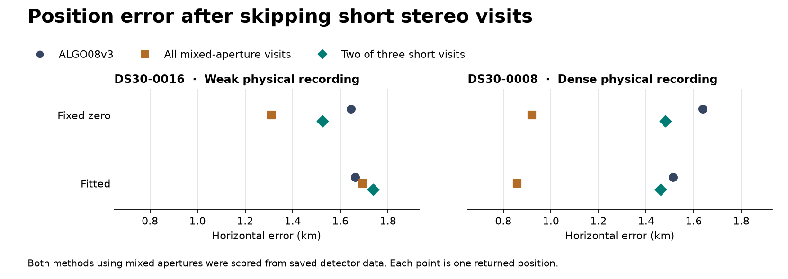

# Where a second 2× could come from

Frozen ALGO08v3 remains the baseline. The guarded 20/12 ms receiver and current solver take **10.835 s North and 10.685 s South** on complete simulated I/Q through both calibration arms, all eight PNGs and exit. Their historical v3 controls take 16.761 s and 14.370 s. The gaps to half time are **2.45 s and 3.50 s**. The 29-visit physical withhold reached 3.01× (1.466 to 0.487 s). The current guarded combination still needs a complete matched physical positive replay. [North and physical withhold](combined-raw.md) · [South](combined-raw-south.md)

## What transferred

| Experiment | Measurement | Consequence |
|---|---|---|
| Skip every third short stereo visit, preserving every full anchor | On the same 64-window dense physical member, verified member CPU fell by 12.8–13.3% in both orders. On the weak member, acquisition CPU fell from 290 to 268 ms. | There is a real single-core detector saving. Both variants read and verified every source window. [Dense timing](live-stereo-0008.md) · [Weak timing](live-stereo-blocks.md) |
| Apply that rule to full held North simulated I/Q | Compared with the same unfiltered receiver on all visits, acquisition saved 0.833 CPU s. The solver hit a repair limit, then spent 4.152 CPU s on fallback. Launch-to-exit elapsed rose from 11.387 to 14.020 s. Fixed-zero/fitted horizontal errors moved from 388/122 to 820/111 m. | A smaller detector output can mean more solver work. Fixed-zero error failed the 250 m allowance against v3 (106 m). RF residuals fell from 69.4/70.9 to 8.4/7.5 Hz despite that loss. [Complete North comparison](live-stereo-blocks.md) |
| Apply the same rule to the South saved detector packet | Containing-offer errors were 593/444 m against 817/1,101 m for v3 and 454/515 m for complete mixed coverage. When the offer excluded truth by 100 m, all three variants returned a false fix. | The masked estimates moved only 0.21/0.10 m between offers. A plausible position inside the box provides little evidence that the box contains the receiver. [South transfer](whole-stereo-blocks-south.md) |
| Use 8 ms measurements on all short visits and choose signal histories at the end | North elapsed was 10.828 s against 10.835 s for guarded 12 ms. Acquisition saved 0.157 CPU s and decision/publication cost 0.169 CPU s more. Errors were 112/128 m versus 106/141 m for v3. | This is a credible accuracy-preserving North receiver. Its standalone through-exit timing gain is negligible. [Original North replay](eight-ms-native-live.md) |
| Eliminate duplicate track proposals | On physical DS30-0316, all 2,002 ordered assignments per arm, both positions, regional evidence and eight PNGs matched the prior research build. Saved detections through exit took 10.808 s against 11.209 s in a separate launch. | Keep the exactness evidence. The difference between those clocks does not isolate a speed gain. [Physical comparison](duplicate-graph-0316.md) |

Each point is one returned position. DS30-0008 retained both fixes after thinning and still lost 562/604 m compared with complete mixed coverage. On DS30-0016, the fitted error rose 77 m above v3. The dense saved process wrote verified positions, grid and figures but failed a post-publication source check. Its numerical CPU is usable as a stage measurement. A successful through-exit timing for that run is unavailable. [Physical position results](whole-stereo-blocks.md)

## A dense recording leaves little room for stalls

On DS30-0008 the resident v3 qualification clock is 113.021 s, giving a 56.510 s target. Subtract the modeled cost of the omitted calls from the earlier original-format acquisition CPU, then add the measured saved masked solve, the earlier remaining CPU and the charged planner. This gives **28.197 + 20.560 + 4.704 + 0.133 = 53.593 s**, assuming zero additional wait. That leaves **2.917 s** and requires verified acquisition of 8,182 MB in 31.114 s, or **263 MB/s**. Two masked runs on its first resident member reached 294 and 269 MB/s. An earlier mostly nonresident complete acquisition exposed 28.046 s of waiting. The model combines different launches and assumes mean per-call cost transfers across members. It supplies a stop criterion for testing, not a measured dense speedup. [Reproducible budget](stereo_schedule_budget.py) · [Earlier whole-recording clocks](measurements/dense-measured-budget.json) · [Paired member timings](live-stereo-0008.md)

## Ranked experiments on saved inputs

Savings in this table overlap. Timing each proposed combination through a real position decision is necessary before adding any stage credits.

| Rank | Proposed change | First decisive check |
|---:|---|---|
| 1 | **Keep good work when the repair falls back.** Hand the ordinary solver exact catalogue scores, orbit projections or fixed assignments already computed with identical inputs. | Trace North's 4.152 CPU s fallback. Count the duplicated portion with identical input keys. Reuse only bit-identical results, and require the original ranking, grid and terminal on both South offers as well. The entire fallback is an upper bound on this one run. |
| 2 | **Choose the receiver once there is evidence about the recording.** Pay all visits in an initial block. Thin only if antenna and frequency-stream evidence passes a frozen rule. | Score each prefix without future observations, site labels or coordinates. Count remaining avoidable calls after the decision. A rule that keeps North accurate but decides too late on dense DS30 has no speed case. |
| 3 | **Spend short visits where they distinguish competing satellite tracks.** Keep full anchors and late time coverage. Restore selected visits where plausible tracks have different predicted frequency or slope. | On saved packets, mask visits, then reveal one block at a time. Measure how many restored calls recover the better assignments and avoid the North fallback. Charge the scheduler, extra buffering or rereads, and all failed recoveries. |
| 4 | **Use a cheap first fit to buy additional evidence, before starting a second solver.** When a signed fit approaches its repair limit, ask for a bounded set of deferred measurements and retry the affected associations once. | Start with the North failure. Measure the least extra evidence needed to avoid fallback and the net time including failed retries. Keep the ordinary route for inconclusive cases. |
| 5 | **Keep the full signed finish and make its iterations cheaper.** Cache orbit evaluations and share identical derivative or projection terms across calibration arms at exactly matching states. | Profile repeated operations on dense DS30-0008 and hard DS30-0402. The shortcut that skipped the finish showed 2.80 CPU s of dense opportunity, but its guard chose the wrong action on both held cases. Check endpoint and objective equality for exact reuse. [Finish study](survivor-sensitivity.md) |
| 6 | **Combine the 8 ms receiver with selective measurement purchases.** Keep both antennas on ordinary visits. Pay longer integration only for tracks whose assignment could change. | Compare genuine 8 ms packets, history-selected packets and guarded 12 ms on the same opportunities. Require the weak and North gains in both position arms and price any additional downstream iterations. |
| 7 | **Reserve disjoint observations to compare the offered region with an exterior competitor.** Use that regional decision to withhold or end repairs when the evidence warrants it. | Test a valid near-boundary fix alongside 100 m and distant omissions. Record false accepts, lost true fixes and time spent on external candidates. South's 25 existing probes still accepted the near omission. A speed credit requires measured avoided work. |
| 8 | **Process the original input once from verification through both antennas.** Keep each decoded window in cache for its remaining receiver operations. | Profile memory movement after authentication on a resident physical member in both run orders. Require exact decoded bytes and detector factors. Then separately price cold storage wait against the 263 MB/s dense requirement. |
| 9 | **Carry exact solver geometry into the eight required figures.** Reuse identical grid, track and projection arrays across views. | Count repeated evaluations in the actual publisher, including existing caches. Compare every decoded image and charge launch, output checks and exit. Hold the region and calibration provenance in each cache key. |
| 10 | **Change future capture layout to support cheap selective reads.** Give independently decodable visit groups integrity proofs and a full-width fallback. | Compare capture write through first analysis, full replay, and sparse replay on different receiver gains. Also charge indexing, proof bytes and conversion for old recordings. Lossless packing alone was 5–10 ms slower on the guarded weak member through exit. [Packing experiments](packing-and-decision-gates.md) |

The first combination worth a full timing is a causal receiver decision plus exact reuse during solver fallback, provided each first clears its separate saved test. Use one weak positive, one dense positive, a withhold, and held containing and omitted regions before expanding. Keep Gauss to one low-priority single-core benchmark at a time. For promotion, require both the median paired candidate/v3 elapsed ratio and the ratio of summed elapsed times to reach 0.50, with comparable fix rate and horizontal error in both calibration arms and complete required products. Record a common geographic failure against v3 separately from any new regression.
