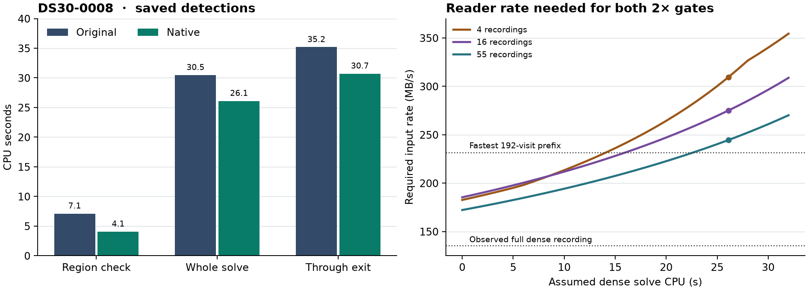

# Regional scorer through a complete dense saved publication

On DS30-0008 the combined candidate with native regional scoring took **30.852 s elapsed** from saved detections through process exit. The same candidate with the previous regional scorer took **35.338 s**. Both published identical positions, all 4,367 assigned observations and roles per calibration arm, the complete 179-point grid, position path and eight PNG files. Each image was read back and decoded independently. [Complete matched receipt](measurements/regional-dense-pair.json)

## Timed pair

Both launches used the same 7,336 selected observations, supplied square, causal archive, installed track graph, fused orbit projection, cold-search track-row reuse and predictive grid phase reuse. Native scoring ran first. The pair used a shared font cache, fresh interpreters and output stores, and one low-priority CPU 2 lock on Gauss. Raw I/Q acquisition and verification were outside both clocks. [Frozen comparison](regional-dense-pair-protocol.md) · [Runner and verifier](regional_dense_pair.py)

| DS30-0008 timing boundary | Previous scoring | Native scoring |
|---|---:|---:|
| Process through exit, elapsed s | 35.338 | 30.852 |
| Process through exit, CPU s | 35.182 | 30.717 |
| Publication function, CPU s | 33.620 | 29.215 |
| Numerical solve, CPU s | 30.468 | 26.105 |
| Regional check, CPU s | 7.109 | 4.069 |
| Fused orbit projection within the regional check, CPU s | 2.075 | 0.580 |
| Cold discovery and finalist race, CPU s | 6.173 | 5.724 |
| Standard numerical evidence, CPU s | 5.990 | 6.022 |

The pair gained 4.486 elapsed seconds. The regional-check difference was 3.041 CPU s and includes changes in timing of the identical projection code. The earlier two-order comparison that reused the same geometry measured **0.942 CPU s** saved across scoring the 25 probes. Machine and memory effects, and ordinary variation in the other stages, limit attribution of the larger one-pair result. [Reversed probe-stage timings](regional-track-scores.md)

Fixed-zero and fitted horizontal errors remained **0.919 / 0.857 km**. RF residual RMS remained **140.961 / 140.950 Hz**. The complete named ALGO08v3 comparator on this recording previously gave **1.639 / 1.512 km** and **129.703 / 129.663 Hz** with its original receiver. Thus, the short receiver and combined solver improved the two position estimates on this recording while increasing RF residual. The regional kernel reproduced the same candidate science. The existing southern 100 m missing-region failure still limits geographic qualification. [Original raw and saved comparisons](dense-real-transfer.md) · [Southern boundary evidence](regional-track-scores.md)

## What the enrolled recordings require

The raw reader and numerical solver share the same single-core budget. We applied the previously published cost model separately to the frozen four- and sixteen-recording prefixes before considering the full historical 55. The new measured 26.105 s solve sets the numerical fraction, relative to the 60.966 s saved installed-v3 numerical reference. The model charges each original compressed byte at the assumed effective acquisition rate, retains original publication tails, and charges the prior shared seal and worker estimate. Uninstrumented outcomes retain their original elapsed charge. The first four are DS30-0374, DS30-0008, DS30-0155 and DS30-0001. These are conditional projections on the actual rosters. There were no fresh four- or sixteen-case raw runs. [Panel inputs and calculated gates](measurements/regional-dense-budget.json) · [Model](regional_dense_budget.py)

| Enrolled panel | Median / summed elapsed fraction at 135.35 MB/s | Median / summed at 231.52 MB/s | Dense solve budget at 231.52 MB/s | Input rate needed with the measured 26.105 s solve |
|---|---:|---:|---:|---:|
| First 4 | 0.833 / 0.808 | 0.587 / 0.555 | 14.07 s | 309.5 MB/s |
| First 16 | 0.788 / 0.771 | 0.548 / 0.549 | 15.96 s | 275.1 MB/s |
| Historical 55 | 0.721 / 0.740 | 0.498 / 0.517 | 22.61 s | 244.5 MB/s |

Both fractions must reach **0.500 or lower**. The slower rate was measured across one complete 8.182 GB dense recording; the faster one came from a 192-visit prefix. At the faster rate, the enrolled first four need another **12.04 s** of dense numerical work removed if all other costs stay fixed. At the slower rate even free numerical solving misses at least one gate in every roster. These cases span one physical site and do not validate geographic generality. [Original reader measurements](dense-real-transfer.md) · [Frozen stage assignments](development/stages.json)

The native run spent 5.724 s in cold discovery and 6.022 s in standard numerical evidence. Even granting both disjoint stages for free would leave **14.359 s** of dense solver CPU, already above that first-four allowance. At the other extreme, holding the measured solve fixed would require **309.5 MB/s** sustained acquisition across those four. Applied to the dense input, this means processing its 8.182 GB in 26.44 s; the existing authenticated receiver consumed 32.40 CPU s on that file. This identifies a joint target for changes to waveform processing, input verification and inference. It does not establish a physical throughput limit.

The most recent measured raw-I/Q-to-exit comparison remains **10.831 → 8.901 s** on weak DS30-0016 with both inputs fully resident. This dense saved result and the panel budgets leave the larger Gauss campaign gated. [Complete weak raw pair](weak-combined-raw.md)

### Three smaller changes tested alongside the dense pair

| Proposed change | Evidence from saved inputs | Decision |
|---|---|---|
| Use both antennas' 8 ms confidence to select 12 ms retries | The rule that eliminated all discrepancies retried all 336 dense lanes and all 36 weak lanes. Requiring only confidence margins raised dense retries from 182 to 242 and left nine disagreements. | Retain independent receiver decisions. [Stereo retry rule and measured costs](stereo-retry.md) |
| Initialize the robust posterior at each grid point from its neighbour and tighten convergence | Across 12 genuine dense grid points per arm, stock used 105.476 ms and the warm implementation used 127.842 ms. Both arms kept their sampled rankings and minima, but four scores per arm exceeded the original objective tolerance. | Keep the existing grid fit. [Dense grid slice](grid-neighbor-gamma.md) |
| Propagate regional satellite states at 8 s intervals and interpolate | Midpoint error reached 0.126 m/s against a 0.035 m/s limit. The weak proof fell back to exact propagation. Its CPU rose from 174.64 to 183.80 ms. | Keep the original orbit support. [Guarded interpolation](regional-orbit-interpolation.md) |

## Reproduce

Under the shared low-priority Gauss CPU 2 lock and one numerical thread, run `regional_dense_pair.py run NEW_DIRECTORY TRACK_LIBRARY`, then `regional_dense_pair.py score NEW_DIRECTORY NEW_RESULT.json` in the repository scoring environment. Use the release interpreter, installed payload for child processes, archived packet and reviewed native library documented in the [regional scorer report](regional-track-scores.md). The pair driver validates the packet, supplied region, archive and both native library digests before launching. `regional_dense_budget.py NEW_RESULT.json NEW_BUDGET.json` recomputes both gates. The [figure script](regional_dense_figure.py) reads the published JSON files.
