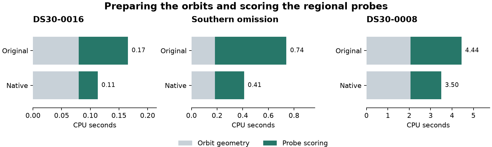

# Faster satellite-track scoring in the regional check

On genuine short-receiver detections from dense DS30-0008, the new implementation scored the 25 geographical probes in **1.434 CPU s**, down from **2.376 s**. It saved **0.942 s** on this stage. All 208 per-track satellite choices matched at every visited point. The original causal geometry still took 2.066 s to prepare. The public southern 52.5 km omission still withheld, and the 100 m omission still produced a false fix. [Frozen protocol](regional-track-kernel-protocol.md)



| Saved recording and offered region | Tracks / visits to probe locations | Common geometry (CPU s) | Original probe CPU s | Native probe CPU s | Saved CPU s |
|---|---:|---:|---:|---:|---:|
| Weak DS30-0016, containing | 13 / 24 | 0.080 | 0.086 | 0.033 | 0.053 |
| Southern simulation, 52.5 km omission | 26 / 96 | 0.183 | 0.558 | 0.227 | 0.331 |
| Dense DS30-0008, containing | 208 / 25 | 2.066 | 2.376 | 1.434 | 0.942 |

The original scorer gathers three arrays for each track at each probe, then centers observed-minus-predicted frequencies and orbital derivatives on the visible candidates. The C implementation reads the same time indices directly from the fused Doppler projection and reuses two scratch arrays. It evaluates every original visible orbit, the same Gaussian contrast, the uniform prior over the entire causal catalogue, the outlier mixture and the same owner ordering. Data from either antenna stay in their original group. The implementation takes the supplied region through the existing projector. [Native arithmetic](regional_track_scores.c) · [Projection and score binding](regional_track_scores.py)

Each case ran original, native, native, original on the same prepared geometry, with one CPU and one benchmark lock. The reported means include projection, packing the native track inputs on each native pass, and the terminal decision. Dense native passes took 1.468 and 1.399 s, versus 2.215 and 2.536 s for the controls. Each arm stopped at the same location and with the same decision. Maximum absolute drift in the pooled or receiver scores was **1.78 × 10⁻¹⁵** across the three packets. These measurements cover the observed locations and winning labels. Floating-point summation order differs across implementations. [Dense receipt](measurements/regional-track-dense.json) · [Weak receipt](measurements/regional-track-physical.json) · [Southern receipt](measurements/regional-track-south-far.json)

## Full saved publication and the missing-region test

With the installed graph, fused projection, cold track-row reuse and grid phase reuse, the weak DS30-0016 saved publication reproduced all 116 owner/role rows per arm, both endpoints, the full 179-point grid, position path and all eight encoded and decoded web images. Fixed-zero/fitted horizontal errors stayed at **1.311 / 1.694 km** and RF RMS at **121.526 / 120.291 Hz**. The fresh saved solve took **2.962 CPU s**, versus 2.630 s in the previous independent launch with the two reuse options. The local scorer gain did not yield a measured weak whole-solve improvement. The southern far case used the native scorer at all 96 locations and withheld before fitting. [Publication receipts](measurements/regional-track-publication.json) · [Previous matched raw comparison](weak-combined-raw.md)

The same candidate on the same southern detector packet published when truth lay **100 m outside** the 25 km offer. It returned 468 owned observations in each calibration arm, 137 grid points and eight verified images. Its fixed-zero/fitted position errors were **0.454 / 0.515 km**, versus **0.817 / 1.102 km** for the named v3 specification on this offer. RF RMS increased from **6.502 / 6.392 Hz** to **8.312 / 8.188 Hz**. Both pipelines made the wrong regional decision.

Moving the face 200 m from the existing containing control moved the estimated positions by less than 1 mm. The fitted position originally lay 615 m inside the near face and still lay 415 m inside the shifted face. The fixed-zero position went from 453 to 253 m inside. This explains how the fix can be stable across offers and still fail geographic qualification. The waveform and offers are public development fixtures. [Near-omission result and image digests](measurements/regional-track-near.json)

The 0.942 s dense-stage saving would cover about 32% of the **2.960 s** dense numerical reduction needed in the earlier 55-recording model using its fastest measured reader prefix. That calculation assumes the stage saving transfers directly. The observed full-recording reader was slower. There is no new full dense solve or raw timing in this experiment. [Signed dense timing budget](dense-real-transfer.md)

Two other reuse opportunities had smaller ceilings. Eliminating all remaining coarse pilot-template rotations on dense projects to at most 0.244 CPU s. On weak DS30-0016, counting all affected orbit setup calls and repeated parsing gave an inclusive ceiling of 0.152 CPU s. A separate resumable 8 ms receiver analysis found that its current retry rule would still accept 19 dense and five weak disagreements even with free continuation. [Receiver template preparation](short-shared-prep.md) · [Orbit setup overlap](live-orbit-setup-audit.md) · [Resumable receiver bounds](resumable-primary-ceiling.md)

## Reproduction

The research launcher accepts `--regional-track-library` alongside `--geographic-library`. The original scoring path remains the default. Both native libraries must match their reviewed digests. Build the Gauss track library from the pinned source with the following command, adjusting the two paths.

```sh
cc -std=c11 -O3 -march=haswell -ffp-contract=off -fPIC -shared -Wall -Wextra -Werror regional_track_scores.c -lm -o scores.so
```

Use the Gauss release interpreter, the installed payload, and the same one-core lock and thread settings as the [weak raw comparison](weak-combined-raw.md). Run the [paired proof driver](regional_track_trial.py) with `CASE scores.so OUTPUT/CASE.json` in the order `physical`, `south-far`, `dense`. The two small receipts gate the dense proof. For the [saved publication driver](regional_track_publication.py), use `CASE OUTPUT scores.so` for `physical`, `south-far`, and `south-near`, then `score OUTPUT NEW_RESULTS.json` and `score-near OUTPUT NEW_NEAR.json`. The raw detector and causal archive stay fixed. The initial proof-only launch stopped before scoring because the inner numeric region exposes its center and width separately. The corrected driver checks both the supplied offer and those numeric fields. The final adapter also explicitly specifies binary64 scaling and rejects multidimensional track inputs.
