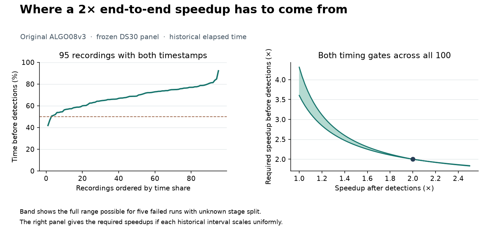

# How much faster the receiver must get for a 2× DS30 result

On the frozen 100-recording ALGO08v3 release panel, **93 of the 95 runs with a terminal timestamp spent more than half their elapsed time reaching the saved detections**. Across those 95 runs, reaching detections took **6,778 s**, or **67.9%** of the 9,984 s total. Everything after detection publication took 3,206 s. The other five runs exited with solver errors. Their 430 s are included in the timing gates below. The measurements come from existing benchmark receipts and output timestamps. This analysis ran zero receiver or solver jobs. [Historical release and assigned cases](https://github.com/misko/leo-tracker-reduxredux/blob/2424d8897e6003f39550e2ae50ba3cd149da389a/reports/ALGO08/v3/ds30-100/README.md) · [Recording-level timing evidence](https://github.com/misko/leo-tracker-reduxredux/blob/021a0ce8ab4b5e01e95b66c83357b00cb63671d9/reports/ALGO08/v3/measurements/release-stage-budget.json)

### Two timing gates

Both the median of paired candidate-to-v3 time ratios and the ratio of summed times must be at most 0.5. The table scales the two observed intervals by separate fixed factors and finds the least speedup before detections that meets both gates. The range allows each unpartitioned failure to have spent its entire runtime in either interval. This retains the original 100 denominators. It assumes both intervals scale uniformly across recordings and that fix decisions remain unchanged.

| Assumed speedup after detection publication | Required speedup from startup to detection publication |
|---:|---:|
| 1.00× | 3.60–4.31× |
| 1.25× | 2.73–2.95× |
| 1.50× | **2.35–2.44×** |
| 1.60× | 2.25–2.31× |
| 2.00× | 2.00× |

Even making the entire interval after detections instantaneous gives at most **1.46× on the paired median and 1.54× on the summed gate**. Conversely, work before detections includes launch, file access, verification and publication of the native packet as well as the two-scan detector. A 2.4× improvement to a detector kernel alone would save only its share of this interval.

### A throughput target for small receiver trials

An intake benchmark can express the same budget in **original compressed megabytes per second through publication of detections**. That boundary pays for reading input, integrity checks, native detection and writing the packet. The original v3 processes achieved **110.3 MB/s** in aggregate across the 95 partitioned cases. Cases with at most 1% of input pages already resident averaged **94.3 MB/s**, and cases with at least 99% resident averaged **173.3 MB/s**. The absolute rates use decimal MB and weight each group by its measured elapsed time.

For the 95 partitioned jobs, this model charges an optional startup cost, the compressed input size divided by a uniform effective rate, and the original post-detection interval divided by the assumed speedup. The other five jobs retain their full measured wall times in both denominators and in the modeled candidate total. Actual software cannot select those five jobs in advance from their eventual failure status. Holding their cost fixed is an accounting scenario. It differs from the stage-split bounds above.

| Assumed speedup after detections | Intake rate needed with no separate startup | Intake rate needed with 0.50 s startup per partitioned case |
|---:|---:|---:|
| 1.00× | 475.7 MB/s | 490.5 MB/s |
| 1.50× | **283.1 MB/s** | **288.3 MB/s** |
| 1.60× | 269.5 MB/s | 274.2 MB/s |
| 2.00× | 235.5 MB/s | 239.0 MB/s |

The summed-time gate sets the threshold in all four rows. For scale, the 991.735 MB original DS30-0016 recording reached detections at **217.3 MB/s** on first use and **267.0 MB/s** with its replay indexes ready, including startup in both rates. The one-case clocks used resident input. The modeled target is a panel-wide rate with its stated post-detection assumption. [Original-file timing](https://github.com/misko/leo-tracker-reduxredux/blob/021a0ce8ab4b5e01e95b66c83357b00cb63671d9/reports/ALGO08/v3/legacy-first-use-original-panel.md) · [Prepared reader comparison](https://github.com/misko/leo-tracker-reduxredux/blob/021a0ce8ab4b5e01e95b66c83357b00cb63671d9/reports/ALGO08/v3/legacy-map-writer-0016.md)

The historical cache observer counted pages for each original compressed member. We recovered exact sizes for 55 recordings from the earlier signed extent ledger. For the remaining 45 we bounded each rounded-up final page between one byte and a full page. Across all 100 jobs the original payloads total **788.684–788.703 GB**. Propagating both ends of that interval changes the 288.3 MB/s target by less than 0.01 MB/s. No waveform was reopened. [Original page-count implementation](https://github.com/misko/leo-tracker-reduxredux/blob/021a0ce8ab4b5e01e95b66c83357b00cb63671d9/tools/pipeline_eval/qualification/cache_residency.py) · [55 exact recording sizes](https://github.com/misko/leo-tracker-reduxredux/blob/021a0ce8ab4b5e01e95b66c83357b00cb63671d9/reports/ALGO08/v3/measurements/acquisition-throughput.json) · [100-case throughput calculation](https://github.com/misko/leo-tracker-reduxredux/blob/021a0ce8ab4b5e01e95b66c83357b00cb63671d9/reports/ALGO08/v3/release_intake_rate.py) · [Per-record bounds and gates](https://github.com/misko/leo-tracker-reduxredux/blob/021a0ce8ab4b5e01e95b66c83357b00cb63671d9/reports/ALGO08/v3/measurements/release-intake-rate.json)

### Single-core CPU and file residency

The historical processes spent **73.6% of summed elapsed time on CPU**. If each process used half as much CPU and its remaining elapsed time stayed constant, the paired median and summed elapsed speedups would both be **1.58×**. Under this assumption a **3.12× reduction in CPU time** would meet both elapsed gates. Elapsed time outside CPU can include scheduler delays and input waits. Streaming or changing the access pattern can affect both components.

| Original payload pages resident at launch | Runs with both timestamps | Fraction of summed elapsed time before detections |
|---|---:|---:|
| At most 1% | 49 | 70.5% |
| Between 1% and 99% | 25 | 69.2% |
| At least 99% | 21 | 55.7% |

The groups contain different recordings. For example, on median-sized DS30-0004 the installed process reached detections in 83.645 s and exited in 126.979 s. Its target at half that observed elapsed time is 63.489 s. The newer DS30-0004 study times only a solver starting from the saved native packet. All of these recordings came from one site. [DS30-0004 saved solver comparison](https://github.com/misko/leo-tracker-reduxredux/blob/021a0ce8ab4b5e01e95b66c83357b00cb63671d9/reports/ALGO08/v3/nomination-handoff.md)

### What the new first-use candidate would still need

The same file boundary can be observed in the two small, complete candidate runs that generated their own indexes. On DS30-0016, 4.565 s elapsed before the detection file and 3.678 s after it. On DS30-0107 those intervals were 0.488 s and 0.075 s. In total the candidate spent **5.053 s before detections and 3.753 s after**. Holding its post-detection time fixed, halving its current pre-detection time would give 6.280 s, still 0.159 s above half of installed v3. The pre-detection interval would have to get **2.13× faster again** to meet the summed gate under this assumption. These two original-file recordings have 808 and 29 visits and were outside the historical 100. [Matched normal first-use runs](https://github.com/misko/leo-tracker-reduxredux/blob/021a0ce8ab4b5e01e95b66c83357b00cb63671d9/reports/ALGO08/v3/legacy-first-use-original-panel.md)

The two intervals use the archived child `started_unix_ns` and elapsed clocks. The corresponding native `detections.json` modification times were `1795515024035109142` ns for DS30-0016 and `1795515019391747799` ns for DS30-0107. The positive case independently records its launch-to-detections interval in the scored scientific receipt.

On the fixing recording, the same installed-v3 boundary was **5.772 s before detections and 4.973 s after**. The new first-use candidate took 4.565 s and 3.678 s at those boundaries, equivalent to **1.26× and 1.35×** on this case. A separate receiver experiment on one DS30-0169 member tried vectorizing the timing eigensolver. It preserved every ordered factor, but even removing the entire eigensolver would save at most **0.84% of native callback CPU on the 20/8 ms schedule**. The complete vectorized callbacks were slower than the shipped builds. That result points toward reducing the cost of both verified input and detection to meet the earlier-stage budget. [Installed milestones](https://github.com/misko/leo-tracker-reduxredux/blob/021a0ce8ab4b5e01e95b66c83357b00cb63671d9/reports/ALGO08/v3/history-risk-physical-cohort.md) · [One-member receiver experiment and cost limits](https://github.com/misko/leo-tracker-reduxredux/blob/021a0ce8ab4b5e01e95b66c83357b00cb63671d9/reports/ALGO08/v3/receiver-jacobi-columns.md)

### Reproduction and limits

The release decision binds all 100 archived pair receipts by SHA-256. For the 95 with terminals we subtracted the detection-to-terminal modification-time interval from the launch-to-terminal clock stored by the original timing harness. All 52 corresponding rows in the first published timing table matched within a microsecond. No detection or terminal body needed reading. The release receipts bind the clocks and case identities. File timestamps for the 43 additional terminal cases came from the retained benchmark directories and depend on those directories preserving mtimes. Errors, full-wall totals, CPU totals, and both timing gates are kept separately in the receipt. [Earlier timing table](https://github.com/misko/leo-tracker-reduxredux/blob/021a0ce8ab4b5e01e95b66c83357b00cb63671d9/reports/ALGO08/v3/first-55/stage-clocks.csv) · [Reconstruction and gate calculation](https://github.com/misko/leo-tracker-reduxredux/blob/021a0ce8ab4b5e01e95b66c83357b00cb63671d9/reports/ALGO08/v3/release_stage_budget.py)

Run the script with the original Gauss panel directory, the linked release's `decision.json`, the earlier `stage-clocks.csv`, and an output JSON path. Pass `--plot FILE.png` for the figure. Both small input ledgers are checked against their published digests before any panel measurement is used.
