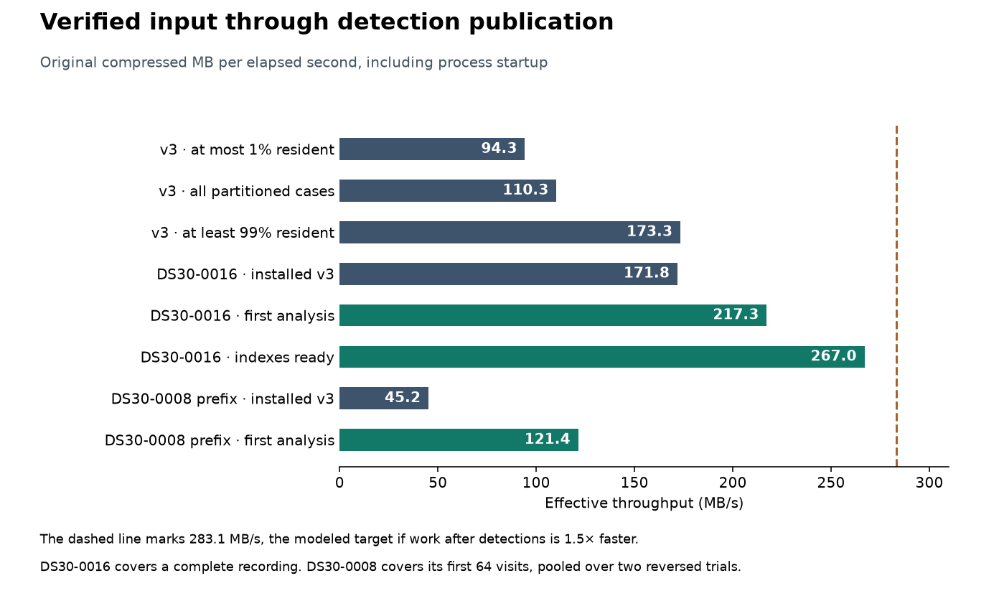
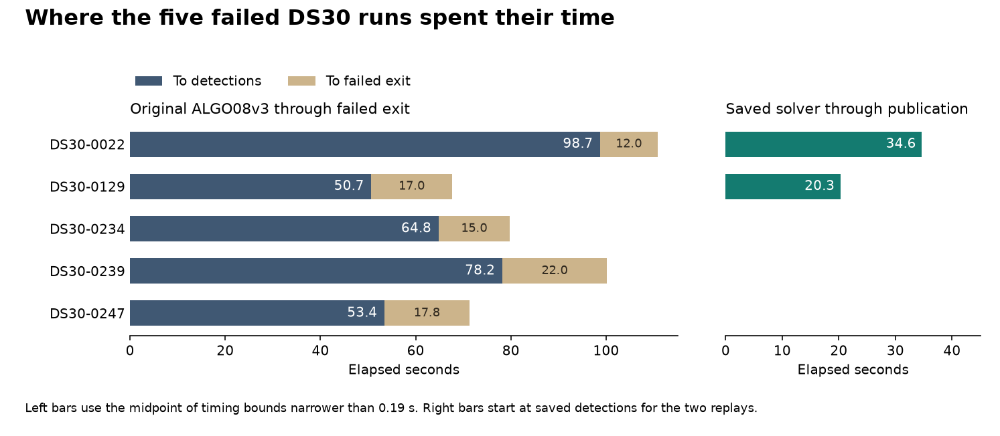

# How much faster the receiver must get for a 2× DS30 result

On the frozen 100-recording ALGO08v3 release panel, **93 of the 95 runs with a terminal timestamp spent more than half their elapsed time reaching the saved detections**. Across those 95 runs, reaching detections took **6,778 s**, or **67.9%** of the 9,984 s total. Everything after detection publication took 3,206 s. The other five runs exited with solver errors. Their 430 s are included in the timing gates below. The measurements come from existing benchmark receipts and output timestamps. This analysis ran zero receiver or solver jobs. [Historical release and assigned cases](https://github.com/misko/leo-tracker-reduxredux/blob/2424d8897e6003f39550e2ae50ba3cd149da389a/reports/ALGO08/v3/ds30-100/README.md) · [Recording-level timing evidence](https://github.com/misko/leo-tracker-reduxredux/blob/f881655010564064b4f584e99232694581ac58f2/reports/ALGO08/v3/measurements/release-stage-budget.json)

### Two timing gates

Both the median of paired candidate-to-v3 time ratios and the ratio of summed times must be at most 0.5. The table scales the two observed intervals by separate fixed factors and finds the least speedup before detections that meets both gates. The range allows each unpartitioned failure to have spent its entire runtime in either interval. This retains the original 100 denominators. It assumes both intervals scale uniformly across recordings and that fix decisions remain unchanged.

| Assumed speedup after detection publication | Required speedup from startup to detection publication |
|---:|---:|
| 1.00× | 3.60–4.31× |
| 1.25× | 2.73–2.95× |
| 1.50× | **2.35–2.44×** |
| 1.60× | 2.25–2.31× |
| 2.00× | 2.00× |

Even making the entire interval after detections instantaneous gives at most **1.46× on the paired median and 1.54× on the summed gate**. Conversely, work before detections includes launch, file access, verification and publication of the native packet as well as the two-scan detector. A 2.4× improvement to a detector kernel alone would save only its share of this interval.

### A throughput target for small receiver trials

An intake benchmark can express the same budget in **original compressed megabytes per second through publication of detections**. That boundary pays for reading input, integrity checks, native detection and writing the packet. The original v3 processes achieved **110.3 MB/s** in aggregate across the 95 partitioned cases. Cases with at most 1% of input pages already resident averaged **94.3 MB/s**, and cases with at least 99% resident averaged **173.3 MB/s**. The absolute rates use decimal MB and weight each group by its measured elapsed time.

For the 95 partitioned jobs, this model charges an optional startup cost, the compressed input size divided by a uniform effective rate, and the original post-detection interval divided by the assumed speedup. The other five jobs retain their full measured wall times in both denominators and in the modeled candidate total. Actual software cannot select those five jobs in advance from their eventual failure status. Holding their cost fixed is an accounting scenario. It differs from the stage-split bounds above.

| Assumed speedup after detections | Intake rate needed with no separate startup | Intake rate needed with 0.50 s startup per partitioned case |
|---:|---:|---:|
| 1.00× | 475.7 MB/s | 490.5 MB/s |
| 1.50× | **283.1 MB/s** | **288.3 MB/s** |
| 1.60× | 269.5 MB/s | 274.2 MB/s |
| 2.00× | 235.5 MB/s | 239.0 MB/s |

The summed-time gate sets the threshold in all four rows. For scale, the 991.735 MB original DS30-0016 recording reached detections at **217.3 MB/s** on first use and **267.0 MB/s** with its replay indexes ready, including startup in both rates. The one-case clocks used resident input. The modeled target is a panel-wide rate with its stated post-detection assumption. [Original-file timing](https://github.com/misko/leo-tracker-reduxredux/blob/f881655010564064b4f584e99232694581ac58f2/reports/ALGO08/v3/legacy-first-use-original-panel.md) · [Prepared reader comparison](https://github.com/misko/leo-tracker-reduxredux/blob/f881655010564064b4f584e99232694581ac58f2/reports/ALGO08/v3/legacy-map-writer-0016.md)

The historical cache observer counted pages for each original compressed member. We recovered exact sizes for 55 recordings from the earlier signed extent ledger. For the remaining 45 we bounded each rounded-up final page between one byte and a full page. Across all 100 jobs the original payloads total **788.684–788.703 GB**. Propagating both ends of that interval changes the 288.3 MB/s target by less than 0.01 MB/s. No waveform was reopened. [Original page-count implementation](https://github.com/misko/leo-tracker-reduxredux/blob/f881655010564064b4f584e99232694581ac58f2/tools/pipeline_eval/qualification/cache_residency.py) · [55 exact recording sizes](https://github.com/misko/leo-tracker-reduxredux/blob/f881655010564064b4f584e99232694581ac58f2/reports/ALGO08/v3/measurements/acquisition-throughput.json) · [100-case throughput calculation](https://github.com/misko/leo-tracker-reduxredux/blob/f881655010564064b4f584e99232694581ac58f2/reports/ALGO08/v3/release_intake_rate.py) · [Per-record bounds and gates](https://github.com/misko/leo-tracker-reduxredux/blob/f881655010564064b4f584e99232694581ac58f2/reports/ALGO08/v3/measurements/release-intake-rate.json)

### How much intake time do the measured solvers leave?

Six of the 100 recordings have fresh saved-packet solver comparisons as well as original v3 process clocks. We can replace the uniform 1.5× solver assumption with the observed result for each of those six. Using each routed worker's full elapsed time, including its admission, leaves a required intake rate of **361.7 MB/s** for the six together. Scaling the historical post-detection interval by each matched solver speedup yields **359.7 MB/s**. In both calculations the median paired time ratio sets the threshold. A uniform 283.1 MB/s would yield about **1.74×** median speedup on these six under either assumption.

| Recording | Original compressed GB | Installed raw-to-exit (s) | Routed saved-packet worker with admission (s) | Intake MB/s needed to halve this case using the worker time |
|---|---:|---:|---:|---:|
| DS30-0160 | 4.59 | 33.93 | 10.89 | 756 |
| DS30-0316 | 3.74 | 40.37 | 12.81 | 508 |
| DS30-0374 | 8.41 | 84.85 | 16.66 | 327 |
| DS30-0402 | 8.18 | 121.44 | 27.66 | 247 |
| DS30-0169 | 5.19 | 73.67 | 12.48 | 213 |
| DS30-0138 | 8.24 | 85.73 | 22.60 | 407 |

The rates divide original compressed bytes by the time left for intake after paying the solver out of half the installed runtime. The two boundary assumptions account differently for a separately launched solver's startup. All six were fixes. Four original processes started with their entire input resident. These were reruns from installed 20 ms detections, so the measured solver times may change when a faster receiver supplies different detections. On the median-duration DS30-0138, a full original-input candidate would have to publish its detections in **20.26 s** to halve the original time if it then spent the measured 22.60 s on the solver and outputs. That gives a specific target for a triaged receiver experiment. [Saved solver comparisons](https://github.com/misko/leo-tracker-reduxredux/blob/f881655010564064b4f584e99232694581ac58f2/reports/ALGO08/v3/history-risk-0138.md) · [Calculation for both assumptions](https://github.com/misko/leo-tracker-reduxredux/blob/0cd5ed1cbb7b5a75aa97ea5fe3cce4a3ab9e0e21/reports/ALGO08/v3/saved_solver_intake_budget.py) · [Case-level clocks and thresholds](https://github.com/misko/leo-tracker-reduxredux/blob/f881655010564064b4f584e99232694581ac58f2/reports/ALGO08/v3/measurements/saved-solver-intake-budget.json)

### What the independently selected seventh recording changes

DS30-0255 took **107.959 s** from raw recording to exit on installed v3. Halving that leaves **53.979 s** for the entire pipeline. Even after the fallback fix, the candidate spent **56.232 s** on the saved detections alone. At an effective intake rate of 400 MB/s, reading and processing its original 8.213 GB would leave just **33.447 s** for the downstream stage. This case needs a faster solver as well as a faster receiver. The panel gates allow individual recordings to miss 2×. [Original holdout](https://github.com/misko/leo-tracker-reduxredux/blob/0cd5ed1cbb7b5a75aa97ea5fe3cce4a3ab9e0e21/reports/ALGO08/v3/unseen-saved-holdout-0255.md) · [Measured fallback improvement](https://github.com/misko/leo-tracker-reduxredux/blob/0cd5ed1cbb7b5a75aa97ea5fe3cce4a3ab9e0e21/reports/ALGO08/v3/nomination-handoff-0255.md)

| Seven-case calculation | Required intake using full saved-worker time | Required intake scaling the original downstream interval |
|---|---:|---:|
| Six previous routed results plus DS30-0255 as independently scored | 449.3 MB/s | 427.3 MB/s |
| Same six plus DS30-0255 after tuning fallback on that case | 407.7 MB/s | 397.4 MB/s |

Each row retains all seven recordings in both timing gates. The first column charges each candidate's measured admission and complete saved worker. The second multiplies each original downstream interval by the ratio of that candidate cost to the installed saved-worker time. Both calculations hold the six earlier results fixed. The rates model uniform intake on original bytes. Only the downstream workers were timed on these seven saved inputs. Reproduce the calculation with `python -m reports.ALGO08.v3.saved_solver_intake_budget --with-holdout`. [Budget calculation](https://github.com/misko/leo-tracker-reduxredux/blob/0cd5ed1cbb7b5a75aa97ea5fe3cce4a3ab9e0e21/reports/ALGO08/v3/saved_solver_intake_budget.py)

The next independently assigned recording, DS30-0419, gives a practical intake target. Installed v3 took **93.571 s** from raw input to exit. With half that allowance, paying the candidate's **16.178 s** saved-worker time and **0.762 s** of admission leaves **29.845 s** to publish detections from about 8.372 GB, or **280.5 MB/s**. Installed intake originally took **57.191 s**. This calculation assumes a faster receiver supplies a packet with the same downstream cost. Its raw runtime and positions still need measurement. [Blind worker clocks](https://github.com/misko/leo-tracker-reduxredux/blob/62cdfce0b0a3aca449df5800fef7cd7a795212c1/reports/ALGO08/v3/nomination-handoff-0419-local.md) · [Historical byte and time bounds](https://github.com/misko/leo-tracker-reduxredux/blob/f881655010564064b4f584e99232694581ac58f2/reports/ALGO08/v3/measurements/release-intake-rate.json)

### Five original solver failures and two saved-input recoveries

The five original failed processes had already published their detections. The two programs in each release pair ran serially. The other program's signed launch-to-terminal interval and terminal file timestamp give its start time. The original configuration write precedes the first launch, and the pair receipt follows the second exit. Together with both measured process durations these events bound launch time on either launch order. This reconstruction uses the retained file modification times and assumes wall time tracked the measured monotonic intervals during each pair. The same bounds enclosed **all 95 directly reconstructible starts**. Every failure interval below is narrower than 0.19 s.

| Failed ALGO08v3 recording | Launch to published detections (s) | Detections to failed exit (s) |
|---|---:|---:|
| DS30-0022 | 98.70–98.80 | 11.97–12.07 |
| DS30-0129 | 50.62–50.72 | 16.92–17.02 |
| DS30-0234 | 64.74–64.83 | 14.94–15.03 |
| DS30-0239 | 78.07–78.27 | 21.91–22.11 |
| DS30-0247 | 53.38–53.47 | 17.79–17.89 |

Of their combined **429.625 s**, the five failures spent **345.52–346.07 s** reaching detections. Assuming every downstream interval gets 1.5× faster **and all five still fail** would lower the modeled 100-case intake target to **261.7 MB/s**. Charging the measured DS30-0022 recovery below, holding the other four failures at their original cost and applying 1.5× only to the original 95 completed workers gives **278.8 MB/s**. The earlier **283.1 MB/s** model holds all five failure costs fixed. Each scenario retains all 100 original recordings. Successful recovery changes the amount of downstream work. [Serial launch and publication clocks](https://github.com/misko/leo-tracker-reduxredux/blob/47fd843beca155e64be89fa22d84dee786e88fdd/tools/pipeline_eval/qualification/paired_publication.py) · [Reproduction](https://github.com/misko/leo-tracker-reduxredux/blob/187bd3496aad1cc18737768694f79c0e65ab0197/reports/ALGO08/v3/failed_intake_clocks.py) · [Original time bounds and model results](https://github.com/misko/leo-tracker-reduxredux/blob/47fd843beca155e64be89fa22d84dee786e88fdd/reports/ALGO08/v3/measurements/failed-intake-clocks.json)

DS30-0022 was one of the five failed v3 runs charged at its original time in the 100-recording model. A separate candidate replay of its saved detections recovered the fix. The original orbit lookup had requested a time outside its interpolation interval. On retry the candidate propagated the missing orbit state from the same capture-time catalogue. It reproduced ALGO08v2's fixed and fitted errors (**1.294 / 1.311 km**), both frequency residuals, and all 2,388 ordered assignments per arm. It verified the grid, path and eight PNGs.

The saved worker took **39.812 s** through exit, plus **0.430 s** for input checks. Its original ALGO08v3 process had failed after 110.770 s. If the recovered worker's cost followed a new receiver unchanged, halving that original time would leave **15.14 s** for 8.369 GB of input through detection publication, about **553 MB/s**. This case now has a measured recovery cost. Its complete original-input candidate time and the other four recoveries remain unmeasured in this trial. [Failure mechanism, controlled calibration and timing](https://github.com/misko/leo-tracker-reduxredux/blob/42f5be5c2a055f0a9ab5404750c477d2e8c98963/reports/ALGO08/v3/solver-exception-0022.md)

Extending the orbit at its first unsupported lookup saved **5.179 s** on the same packet. The solver prepared its inputs once and made 101 verified catalogue reads, down from 202. It returned the same 2,388 assignments in each calibration arm, coordinates, residuals, grid, fit path and all eight PNG bytes. The saved child took **34.634 s**, with **0.340 s** of separate checks on the already admitted input. Those clocks leave **20.41 s** for original intake at the same half-time target, about **410 MB/s**. The 278.8 MB/s scenario above retains its original recovery clock for reproducibility. [In-flight orbit support and exact publication comparison](https://github.com/misko/leo-tracker-reduxredux/blob/187bd3496aad1cc18737768694f79c0e65ab0197/reports/ALGO08/v3/live-orbit-support.md)

The same frozen change also completed the next original failure, **DS30-0129**, in **20.264 s** from saved detections. It added the missing +318 s orbit knot and completed its first inference. Compared with deployed v2, the recovered fixed and fitted errors were **0.725 / 0.698 km**, increases of **48 / 87 m**, even as frequency-fit RMS fell by about 0.4 Hz. This fit used 144 fewer observations per calibration arm. The earlier repaired v3 solver used another set of assignments. No matched restart timing is available for this case. These two saved recoveries leave three original exceptions untested with this change. [Independent transfer and both accuracy comparisons](https://github.com/misko/leo-tracker-reduxredux/blob/187bd3496aad1cc18737768694f79c0e65ab0197/reports/ALGO08/v3/live-orbit-support-0129.md)

### What the intake experiments bought

**Fewer starting states for the solver.** A separate DS30-0138 trial searched all satellites and all four corners of the supplied region, but ran the expensive centre fit from two starting states instead of four. It saved **1.110 CPU s** in the matched discovery stage and kept the winning association. The complete saved worker took **21.276 s** and matched the routed control's positions, assignments, grid, path and eight figures. The same rule saved **0.357 CPU s** during discovery on DS30-0169 and retained that recording's winning association and three finalist scores. The DS30-0169 check stopped at discovery. This variant used the original numerical grid, so its whole-process timing is separate from the exact grid timing below. [Starting-state rule, measured timings and held control](https://github.com/misko/leo-tracker-reduxredux/blob/788842c6363ca8318054784269673a42506afe48/reports/ALGO08/v3/two-centre-seeds.md)

**Short negative screen.** A 4 ms sample check attempted to identify empty antenna lanes before calling the 8 ms detector. At the frozen threshold it preserved every signed detection on the first original members of DS30-0008 and DS30-0169, but skipped **zero calls** and added 1.49 and 1.17 ms CPU. On DS30-0008 the thresholds needed to remove 14–18 empty calls also removed 17–26 genuine detections. The full receiver kept its existing decision. [Measured speed and detection tradeoff](https://github.com/misko/leo-tracker-reduxredux/blob/187bd3496aad1cc18737768694f79c0e65ab0197/reports/ALGO08/v3/three-origin-negative.md)

**Position-grid computation.** On median-duration DS30-0138 a faster implementation of the numerical grid reduced its CPU cost from **4.545 to 4.154 s** in a matched comparison. All 179 scores and coordinates, both calibrations, 4,718 ordered assignments per arm, path and eight PNGs matched. From saved 20 ms detections the complete worker took **21.215 s**, compared with the earlier routed worker's **22.594 s** and installed v3's **36.432 s**. The 0.391 s grid saving was isolated in the matched timing. The through-exit numbers came from separate launches. [Grid, whole-worker and frequency-fit evidence](https://github.com/misko/leo-tracker-reduxredux/blob/187bd3496aad1cc18737768694f79c0e65ab0197/reports/ALGO08/v3/exact-grid-0138.md)

**A dense original input.** On the first 64 chronological visits of DS30-0008 (77.443 MB), opposite-order comparisons took **1.829 / 1.599 s** from launch to the published detections for installed ALGO08v3 and **0.644 / 0.632 s** for the 20/8 ms candidate. Inside the authenticated acquisition stage the candidate sustained **273 / 270 MB/s**. Both builds processed the same 128 antenna opportunities. Installed v3 selected 19 positive lanes and the candidate selected 70, with 17 in common. The candidate's prefix harness skipped position and plot setup, and each run had only one member over which to amortize startup. Position accuracy and complete-recording speed on this input remain unmeasured. [Dense-prefix comparison, native output and exact boundaries](https://github.com/misko/leo-tracker-reduxredux/blob/f881655010564064b4f584e99232694581ac58f2/reports/ALGO08/v3/original-dense-intake.md)

**Solver preparation.** Using the original capture-time orbit catalogue, the solver skipped repeated comparisons of the same source rows. Two opposite-order preparation comparisons on the DS30-0016 fix saved **112–136 ms CPU** and produced identical arrays. A separate saved-packet pair finished in **4.691 s** and **4.513 s**, with both calibration results and all eight PNGs identical. The slower control also had more page faults, and preparation within that pair saved only 29 ms CPU. [Matched outputs, CPU and elapsed comparisons](https://github.com/misko/leo-tracker-reduxredux/blob/f881655010564064b4f584e99232694581ac58f2/reports/ALGO08/v3/causal-body-election.md)

**Lossless storage.** On a 64-visit original member from DS30-0169, separately compressing the high bytes reduced the payload from 76.800 MB to 69.107 MB against the earlier 12-bit aperture format. Writing and verifying the first read took **320–321 ms CPU**, up from **184–186 ms**. Every sample survived exactly. For a subsequent cold replay, the saved 7.693 MB could offset about 8 ms of extra decoder CPU. An illustrative serial read at 207.5 MB/s would save about 29 ms net per member. The actual experiment used resident data and measured no cold replay or position fix. [Codec comparison and charged conversion](https://github.com/misko/leo-tracker-reduxredux/blob/f881655010564064b4f584e99232694581ac58f2/reports/ALGO08/v3/ci16-planes.md)

**Changing visit order.** A schedule spread complete stereo visits across the recording before filling in adjacent visits. The installed receiver also needs each anchor’s recent same-channel history. On DS30-0008 and DS30-0016, preserving that history and the final scheduled block required every admitted detector call at both the one-third and one-half stops. Removing the history requirement instead changed 1,564 and 82 protected continuation choices, respectively, at the one-third stop. In that scenario only 1,845 of 4,367 dense observations and 47 of 116 weak observations still had their original assigned support in each calibration arm. These are checks against saved selections. They do not establish a new timed receiver or position result. [Visit ordering and support checks](https://github.com/misko/leo-tracker-reduxredux/blob/f881655010564064b4f584e99232694581ac58f2/reports/ALGO08/v3/span-sweep-schedule.md)

**Reducing sample precision.** On one saved DS30-0016 member, the baseline receiver selected 43 lane detections. At 8 bits one selected frequency moved by 251 kHz and a previously empty lane gained a detection. At 10 bits the receiver selected the same 43 branches, with 1.23 Hz RMS and 5.61 Hz maximum frequency change. Against the original 78.55 MB compressed member, the 10-bit representation used 64.00 MB. Conversion and reconstruction cost a combined 63.7 ms CPU. This trial measured neither end-to-end runtime nor position error. [Receiver comparison for both precisions](https://github.com/misko/leo-tracker-reduxredux/blob/f881655010564064b4f584e99232694581ac58f2/reports/ALGO08/v3/iq-block-float-0016.md)

### Single-core CPU and file residency

The historical processes spent **73.6% of summed elapsed time on CPU**. If each process used half as much CPU and its remaining elapsed time stayed constant, the paired median and summed elapsed speedups would both be **1.58×**. Under this assumption a **3.12× reduction in CPU time** would meet both elapsed gates. Elapsed time outside CPU can include scheduler delays and input waits. Streaming or changing the access pattern can affect both components.

| Original payload pages resident at launch | Runs with both timestamps | Fraction of summed elapsed time before detections |
|---|---:|---:|
| At most 1% | 49 | 70.5% |
| Between 1% and 99% | 25 | 69.2% |
| At least 99% | 21 | 55.7% |

The groups contain different recordings. For example, on median-sized DS30-0004 the installed process reached detections in 83.645 s and exited in 126.979 s. Its target at half that observed elapsed time is 63.489 s. The newer DS30-0004 study times only a solver starting from the saved native packet. All of these recordings came from one site. [DS30-0004 saved solver comparison](https://github.com/misko/leo-tracker-reduxredux/blob/f881655010564064b4f584e99232694581ac58f2/reports/ALGO08/v3/nomination-handoff.md)

### What the new first-use candidate would still need

A complete physical replay subsequently combined direct decoding, prefix hash reuse, orbit row selection and the exact grid. It saved **0.487 s** on the original pair and increased summed speedup from **1.39× to 1.47×**. The partition below uses the earlier 8.806 s candidate, for which the original per-mode wall clocks were recovered. [Updated physical comparison and plot](compatible-archive-transfer.md)

The complete first-use process audits time the two native receiver modes independently. Subtracting those wall clocks from their enclosing acquisition interval separates the real cost of detecting signals from reading and verifying original samples. The table partitions entire candidate processes. The last column includes launch, setup, selection and teardown outside the two measured stages.

| Original input | Full receiver calls (s) | Short receiver calls (s) | Remaining acquisition (s) | Decision and publication (s) | Other through-exit work (s) |
|---|---:|---:|---:|---:|---:|
| DS30-0107, withhold | 0.036 | 0.030 | 0.068 | 0.014 | 0.415 |
| DS30-0016, fix | 0.561 | 1.094 | 1.764 | 4.206 | 0.618 |
| North simulation, fix | 0.843 | 1.843 | 2.482 | 5.799 | 0.638 |

Halving the time spent in short receiver calls, with unchanged downstream work, would move the two physical recordings from **1.39× to 1.48×** by total elapsed time. Even giving every full and short receiver call zero cost yields only **1.73×** by total time on this pair. If short calls instead take half their time and decision plus publication gets 1.5× faster, the remaining acquisition work must also get **1.64× faster** to meet both physical timing gates. The same half-short and 1.5× publication assumptions alone would give **2.08×** on North against the installed control with figure readback. These are one-core accounting scenarios. Changing the selected detections can change solver workload, fix availability and error. [Calculation and source checks](https://github.com/misko/leo-tracker-reduxredux/blob/5199daaa675f3230329cf5e0db149d78b71a6d42/reports/ALGO08/v3/first_use_native_budget.py) · [Measured partition and modeled totals](https://github.com/misko/leo-tracker-reduxredux/blob/5199daaa675f3230329cf5e0db149d78b71a6d42/reports/ALGO08/v3/measurements/first-use-native-budget.json)

A saved-input experiment explicitly kept every anchor and paid for both antennas on alternating short visits. On DS30-0016 it reduced the solver input from 506 to 285 factors and the position solution from 115 to 64 assigned observations per arm. Fixed-zero and fitted errors rose from **490 / 980 m to 1,504 / 1,538 m**, although they remained below the installed v3 errors on this roof. On North, every paid visit had at most two eligible predecessors inside the original eight-second window. The history rule required three. It discarded all 838 measured factors and withheld. Using the paid observations directly when this happened restored a fix, with errors of **953 / 119 m**, versus **112 / 128 m** for the full schedule. The fitted arm alone would have hidden the fixed-zero regression. [Physical and North selection tests](https://github.com/misko/leo-tracker-reduxredux/blob/788842c6363ca8318054784269673a42506afe48/reports/ALGO08/v3/balanced-stereo.md) · [North recovery and accuracy](https://github.com/misko/leo-tracker-reduxredux/blob/788842c6363ca8318054784269673a42506afe48/reports/ALGO08/v3/balanced-stereo-recovery.md)

The same file boundary can be observed in the two small, complete candidate runs that generated their own indexes. On DS30-0016, 4.565 s elapsed before the detection file and 3.678 s after it. On DS30-0107 those intervals were 0.488 s and 0.075 s. In total the candidate spent **5.053 s before detections and 3.753 s after**. Holding its post-detection time fixed, halving its current pre-detection time would give 6.280 s, still 0.159 s above half of installed v3. The pre-detection interval would have to get **2.13× faster again** to meet the summed gate under this assumption. These two original-file recordings have 808 and 29 visits and were outside the historical 100. [Matched normal first-use runs](https://github.com/misko/leo-tracker-reduxredux/blob/f881655010564064b4f584e99232694581ac58f2/reports/ALGO08/v3/legacy-first-use-original-panel.md)

The two intervals use the archived child `started_unix_ns` and elapsed clocks. The corresponding native `detections.json` modification times were `1795515024035109142` ns for DS30-0016 and `1795515019391747799` ns for DS30-0107. The positive case independently records its launch-to-detections interval in the scored scientific receipt.

On the fixing recording, the same installed-v3 boundary was **5.772 s before detections and 4.973 s after**. The new first-use candidate took 4.565 s and 3.678 s at those boundaries, equivalent to **1.26× and 1.35×** on this case. A separate receiver experiment on one DS30-0169 member tried vectorizing the timing eigensolver. It preserved every ordered factor, but even removing the entire eigensolver would save at most **0.84% of native callback CPU on the 20/8 ms schedule**. The complete vectorized callbacks were slower than the shipped builds. That result points toward reducing the cost of both verified input and detection to meet the earlier-stage budget. [Installed milestones](https://github.com/misko/leo-tracker-reduxredux/blob/f881655010564064b4f584e99232694581ac58f2/reports/ALGO08/v3/history-risk-physical-cohort.md) · [One-member receiver experiment and cost limits](https://github.com/misko/leo-tracker-reduxredux/blob/f881655010564064b4f584e99232694581ac58f2/reports/ALGO08/v3/receiver-jacobi-columns.md)

### Reproduction and limits

The release decision binds all 100 archived pair receipts by SHA-256. For the 95 with terminals we subtracted the detection-to-terminal modification-time interval from the launch-to-terminal clock stored by the original timing harness. All 52 corresponding rows in the first published timing table matched within a microsecond. No detection or terminal body needed reading. The release receipts bind the clocks and case identities. File timestamps for the 43 additional terminal cases came from the retained benchmark directories and depend on those directories preserving mtimes. Errors, full-wall totals, CPU totals, and both timing gates are kept separately in the receipt. [Earlier timing table](https://github.com/misko/leo-tracker-reduxredux/blob/f881655010564064b4f584e99232694581ac58f2/reports/ALGO08/v3/first-55/stage-clocks.csv) · [Reconstruction and gate calculation](https://github.com/misko/leo-tracker-reduxredux/blob/f881655010564064b4f584e99232694581ac58f2/reports/ALGO08/v3/release_stage_budget.py)

Run the script with the original Gauss panel directory, the linked release's `decision.json`, the earlier `stage-clocks.csv`, and an output JSON path. Pass `--plot FILE.png` for the figure. Both small input ledgers are checked against their published digests before any panel measurement is used.
