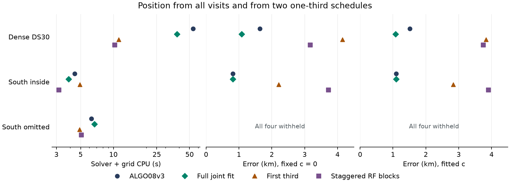

# What happens if each RF channel gets one continuous third of the scan?

Dense DS30-0008 took **10.29 CPU seconds** from saved detections through the position solution and numerical grid. Using all observations took **38.06 seconds** with the same joint solver. The reduced data yielded a fitted position error of **3.750 km**, compared with **1.080 km** on all observations and **1.512 km** for installed ALGO08v3. The southern containing offer also returned a less accurate fix. Both sparse policies missed the 0.25 km development tolerance on both containing recordings. [Frozen staggered policy](rf-block-protocol.md) · [Scored comparisons](measurements/rf-block.json) · [Continuous first-third comparison](contiguous-third.md)



| Input and supplied region | Used + warmup / admitted stereo visits | Selected factors, full → staggered | Solver CPU s, full joint → staggered | Horizontal error km, full joint → staggered, fixed zero / fitted | RF RMS Hz, full joint → staggered, fixed zero / fitted |
|---|---:|---:|---:|---|---|
| DS30-0008, containing | 2,253 + 60 / 6,765 | 7,016 → 2,391 | 38.06 → 10.29 | 1.086 / 1.080 → 3.171 / 3.750 | 128.82 / 128.75 → 127.72 / 127.55 |
| Southern simulation, containing | 400 + 20 / 1,200 | 456 → 190 | 3.85 → 3.15 | 0.817 / 1.101 → 3.726 / 3.903 | 6.50 / 6.39 → 5.05 / 5.02 |
| Same southern recording, distant omission | 400 + 20 / 1,200 | 456 → 190 | 6.43 → 5.09 | Both withheld | — |

Both containing fits completed the original evidence grid without a full solver fallback. Both had lower RF residuals under the staggered policy despite worse horizontal errors. On the dense recording the fit used 1,093 curved and 323 predictive observations per calibration arm. In the southern case it used 114 curved observations and zero predictive observations. The omitted southern case withheld through the existing two-receiver exterior test. These are two recordings and three offers, including one physical site. The two full-joint timings on the plot use fresh controls from the continuous-first-third experiment. The table uses the original full-joint receipts. [Original full-joint controls](blind-joint-signed.md) · [Complete staggered solver receipts](measurements/rf-block-solves.json.gz)

## Signal coverage and measurement

The supplied RF schedule had eight groups. Sorting the groups assigned three to the first third, three to the second and two to the last. Both antennas use the complete two-scan detector on retained opportunities. Previous same-channel, same-RF opportunities are charged whenever the original continuation can still consult them. These warmup calls restore its original candidates for twelve slots or eight seconds, whichever is shorter. The published rows come only from the assigned blocks. In contrast, searching the first third of all channels spends its entire signal budget at the start of the scan.

The experiment used authenticated, previously exported selections on those visits. The native continuation looks only at earlier candidate lists and counters, so paying for the required warmup recovers its state on each retained row. A component test verifies that property using the released continuation over competing carriers and real timing gaps. The solver kept the complete timeline, raw authority, archive and supplied region. Ground truth entered only in the scorer. These clocks measure solving and grid construction. They exclude raw reading, detector execution, and PNG rendering. Initial invocations had a study-runner initialization error before solver entry. The successful invocations initialized the pinned release before loading the packets. [Mask and runner](rf_block_trial.py) · [Scorer](rf_block_score.py)

## Reproduce on Gauss

```sh
r=/opt/leo-algo08/bdb869682a2ea63af4b198a920b763a4c6a78c4c
out=$(mktemp -d)
export PYTHONPATH="$PWD/reports/ALGO08/v3:/opt/leo-algo08/algo08v3/payload:$r/src:$r"
export OPENBLAS_NUM_THREADS=1 OMP_NUM_THREADS=1 MKL_NUM_THREADS=1 BLIS_NUM_THREADS=1 NUMEXPR_NUM_THREADS=1
for case_id in DS30-0008 south-containing south-far; do
  flock -x /tmp/leo-algo08v2-2x-bench/gauss.lock ionice -c2 -n7 nice -n15 taskset -c 2 \
    "$r/venv/bin/python" -BPs reports/ALGO08/v3/rf_block_trial.py "$case_id" "$out/$case_id.json"
done
PYTHONPATH="$PWD/reports/ALGO08/v3:$PWD:$PWD/src" \
  "$r/venv/bin/python" -BPs reports/ALGO08/v3/rf_block_score.py "$out" "$out/summary.json" "$out/solves.json.gz"
```
