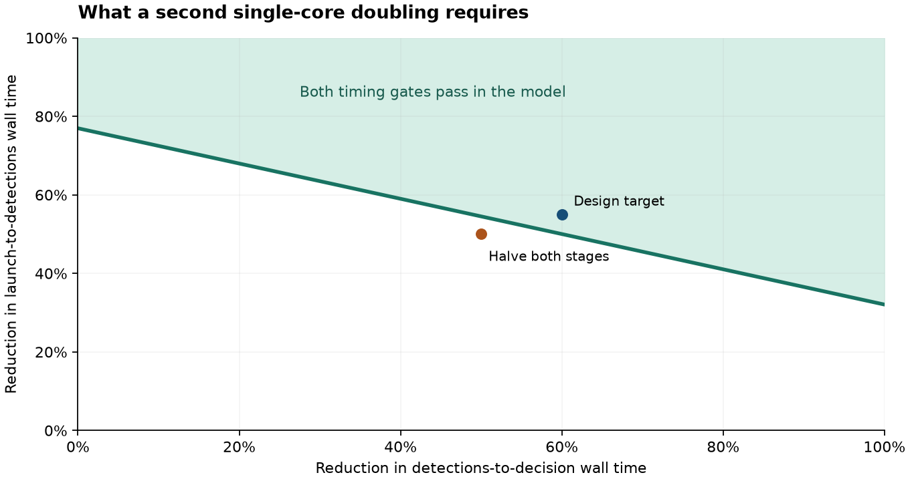

# Where the next single-core doubling can come from

Across 52 historical fixes with complete stage clocks, launch through signed detections accounts for **67.1%** of elapsed time, detections through the position decision for **30.1%**, and publication through exit for **2.8%**. The two release gates measure the median of each recording's candidate-to-v3 elapsed ratio and the ratio of the two elapsed-time totals. Both must be at most 0.500. The model below uses the original 55 recordings. It retains the full original time on the three processes with no stage split, charges the ordinary publication tail and applies the same proportional reduction within each eligible stage and recording. [Original clocks and wait sensitivity](twofold-budget-after-0402.md) · [Calculation and figure](second_doubling_frontier.py)

| Hypothetical elapsed-time changes | Median paired ratio | Ratio of totals |
|---|---:|---:|
| Free solves on the 13 longest solver stages, everything else unchanged | 1.0000 | 0.8892 |
| Same free solves and 50% less acquisition on every measured fix | 0.6264 | 0.5643 |
| Reduce acquisition and solving by 50% on every measured fix | 0.5135 | 0.5293 |
| Reduce acquisition by 55% and solving by 50% | 0.4799 | 0.4968 |
| Reduce acquisition by 55% and solving by 60% | 0.4509 | 0.4676 |

Even zero-cost solves on the most expensive quarter cover only 38.0% of historical solver time. Halving every solve still requires at least a **54.51% reduction in acquisition elapsed time** on this panel. For a 60% reduction in solving, the required acquisition reduction falls to **50.02%**. A target of 55% and 60% respectively leaves room for fallbacks. Reducing CPU while retaining storage waits moves the observed time by less. The most recent complete two-recording warm raw comparison still took **9.075 s versus 12.108 s**, ratios **0.568 and 0.750**. These model results and the targeted studies below add no new raw-to-exit pairs. [Original complete processes](unified-short-layout.md) · [Dense full raw run under different storage residency](dense-full-short-raw.md)

## Which changes earned further testing

| Research question | Measured result | Decision |
|---|---|---|
| How much of the exact solver's fallback cost can a wider compiled likelihood recover? | All 239 unsupported calls on 0402 ran through the wider implementation. Complete saved time fell to **49.712 s**, against 55.830 s for fitted-first alone and 73.351 s for historical stock. The two positions, RF residuals, all 4,821 ordered observations per arm, grid, path and eight PNGs matched stock. | Transfer to an independent saved packet. Half the 0402 historical raw clock is 60.719 s. Charging the 49.712 s saved process would leave 11.007 s for 8.177 GB of acquisition, before accounting for any shared startup. [Wider fallback comparison](wide-private-0402.md) |
| Can faster fitting preserve the observation list that gives v3 its accuracy? | A guarded handoff after the original paired roster was admitted cut DS30-0155 from 25.888 to 21.948 s, with the exact original positions, 3,498 observations per arm and eight identical images. Stock offered no profitable reassignment. | Check the guard on previously accepted alternatives and measure how frequently it can run. [Guarded handoff](pre-signed-hybrid.md) |
| Can an earlier orbital correction recover the 141 missing observations on DS30-0402? | One 48-row fragment failed the slope gate and took 32 predictive rows out of consideration. A different fragment lost 61 original observations at the final step gate. The earlier signed correction cost 0.582 CPU s and still failed that check. | Preserve the original assignment process while testing cheaper calculations underneath it. [Observation-by-observation trace](owner-loss-0402.md) |
| Can the exact solver and faster figures run together? | Saved DS30-0402 fell from 55.752 to 53.403 s. All original positions and observations matched. Two gray orbit layers missed the pixel threshold. On weak DS30-0016 direct drawing cut render CPU from 1.138 to 0.483 s with all eight qualified images. | Carry scientific and figure acceptance separately. The warm raw weak pair was deferred because zero original input pages were resident. [Dense comparison](named-combined-0402.md) · [Weak comparison](weak-cairo-combined-DS30-0016.md) |
| Does changing recording layout actually avoid receiver work? | On a saved DS30-0008 member, a seekable 12 ms prefix with an 8 ms extension avoided 35% of payload bytes and 54–70 ms of CPU under the mixed schedule. Reading all 20 ms cost 32–38 ms more. Legacy conversion and full verification cost 473 ms. | Consider it for new recordings or frequently repeated reads. It supplies zero fresh speedup evidence for the legacy DS30 release gates. [Receiver and verification experiment](seekable-member.md) |
| Does batching independent FFTs preserve the receiver while lowering single-core cost? | Using sample-major inputs raised short FFT kernel CPU by 41.5%, 56.1% and 163.9% at widths two, four and eight. Every tested width changed all 640 float32 transforms relative to scalar execution. | Stop at the transform boundary. These slower outputs never entered position estimation. [Saved receiver buffers and kernels](sample-major-fft.md) |

All physical DS30 recordings in these experiments came from one roof. A cheap regional screen retained the five tested valid offers and missed both held 1.5 km omissions. An accuracy-preserving candidate still needs the two calibration arms, geographic errors, fixes and withholds on containing and missing region offers, as well as the raw process gates. [Held geographic results](local-exterior-descent.md)

The frozen shortcut that saved 3.940 s on DS30-0155 was subsequently applied to saved DS23 diagnostics. It would keep the full satellite-family search on all **nine adopted replacements** under the archived sticky policy and all eight held controls that tested and rejected alternatives. It would skip the search on three of eight held zero-trial controls. This supports a narrower opportunity on recordings that never find a competitive alternative. The audit used recorded decisions and did not run the solver or measure elapsed time. [Adoption and coverage audit](hybrid-witness-archive.md)

The wider likelihood subsequently ran through the generic named CLI on independent DS30-0316. All **82** previously unsupported calls activated. Both arms retained the exact 1,976 ordered observations, positions, RF residuals, grid, path and eight original PNGs. Saved elapsed time moved from **18.140 to 17.881 s**, a **0.259 s** difference on one pair, versus **6.118 s** on the larger fitted-first 0402 solve. A separate reusable library build cost 0.627 s. The number of unsupported calls alone gives a poor estimate of the time this optimization can save. [Portable option, clocks and reproduction](named-wide-likelihood.md)

A crossed calculation on 0402 isolated two different causes of the aggressive solver's error. For one fragment the faster solver included an extra trailing observation. Removing just that observation made both arms pass with the fit held fixed. Adding it to the original fit made both arms fail. On the other fragment, changing position and orbital phase alone did not fix the gate. Its 48 curved observations passed with the original surrounding calibration roster. Losing that fragment also excluded 32 predictive observations. These comparisons identify bounded remedies to test without relaxing the original thresholds. [Fixed-state crossings and full gates](fragment-cross-0402.md)
