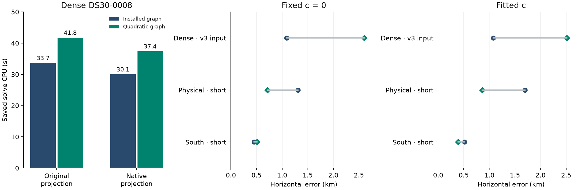

# A faster regional check and the cost of changing the track graph

The native projection saved **4.35 CPU seconds** on the candidate's dense quadratic-graph solve, **41.78 → 37.43 s**. All 25 regional decisions about individual probe locations, the final position in each calibration arm, 4,328 satellite assignments and roles per arm, and the entire numerical grid and path agreed with the original projection. On the public southern short-receiver recording, normal publication produced the identical terminal, grid scores, optimizer path and eight byte-identical figures. The same pipeline withheld on the displaced southern offer. Gauss used one low-priority single-core benchmark slot. [Matched dense pair](dense-quadratic-fused.md) · [Southern web evidence](measurements/short-geographic-publication.json)



## Track construction and position

The graph groups measured signal observations into tracks before satellite association. The candidate permits quadratic tracks with six observations and two observations per coefficient. We exchanged only that configuration in the same full-catalogue solver. The DS30-0008 packet contains installed v3 receiver measurements. DS30-0016 and the southern packet contain measurements from the actual short receiver. Each row uses identical waveform measurements, location offer and causal catalogue for both graphs. Ground truth entered after the replay outputs sealed. [Dense graph experiment](dense-quadratic-proxy.md) · [Short-receiver experiment protocol](full-short-graph-transfer-protocol.md) · [Scored rows](measurements/full-short-graph-transfer.json)

| Detector packet and offer | Installed graph, zero / fitted error (km) | Quadratic graph, zero / fitted error (km) | Solve CPU, installed / quadratic graph (s) |
|---|---:|---:|---:|
| DS30-0008, installed v3 detections | 1.088 / 1.079 | 2.603 / 2.512 | 33.677 / 41.783 |
| DS30-0016, short receiver | 1.311 / 1.694 | **0.710 / 0.861** | 3.038 / 3.026 |
| Southern simulation, short receiver, containing offer | **0.454** / 0.515 | 0.506 / **0.392** | 4.343 / 4.627 |
| Southern simulation, short receiver, 52.5 km omission | Withheld | Withheld | 3.451 / 3.831 |

The dense quadratic graph formed 322 tracks versus 236. It qualified all three finalists for full fitting and needed another signed fit. It reduced fitted RF RMS from 128.753 to 127.024 Hz even as fitted position error increased by **1.432 km**. On the short physical packet the quadratic graph improved fitted RF RMS from 120.291 to 108.046 Hz and horizontal error by **0.833 km**. Southern fitted RF RMS moved from 8.188 to 8.631 Hz while horizontal error improved by **0.123 km**. A lower fitted RF residual cannot reliably choose the graph. These development comparisons do not establish which graph fares better with genuine dense short-receiver measurements. [Dense graph, finalist and owner diagnostics](dense-quadratic-proxy.md)

## Geographic projection through the standard web publisher

The new compiled Gauss implementation calculates slant range, Doppler, phase derivative and horizon sign in one pass through contiguous arrays. The existing causal catalogue, track likelihoods, both receivers and the regional stopping rule still decide publication. The general full-short research entry exposes it with `--geographic-library`; its binary SHA-256 is `b8c8e0bb22e62fc69585909f193c76ab22ab4f2892d7fcbedd2cc31c78c573ee`. This build targets Haswell-compatible x86 CPUs. Embedded ARM timing is unmeasured. [Kernel and build](dense-geographic-kernel.md) · [Research entry](full_short_run.py)

| Southern publication using identical genuine short measurements | Original projection | Native projection |
|---|---:|---:|
| Valid offer, proof / whole solve CPU (s) | 0.566 / 4.627 | 0.323 / 4.300 |
| Far omission, proof / whole solve CPU (s) | 1.543 / 3.831 | 0.751 / 3.104 |

On the containing offer both runs published 519 owners per arm. The standard 137-point grid differed only in its elapsed-time field. Both far results withheld before fitting, with identical winners and a maximum receiver-score gain difference of 5.92×10⁻¹³. Earlier testing found a false fix when the southern reference was just 100 m outside the square. The projection change preserves the decision rule. [Publication regression protocol](short-geographic-publication-protocol.md) · [Near-omission test](full-short-transfer.md)

## An archived v3 failure

On DS30-0022, installed v3 failed before publication with an orbit-interpolation exception. The current quadratic solver took the ordinary orbit route and completed the saved handoff on its first attempt. It used the exact v3 detector packet from the failed run and required no extra support knots. The handoff through process exit took **25.17 s**; the numerical solve used **20.55 CPU s**. The publication returned all eight figures, both calibration fits with 2,439 assigned points each, and 179 complete grid points. [Regression protocol](full-short-orbit-transfer-protocol.md) · [Verified result](measurements/full-short-orbit-transfer.json)

| DS30-0022 outcome | Fixed / fitted error (km) | Fixed / fitted RF RMS (Hz) |
|---|---:|---:|
| Archived ALGO08v2 fix | 1.294 / 1.311 | 161.796 / 161.615 |
| Current solver on archived v3 detections | 1.292 / 1.419 | 147.976 / 147.984 |

This establishes numerical recovery on one prior failure. It does not establish raw end-to-end recovery with the shortened detector or change the historical v3 fix count.

## The 2× decision

The previous 55-recording model used **33.68 s** from the installed graph inside the candidate solver. Charging the actual quadratic graph and faster projection gives **0.557 median paired / 0.571 summed elapsed**, assuming the fastest measured short-reader prefix (231.52 MB/s), its worker overhead and optimistic sealing. The same model with the original projection gives 0.574 / 0.592. Charging one projected DS30-0022 recovery in place of its 110.77 s historical failure gives 0.554 / 0.562. That sensitivity adds its entire 25.17 s saved-publication cost to a modeled 36.15 s of raw ingress. None of these are 55 measured candidate runs. Both timing gates are 0.5. [Model and charges](short_graph_budget.py) · [Numerical projections](measurements/short-graph-budget.json)

A separate 8 ms receiver trial saved **15.5% of native detector CPU** on 192 real dense stereo visits while keeping all 20 ms anchor searches. It matched 38 of 43 position observations used by installed v3, versus 40 with the 12 ms receiver. Both losses were predictive observations. The calculation above retains the measured 12 ms reader rate. The 8 ms trial provides no position or whole-recording timing evidence. The larger Gauss evaluations remain on hold. [Eight-millisecond receiver evidence](eight-ms-primary.md)

### Reproduce the saved runs

Use a fresh output path for each invocation. The Gauss environment and shared-slot command are in the [southern transfer instructions](full-short-transfer.md#reproduce-on-gauss). For graph-only replay, use the installed release interpreter with the research script directory and installed payload first in `PYTHONPATH`, as in the [dense profile](live-inference-profile.md). The score commands use the repository Python environment. The physical dataset metadata requires the archived-data account. The general entry accepts the original recording, region, archive, saved packet and authenticated digest for the containing and far offers.

```text
full_short_graph_transfer.py {physical,south-inside,south-far} OUTPUT_PREFIX-CASE
short_transfer_score.py graph OUTPUT_PREFIX SCORED_JSON
full_short_orbit_transfer.py run NEW_ROOT
short_transfer_score.py orbit NEW_ROOT SCORED_JSON
full_short_run.py --recording RECORDING --archive ARCHIVE --region REGION --output NEW_ROOT --saved DETECTIONS --saved-digest NATIVE_SHA --geographic-library LIBRARY
short_transfer_score.py projector OUTPUT_PREFIX SCORED_JSON
short_graph_budget.py NEW_BUDGET_JSON
```

For the dense matched projector reproduction, use the exact graph-audit source captured by its sealed control. [Pinned experiment checkout and instructions](https://github.com/misko/leo-tracker-reduxredux/blob/d1ed2b4799a307413efd3872bac518935a2b4026/reports/ALGO08/v3/dense-quadratic-fused.md)
