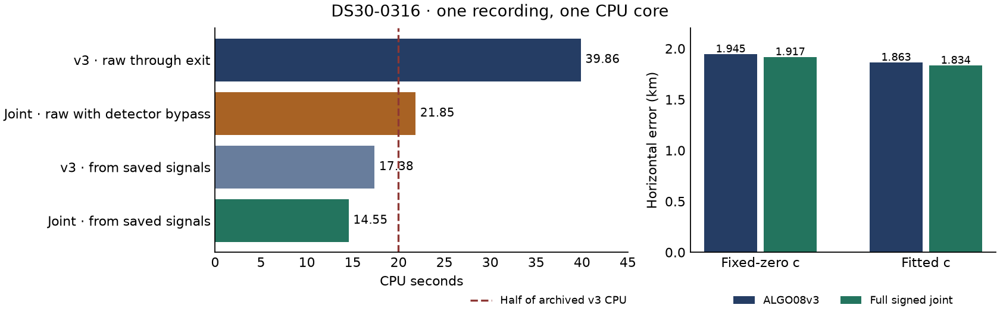

# How much time does a short recording leave for the receiver?

DS30-0316 returned a complete fix in both calibration arms with the full-coverage signed joint solver. From saved detections through eight published figures it took **14.55 CPU s**, compared with **17.38 CPU s** for installed v3. Reading the original recording, verifying it, supplying the archived receiver answers at every admitted visit, and running the same signed solver and publication took **21.85 CPU s**. Half of the historical v3 complete time was **19.93 CPU s** or **20.19 elapsed s**. Even this favorable receiver substitution leaves the current implementation above both historical half-time values on this recording. [Prespecified decision rule](short-recording-floor-protocol.md) · [Saved publication pair](measurements/signed-short-DS30-0316.json) · [Verified raw diagnostic](measurements/short-floor-DS30-0316.json)



| DS30-0316 measurement | CPU s | Elapsed s | Fixed-zero / fitted error (km) | Fixed-zero / fitted RF RMS (Hz) |
|---|---:|---:|---:|---:|
| Archived complete ALGO08v3 launch through exit | 39.856 | 40.371 | 1.945 / 1.863 | 99.232 / 99.054 |
| Fresh stock v3, saved detections through publication | 17.376 | 17.855 | 1.945 / 1.863 | 99.232 / 99.054 |
| Signed joint solver, same saved detections through publication | 14.551 | 14.576 | 1.917 / 1.834 | 99.594 / 99.435 |
| Verified raw traversal with archived detector answers, signed solve and publication | 21.850 | 25.258 | 1.917 / 1.834 | 99.594 / 99.435 |

Both signed arms kept all 1,976 stock observation assignments, including their satellite and role. Each added 26 observations. The two arms used the same supplied region, orbit archive, observations, other priors and search budget. Fitting the RF-dependent calibration lowered the signed solver's RMS by 0.159 Hz and its horizontal error by 83 m. Against stock, the signed solver improved the two position errors by 28 and 29 m while its frequency residual increased on the changed support. The geographic reference was opened after sealing the saved pair. DS30-0316 comes from the same physical site as the other DS30 development recordings.

## What the raw trial paid for

The standard reader handled all 3,042 scheduled windows from six segments, excluded the original 340 invalid windows, and submitted the other 2,702 in their original order. A lookup supplied both precomputed receiver rows only after matching receiver ID, visit, RF, channel, edge and sample counters to the current authenticated window. The input path regenerated the original 5,404 ordered probes and detection file byte for byte. The signed solver then ran from scratch, completed its 179-point grid and published the eight standard figures. Its terminal, path, all grid values, PNG bytes and decoded pixels matched the signed saved-input publication. [Input binding](short_recording_floor.py) · [Receiver substitution and publication audit](short_floor_raw.py)

The measured raw publication used 12.258 CPU s in the solve and 9.592 CPU s elsewhere. Lookup validation inside the publication cost 0.009 CPU s. Subtracting even that cost leaves **21.841 CPU s**, about **1.91 CPU s above** the historical half-CPU value before paying for any real detection. Loading the archived oracle document cost a further 0.012 CPU s outside the publication clock. With all other work fixed, the receiver and solver together have **10.35 CPU s**. For example, a solver taking half of the measured 15.178 CPU s for stock would leave **2.76 CPU s**, or **1.02 ms per stereo visit**, for detection. This is one recording and an additive cost diagnostic. The release gates use the median and sum of paired complete elapsed times across recordings.

The original v3 comparison started fully cached. In the diagnostic, the first post-run auditor treated the grid's own elapsed-time field as part of its scientific contents and rejected it. The two grids differ only in that field, 1.780 and 1.801 seconds. Rechecking the persisted outputs verified the scientific and image equality without another raw read. The initial observer had yet to save its cache snapshot and external launch-to-exit clocks when it stopped. Those fields are marked unavailable. The raw CPU and elapsed values above were independently saved inside the publication process before the audit. Startup before that clock and post-publication verification are excluded. The corrected observer persists cache and timing before auditing. A preliminary saved-input launch under the workspace account also stopped on recording-directory permissions before acquisition. The measured experiments used the normal recording account.

## Dense receiver and solver budgets

The dense DS30-0008 stage clocks give a separate, optimistic budget calculation. Its historical half-CPU value is 55.54 s. A real eight-frame receiver reduced native CPU on its 96-lane slice, but retained 56 of 80 signals at the same scan rank and allowed timing and frequency errors. Transferring its measured callback ratio to the full dense acquisition gives **44.36 CPU s** before the solver starts. Even granting free publication, that leaves **11.18 CPU s** for position solving. An ideal selector that retries every lane falling outside those signal tolerances leaves just **0.21 CPU s** for solving and publication. These are projections across separate runs. They explain why a nominal 24-second solver and the tested eight-frame receiver still do not form a credible combined 2× candidate. [Measured receiver gates, costs and transfer assumptions](short-signed.md) · [Dense input timings](acquisition-split.md)

## Reproduction

From a research checkout on Gauss, use the installed numerical release and the same saved recording and archive. Supply a fresh directory owned by the recording account. The second command proceeds only if the fresh saved publication passes its time and accuracy screen. The measured comparison used one pinned core at nice 15, best-effort I/O priority 7 and one numerical thread.

```bash
runner="$PWD/reports/ALGO08/v3"
work=$(sudo -n -u leo mktemp -d /var/tmp/leo-short-floor.XXXXXXXX)
bench() {
  flock -x /tmp/leo-algo08v2-2x-bench/gauss.lock ionice -c2 -n7 nice -n15 taskset -c 2 \
    sudo -n -u leo env PYTHONPATH="$runner:$PWD:$PWD/src" OMP_NUM_THREADS=1 OPENBLAS_NUM_THREADS=1 \
    MKL_NUM_THREADS=1 NUMEXPR_NUM_THREADS=1 BLIS_NUM_THREADS=1 \
    /home/mouse9911/gits/leo-tracker-reduxredux/.venv/bin/python -B "$@"
}
bench "$runner/short_recording_floor.py" "$work/pubs" "$work/score.json"
bench "$runner/short_floor_raw.py" measure "$work/floor" "$work/score.json"
```
