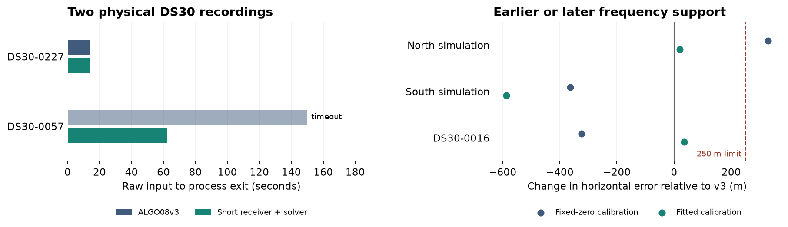

# Two raw DS30 workloads and two tests of short-receiver selection

The combined 12 ms receiver and compact solver produced the same scientific decisions as installed ALGO08v3 on the smallest previously withheld and smallest previously fixed recordings in the 100-recording DS30 archive. Both builds withheld on DS30-0227. Both sealed a two-arm position result on DS30-0057, and the candidate's position was more accurate in both calibration arms. The fresh installed process timed out while writing figures on DS30-0057. The two assignments are retained in the timing analysis.

| Recording | Visits | Candidate raw through exit | Installed ALGO08v3 raw through exit | Quality |
|---|---:|---:|---:|---|
| DS30-0227 | 18 | 13.77 s, 3.38 CPU s | 13.65 s, 1.29 CPU s | Both withheld for lack of active curvature |
| DS30-0057 | 2,717 | 62.52 s, 21.61 CPU s | No complete clock at the 150 s timeout | Fixed-zero / fitted error was 240 / 297 m for the candidate and 426 / 525 m for v3 |

The candidate used the unfiltered short receiver, installed track graph, native regional scoring and projection, cold-row and grid-phase reuse. All eight candidate images on DS30-0057 were decoded and verified. Its RF residuals were **125.30 / 125.31 Hz**, compared with **109.97 / 109.83 Hz** for v3. The fresh installed terminal matched its archived scientific output. Its archived eight figures were verified separately. Both timed arms started with all input pages resident. The installed process reached its terminal in **39.59 s**, while the candidate reached its terminal in **42.34 s**. At the timeout the installed process was blocked on output synchronization. The time spent waiting for termination forms no part of a completed publication clock. [Matched raw measurements and reproduction](short-raw-diagnostic.md)

The one-recording candidate/stock elapsed fraction was **1.009**. For two recordings the exact median is unknown, but it must exceed **0.504** even if the censored candidate/stock ratio approached zero. Therefore the median gate of 0.500 was missed on this diagnostic subset. The summed elapsed fraction has an upper bound of **0.466** under the 150 s censoring bound. Heavy output contention, deliberate selection of short workloads, one physical site, and only one shared fix limit performance and accuracy conclusions. Larger raw panels remain unwarranted for this build.

## Eliminating unnecessary regional work on DS30-0227

The original short receiver supplied 13 factors but produced no graph tracks on the 18-visit recording. The early region check spent **2.07 CPU s** building a causal satellite catalogue before the track scorer reported that it could not evaluate an empty graph. The optional `--skip-empty-proof` bypasses that catalogue only when the graph is empty. The ordinary solver retains control of the final decision. A fresh saved-input pair reproduced the raw terminal digest, withheld decision and empty image set. Solve CPU fell from **2.171 to 0.101 s**, and complete saved-publication CPU fell from **3.252 to 1.190 s**. These saved clocks exclude raw acquisition and the option was added after the two-case raw diagnostic. [Exact replay](measurements/empty-graph-pair.json) · [Replay driver](empty_graph_trial.py)

## Which frequency evidence transfers?

The prespecified two-sided rule keeps a signed measurement if the unmodified carrier-history test selects it looking backward or forward along the same radio/RF sequence. This charges about **10–11 ms CPU** per saved test for selection and construction of the rebound packet in memory. An offline pass can use future evidence. A streaming implementation must delay decisions up to the existing eight-second horizon.

| Development containing offer | Additional factors rescued by future support | Assigned rows in each arm, past only → either direction | Either-direction error, fixed / fitted | Difference from stock, fixed / fitted |
|---|---:|---:|---:|---:|
| DS30-0016 physical | 69 | 107 → 116 | 1,320 / 1,697 m | −323 / +36 m |
| Northern simulation | 72 | 304 → 302 | 434 / 160 m | +328 / +20 m |
| Southern simulation | 72 | 266 → 468 | 454 / 515 m | −363 / −587 m |

All three returned both estimates and all eight figures. Northern frequency residual RMS was **6.91 / 6.49 Hz**, yet fixed-zero error exceeded the prespecified 250 m development tolerance. The added factors changed which tracks the solver chose. On weak physical data it kept all previously assigned observations and added nine, preserving both satellite labels and roles on the common rows. In the north it lost 77 assignments, gained 75 and changed the role of 18 surviving rows. In the south it gained 202 assigned observations without losing any. The northern failure ended this variant's evaluation before expansion to DS30-0057. [Selection protocol](bidirectional-selection-protocol.md) · [Paired ownership changes and scientific receipts](measurements/bidirectional-selection.json)

A separate worker tested adding simultaneous two-radio support to the forward-only rule. It rescued **zero** observations on all three offers and reproduced all causal-only positions and 24 figures. On physical data, timing coincidence alone could cover just five of the 119 rejected factors. On each simulation, using timing alone would reintroduce 72 factors where stock had selected none. [Stereo comparison](short-stereo-evidence.md)

## Compute budget for the next iteration

- Fusing Zstandard block decoding with the two required SHA checks saved **16.65–22.72 ms of whole acquisition CPU** on one dense 64-window member, or **5.6–7.4%**. All original signed detections matched in both run orders. Peak memory increased by about **94 MiB**, and the decoder alone performed similarly to the earlier system streaming decoder. This is a member-level result. [Decoder implementation, memory and timing](fused-block-input.md)
- A hypothetical **250 MB/s acquisition and 16 s dense solve** leaves **11.74 s total** for quality repairs across the original four-recording roster before the summed gate fails. The median can bind sooner. If only DS30-0008 needs repair, its additional allowance is **2.62 s**; for DS30-0001 it is **2.17 s**. Sending any one of the four directly to full stock would miss at least one gate, even with perfect advance routing. On the first 16, exactly one of 15 instrumented cases could be sent to stock individually while retaining both modeled gates. The remaining case already carries its original clock. These are conditional budgets, not observed 4- or 16-recording runs. [Calculation](quality_retry_budget.py) · [Per-case budgets](measurements/quality-retry-budget.json)

The assignment comparison suggests testing a local repair that preserves tracks already supported by past observations and attaches additional measurements only where the same satellite explains their Doppler. The weak and northern saved packets distinguish recovery of missing information from displacement of already useful observations. A credible candidate must charge the cost of that repair, any fallback, and publication, then repeat both raw timing gates on a representative roster. The current experiments do not establish 2× without accuracy loss.
