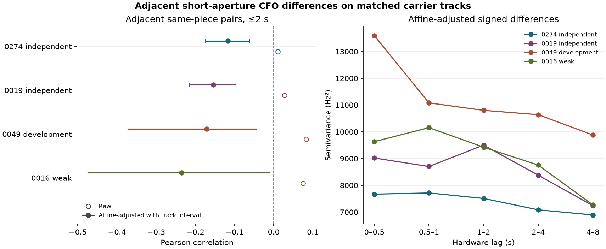

# Adjacent signed CFO differences on matched Graph tracks

Consecutive measured short-aperture CFO differences show no strong positive correlation on either independent complete recording. On DS30-0274 and DS30-0019, raw adjacent correlations are **0.010 and 0.028**. After subtracting a matched run's affine trend, they are **−0.116 and −0.154**. Both radios give the same qualitative result. The correlation gate for adjacent blocking fails, and the study ends at the saved-packet comparison. [Frozen protocol](signed-cfo-time-protocol.md) · [Scored receipt](measurements/signed-cfo-time.json.gz) · [Candidate-only block plan](measurements/signed-cfo-time-plan.json.gz)

## Carrier and track scope

Each comparison joins the original session, visit, RF, pilot edge, channel, receiver, 10 MS/s hardware counter and admission clocks. Both original packets supply the selected signed factors. The primary match requires at most **250 Hz** difference in continuous CFO without a native alias roll and **two samples** of absolute epoch difference. The relaxed signed-frequency and frame-wrapped epoch gate identified the same short matches in these four pairs. The released Graph prep reconstructs both tracks and original polynomial pieces from each packet. Its successor counts match the corresponding live witness. A run splits on either original piece boundary, a missing member, changed relative Graph alias or more than eight hardware seconds of gap. Graph uses its original slope rule, aliases and geometry-independent polynomial gates. Near-frequency matches are evidence of a common carrier and do not independently identify a transmitting satellite. [Readout and authority checks](signed_cfo_time_readout.py)

| Scope | Common positive short lanes | Same-atom short matches | In paired Graph pieces | Common positive full-anchor lanes | Byte-identical full-anchor factors | Mean / RMS short difference, Hz |
| --- | ---: | ---: | ---: | ---: | ---: | ---: |
| DS30-0274 independent | 4,778 | 3,954 | 3,620 | 805 | 777 | +17.0 / 99.4 |
| DS30-0019 independent | 3,442 | 2,888 | 2,628 | 577 | 558 | +15.5 / 106.9 |
| DS30-0049 development | 356 | 284 | 261 | 71 | 71 | +12.9 / 114.4 |
| DS30-0016 weak | 303 | 245 | 213 | 58 | 57 | +13.6 / 116.9 |

Every same-atom full-anchor difference is exactly zero. Its correlation is undefined at zero variance. The remaining common-positive anchors on three captures selected different measurements. For example, DS30-0274's full-anchor differences before the same-atom screen ranged from −223 to +311 kHz. These are a check on the aperture and carrier identity separation. Neither those comparisons nor the 824 and 554 unmatched common-positive short lanes on the two independent captures enter the primary correlation. [Original development receiver accounting](ds30-0049-publication-forensic.md)

## Signed CFO dependence and residuals

| Scope | Raw adjacent r / pairs | Demeaned r | Affine-adjusted r / pairs | Original selected track clusters | Track bootstrap 95% interval | Radio 0 / 1 adjusted r |
| --- | ---: | ---: | ---: | ---: | ---: | ---: |
| DS30-0274 | +0.010 / 2,437 | −0.063 | −0.116 / 1,762 | 99 | [−0.175, −0.062] | −0.130 / −0.098 |
| DS30-0019 | +0.028 / 1,606 | −0.066 | −0.154 / 998 | 61 | [−0.215, −0.096] | −0.164 / −0.140 |
| DS30-0049 | +0.083 / 167 | −0.046 | −0.171 / 103 | 8 | [−0.372, −0.043] | −0.178 / −0.050 |
| DS30-0016 | +0.075 / 146 | −0.115 | −0.235 / 112 | 8 | [−0.474, −0.009] | −0.198 / −0.308 |

The stricter immediate same-lane opportunity subset gives −0.127 on DS30-0274 (1,163 pairs) and −0.128 on DS30-0019 (688 pairs). The corresponding semivariances from the shortest to the 4–8 s bin fall from **7,668 to 6,892 Hz²** and **9,021 to 7,239 Hz²**. They do not rise with lag as expected under a large positive short-lag component. The finite-run subtraction of a mean and slope can induce negative correlations. The raw correlations, which stay near zero, and the strict adjacency check carry the more restrained interpretation that there is no evidence here of strong positive duplication. The intervals resample whole candidate tracks and describe these conditioned matched runs. They do not adjust for carrier eligibility or generalize to the unpaired measurements.

The original Graph-polynomial residuals give a separate empirical trend diagnostic. Affine-adjusted installed / candidate lag correlations are **−0.084 / −0.098** on DS30-0274 and **+0.016 / −0.043** on DS30-0019. The pair difference cancels much of a common Doppler trend at the same counter. Since both receivers use overlapping original samples and the installed CFO is a reference measurement, the difference cannot identify the 8 ms measurement's own covariance or any common RF-model error. An array of calibrated signed residuals per observation was unavailable for these publications. Aggregate RF RMS and rendered pixels cannot provide this missing series.

The two arms use the same published owner scopes in this readout. DS30-0049's exact common owner-and-role subset has 222 matched Graph rows, 80 adjusted adjacent pairs and correlation **−0.153** in each arm. DS30-0016 has 100 rows, 57 adjacent pairs and **+0.029**. The existing official digest confirms each owner book. On the independent cases only the successor's exact row keys are available. Its published owners comprise 3,595 and 2,459 matched Graph rows, with **−0.116 and −0.162** adjusted correlation respectively in both arms. These are receiver differences on owned support. They do not estimate calibration-arm fit residual covariance or position error. [Published owner evidence](ds30-0049-saved-crossover.md)

## Candidate-only blocking exposure and cost

The frozen plan preserves every full anchor and original piece endpoint. It proposes pairing two consecutive interior short rows with the same Graph alias at most two seconds apart. The possible proposal would use **the mean of two signed observations against the mean of two original exact projections**, retaining both times and using a covariance-aware variance. Matching or blocking never reads an installed factor, owner or survey. Full-data visibility, shortlist verification and both final calibration solves would remain on the original rows.

| Scope | Curved rows before proposal | Disjoint proposed pairs | Pair-moment row reduction | Archived whole rank, CPU s | Proportional share of whole rank, CPU s |
| --- | ---: | ---: | ---: | ---: | ---: |
| DS30-0274 | 3,776 | 1,358 | 36.0% | 3.127 | 1.125 |
| DS30-0019 | 3,058 | 1,076 | 35.2% | 2.520 | 0.887 |
| DS30-0049 | 268 | 97 | 36.2% | 0.385 including retry | 0.139 |
| DS30-0016 | 124 | 46 | 37.1% | 0.129 | 0.048 |

The last column gives a deliberately generous row-proportional comparison. It includes upstream and downstream rank scopes that would stay paid. Both independent cases must still open both original predictions, retain the existing catalogue and charge original gates, finalist scores and fallback. The archived unpruned dense white-profile leaf was **0.843 CPU s** inclusive. Applying the independent 35–36% row fraction to that separate leaf gives **about 0.30 s** of scale before any compaction, packing, covariance or proof costs. The hard per-case ceiling remains the whole recorded rank. Neither proportional number is a measured new clock. The preceding 16-knot quadrature used sparse original times and lost dense branches even with full final fits. Pair moments would change a different input boundary and still need an early proof to preserve challenger evidence. The present signed correlation evidence supplies no reason to pay for that integration. [Existing rank and exact leaf audit](cold-exact-budget.md) · [Frozen current rank attribution](compact-rank-scope-audit.md) · [Earlier quadrature failure](guarded-discovery-quadrature.md)

The protocol was committed at `c7fcca8d6` and the as-run reducer at `008b9037d`. The candidate-only plan expands to SHA-256 `da31507fa6247299e05f78cf50316c869db907dd039e9cd9fdc2e7d8df5561e5`. The scored receipt expands to `ff6772746c14d336c4f20fcedb341bf6aa8f28b8098569880536bc4988a5cdcb`. Four component tests passed. Reproduce with `signed_cfo_time_readout.py FRESH_PLAN.json` using the installed release interpreter, pinned release `src` on `PYTHONPATH`, one numerical thread, nice 15 and I/O priority 7. The readout pinned its three installed Graph and frequency modules before the eight Graph passes. Those are saved metadata computations and no timing experiment. The ordinary paired-case CPU lease stayed available throughout. [Component tests](../../../tests/pipeline_eval/test_signed_cfo_time.py)
