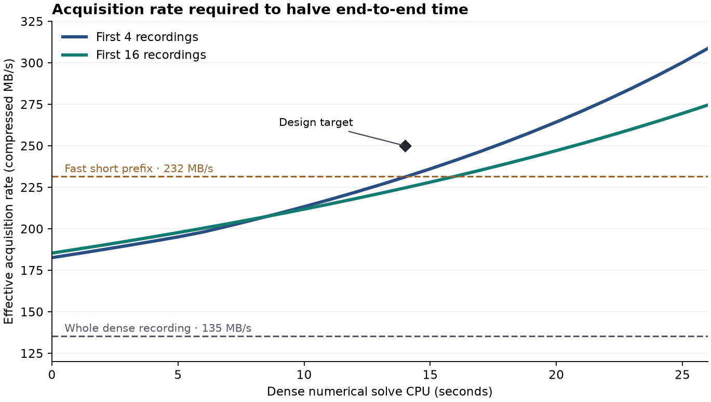

# Where another 2× over ALGO08v3 could come from

On dense DS30-0008, a complete short-receiver candidate took 95.43 s through process exit against a historical named-v3 launch of 149.89 s. Initial input residency differed. On a fully resident weak physical pair, a different combined build took 8.90 s against 10.83 s. These are 1.57× and 1.22× on individual recordings. We have yet to qualify one candidate at 2× across a roster. A fix includes both calibration arms, numerical evidence and eight web PNGs. [Dense raw run](dense-full-short-raw.md) · [Weak raw pair](weak-combined-raw.md)

## The time budget

The figure gives the sustained rate from original signed input through detections needed to meet both elapsed gates at a given dense solver cost. A point above both curves passes the timing model for both rosters. Each curve accounts for the original publication tails, fixed overhead and unchanged uninstrumented cases. The model scales per-recording solver time with the dense clock. Neither the relative solve costs nor the acquisition rate are guaranteed to transfer. [Plot calculation](timing_frontier.py) · [Frozen cases and assumptions](measurements/regional-dense-budget.json)

| Assumed effective acquisition and dense solve | First 4, median / summed elapsed ratio | First 16, median / summed elapsed ratio |
|---|---:|---:|
| 135.35 MB/s and **free** solve | 0.649 / 0.657 | 0.630 / 0.644 |
| 135.35 MB/s and 21.78 s | 0.802 / 0.783 | 0.751 / 0.750 |
| 231.52 MB/s and 21.78 s | 0.556 / 0.530 | 0.522 / 0.528 |
| **250 MB/s and 14 s**, proposed target | **0.474 / 0.459** | **0.446 / 0.467** |
| 240 MB/s and 12 s, alternative target | 0.473 / 0.462 | 0.441 / 0.470 |

The median is the median of paired candidate/v3 ratios. The summed ratio divides total candidate elapsed by total v3 elapsed. Both must be at most 0.500. The full dense raw run measured 135.35 MB/s including DSP. The 231.52 MB/s measurement covers a short prefix. Even a free solver needs 183 MB/s on the first four and 185 MB/s on the first sixteen with the other assumptions fixed. At 21.78 s the requirements rise to 276 and 255 MB/s. The 14 s and 250 MB/s alternative leaves room to charge some quality checks. [Inputs and timing model](dense-protected-cost.md)

Relative to the measured dense acquisition, 250 MB/s requires about 85% more throughput. On the more accurate 26.10 s unfiltered dense solver, 14 s requires a 46% cut. Even removing its entire 5.72 s cold search would leave 20.38 s. The next solver prototype therefore needs to save work in more than initial satellite discovery. [Same-packet solver ceiling](track-moment-exact-rescore.md)

## What the saved recordings tell us

- **The original three shortcuts have too little work to remove.** Early stopping of losing refinements, static layout reuse and region-based fine-recovery pruning have an optimistic combined dense ceiling of 12.34 CPU s, against the 54.55 s needed to halve v3 dense CPU. Together they saved 0.16 CPU s on the matched-cache weak pair. [Three-change prototype](bounds-combined.md)
- **A shorter receiver can produce a better fix.** Unfiltered short observations with the later solver gave 0.919 / 0.857 km on DS30-0008 and 0.240 / 0.297 km on DS30-0057. The faster, filtered solver plus local repair gave 2.298 / 2.238 and 0.708 / 0.937 km. Named v3 gave 1.639 / 1.512 and 0.426 / 0.525 km respectively, fixed-zero / fitted. The filtered dense solve cost 21.78 CPU s against 26.10 s unfiltered. It failed the accuracy screen. [Dense comparison](dense-protected-cost.md) · [Second recording](local-future-transfer.md)
- **A better frequency fit can pick a worse location.** On a northern simulation, keeping satellite labels and roles while removing weak rows improved fixed-zero RF RMS from 69.40 to 8.02 Hz but worsened horizontal error from 0.390 to 0.742 km. Rebuilding the assignments on the same causal packet gave 0.128 km. The independently erased DS30-0057 time block also failed to favor the tested repair in aggregate held-frequency error. One weak block yielded just one eligible forecast. [Controlled assignment ablation](fixed-causal-estimation.md) · [Erased-block validation](erased-block-repair.md)
- **Exact final scoring cannot rescue a discarded candidate.** On dense data all seven approximate branches differed from all seven full-observation branches before exact scoring. The closest still differed on 10 of 111 owners. A new fast solver must track where the correct branch first becomes unavailable. [Exact recheck](track-moment-exact-rescore.md)
- **Geography remains a separate failure mode.** The protected solver withheld on both northern and southern offers missing truth by 52.5 km, but published on both that missed by 100 m. Reusing identical regional answers saved 0.45 s on one boundary case while preserving its false fix. The one-receiver shortcut saved 0.28 CPU s on average on dense input and cost time on a far veto. [Omission panel](local-future-omissions.md) · [Exact reuse](terminal-proof-reuse.md) · [One-receiver experiment](bilateral-veto-disproof.md)
- **Changing the sample placement trades one kind of receiver error for another.** Centering 12 ms improved matches to the strongest v3 factor from 27 to 29 on 36 weak lanes, while matches to its first factor fell from 30 to 28. On the 48-visit dense panel the strongest matches held at 30, with one antenna gaining one and the other losing one. Centering failed the prespecified transfer screen. Spreading eight pilot frames across 20 ms improved weak first-factor matches by one, but its selected-output filter still cost 13% more native CPU on weak lanes and 8% more on dense nonanchors than the contiguous short receiver. These are signed receiver comparisons. The complete positions remain unmeasured for both aperture changes.

The centered, distributed and split-spectrum studies carry the signed waveforms, per-lane results, original probe identities and computational receipts needed to recheck these conclusions. The split-spectrum tracing preserved all 116 factor/flag results and added 1.34% / 2.26% native CPU on the dense / weak samples. [Centered aperture](centered-primary.md) · [Distributed frames](distributed-aperture.md) · [Split-spectrum uncertainty](split-spectrum.md)

On the exact intersection of all three aperture trials, an answer-key selector that chooses among prefix, centered and distributed per lane could match 34/43 strongest stock factors on dense nonanchor data and 34/36 on the weak clips. Prefix alone matched 30/43 and 27/36. All three short choices miss the other nine dense and two weak reference factors. Their importance for localization can be checked against saved observation owners. The same three-way ceiling against stock rank zero was 35/43 and 35/36. Choosing the largest observed candidate margin after paying for all three calls matched 33 strongest factors in each cohort. [Saved-archive comparison](aperture-factor-union.md)

## Ten directions ranked by the next experiment I would fund

| Rank | Direction | Small test and decision |
|---:|---|---|
| 1 | **Measure the physical acquisition limit with paired controls.** On the same original members, time read-only, read+verify, and read+verify+DSP. Compare matched initial page residency and measure blocked reads. If storage has headroom, overlap a bounded slice of eligible orbit preparation with an outstanding read on the same core. | Dense acquisition had 28.05 s elapsed outside process CPU. At most 3.36 CPU s of the dense solve is even potentially eligible initial work, and that includes graph work requiring detections. Verify the visit-zero time bracket, causal catalogue, region and duration before reuse. Include wasted speculation on empty cases. If sustained physical throughput itself falls below the plotted minimum, ordinary DSP or solver tuning cannot close that gap on this path. [Raw budget](revised-2x-priorities.md) · [Setup audit](live-orbit-setup-audit.md) · [Prefetch](public-short-prefetch.md) |
| 2 | **Choose a short aperture once; spend a full call only where it can matter.** The answer-key union above bounds how often aperture selection can recover a reference factor. | Prefix and distributed already match the four archived owner lanes in the entire dense member. Replay the differing rows in a saved packet to see whether they change later track formation, either fit or a withholding decision. Price the cheapest usable short call plus full recoveries under ideal routing before trying a waveform-based selector. |
| 3 | **Design a cheaper widely spaced aperture.** Keep a few distant frame pairs for Doppler leverage while trimming expensive filter support. | Use the eight-frame control to check which paired frames independently support the same signed peak. Price four or six selected frames *including* all filter wings and fixed overhead before implementing the complete receiver. Stop if removing any pair consistently loses weak or secondary carriers. |
| 4 | **Detect a competing peak before paying for a retry.** Test whether a second plausible joint timing/frequency peak, separated from the first by an alias interval, predicts which carriers need a full call. | First price an ideal retry using saved stock references, then test one fixed competition statistic on unseen lanes. An earlier half-frame disagreement metric recovered a planted 70 Hz split but gave rank correlations of −0.084 and +0.057 with recorded CFO errors on dense and weak lanes. Retire that metric. Charge any extra peak search and full retries. |
| 5 | **Propose a position from Doppler changes, then score absolute Doppler.** On a candidate arc, differencing across time removes its constant offset. Use small batches from several geometrically distinct arcs to generate solver starts, then verify their satellite identities, aliases and the complete original objective. | Compare the true full-data winning branch's availability, proposal cost and final position in both arms on dense and weak packets. Differencing can amplify noise and leave position poorly constrained with short parallel arcs. Charge the full search whenever proposals are ambiguous. |
| 6 | **Batch the exact regional checks over nearby candidate positions.** Lay out a small block of positions together and stream each track/time/orbit row through it once on the same core. | Run one 25-point inside decision and one 96-point positive veto. Require the same probe scores, owners and stop point. Charge extra positions computed past an early exit. The entire early check costs 3.32 s on the protected dense solve. [Stage breakdown](dense-protected-cost.md) |
| 7 | **Solve ambiguous satellite assignments locally.** Build a graph linking tracks that compete for satellites, aliases or a calibration parameter. Re-evaluate connected ambiguous groups at each shared-parameter trial while carrying the rest of the objective exactly. | First measure component sizes and cross-group coupling on saved full-observation winners. If nearly everything is connected through shared calibration, or an independent solve drops the winner, stop. Rank and retry are part of the measured bill. |
| 8 | **Batch exact grid likelihoods across positions.** Keep the published grid, each arm's prior and stopping rule. Test arranging several independent grid points in SIMD lanes with separate convergence masks to share row traversal. | Test a strip including an edge and the minimum. Check every score, both minima, the endpoint replay and the eight images. A perfect replacement could save at most the 4.46 s numerical-evidence stage on the protected dense case. Prior phase caching alone saved 0.21 s. [Exact reuse already measured](grid-phase-state-reuse.md) |
| 9 | **Budget ambiguity at the region face.** Compare likelihood for signed position changes normal to the face using observations held out by time or radio, after accounting for nuisance parameters. | Freeze a rule on paired containing and 100 m omitted offers across different latitudes and face orientations. Report false fixes and valid fixes withheld separately. An uncertain face decision is a reason to withhold or pay for evidence. Count its cost on every affected case. [Current near-edge behavior](local-future-omissions.md) |
| 10 | **For future captures, make selective reads verifiable.** A new, independently decodable and authenticated block layout could make it possible to read only the samples the receiver actually needs. | Offline, encode a duplicate of one saved member and charge capture bytes, encoding time, all required hashes, actual reads and recovery on weak lanes. Preserve the original archive. This is a separate future-input experiment. Any gain against a changed input contract is ineligible for the current DS30 raw-input gate. [Current decode and integrity costs](dense-ingress-attribution.md) |

The first combination to price is a verified acquisition path with measured overlap, the cheapest aperture that passes physical and geographic controls, and a solver retaining unfiltered discovery until an alternative reproduces its useful branches. Count fallback, withholding, both calibration fits, diagnostics and all eight PNGs. Use weak/dense physical and independent simulated controls first, then four matched raw recordings, then the frozen sixteen if the four pass. DS30 is one physical site. A fresh physical-site test is still needed to establish field transfer. Gauss uses one low-priority core and one benchmark slot.
