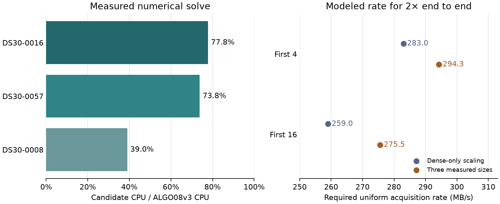

# Dense solver speedup overpredicts the gain on smaller fixes

On matched original recording identities, the cumulative numerical solver used **78% of ALGO08v3 CPU on weak DS30-0016, 74% on medium DS30-0057 and 39% on dense DS30-0008**. All three comparisons use the original graph, both calibration fits and complete numerical evidence. Applying the dense fraction to medium predicts 3.866 CPU s. The actual medium solve took 7.321 s. Applying it to weak predicts 1.308 s, versus 2.612 s measured. The dense proportional budget understates measured solve costs on both smaller physical examples. [Frozen method](solver-transfer-budget-protocol.md) · [Reproducible calculation](solver_transfer_budget.py) · [Numerical receipt](measurements/solver-transfer-budget.json)

| Physical case | Stock solve CPU s | Candidate solve CPU s | Estimate using dense fraction, s | Measured minus estimate, s |
|---|---:|---:|---:|---:|
| DS30-0016 weak | 3.356 | 2.612 | 1.308 | +1.304 |
| DS30-0057 medium | 9.917 | 7.321 | 3.866 | +3.455 |
| DS30-0008 dense | 60.966 | 23.769 | 23.769 | 0 by construction |

Weak stock comes from the earlier raw run with the stock-control numerics. Its 440-factor detector digest and the candidate's 475-factor digest both match the later paired originals. Medium uses the two authentic full and 20/12 ms saved packets with common inventory and region. Dense uses the historical stock numerical clock and the later saved candidate on its genuine short packet. These clocks describe the receiver's effect on downstream work as well as solver changes. They were taken in different sessions. The additional dense graph optimization measured 22.756 CPU s; the two smaller table entries used the original graph. [Weak stock timer](measurements/full-short-DS30-0016-raw.json.gz) · [Weak candidate timer](unified-short-layout.md) · [Medium publication](cumulative-medium.md) · [Dense saved publication](cumulative-dense-graph.md)

## Effect on the two timing gates

Keep the historical panel, publication tails, common overhead and acquisition model fixed. For the sensitivity anchored at all three sizes, interpolate candidate solve time against the original solve time, continuing the final segment beyond dense. The first-four baseline detections-to-terminal spans range from 23 to 57 s. Those clocks are elapsed, used as proxies for stock numerical CPU. The first sixteen include one unsplit failure charged in full. The three physical anchors come from one roof. Interpolation tests the consequence of an observed mismatch in scaling and has yet to be validated prospectively.

| Solve assumption | First 4 required MB/s | First 16 required MB/s | First 4 median / summed elapsed ratio at 292.39 MB/s |
|---|---:|---:|---:|
| Original graph, dense fraction everywhere | 290.52 | 263.65 | 0.498 / 0.468 |
| Original graph, three measured sizes | 301.88 | 279.98 | 0.509 / 0.485 |
| Faster dense graph, dense fraction everywhere | 282.99 | 258.99 | 0.491 / 0.462 |
| Faster dense graph, measured original graph at weak and medium | 294.29 | 275.53 | 0.502 / 0.480 |

The last two rows explain why the earlier projection of a passing first-four pair of gates at the weak recording's observed warm rate is fragile. The median crosses 0.500 under the alternate solve assumption. The difference between 292.39 and 294.29 MB/s is smaller than plausible measurement and transfer variability. At the earlier dense acquisition CPU-only rate of 252.51 MB/s, the last row gives **0.545 / 0.525** for four and **0.514 / 0.524** for sixteen. A fresh weak or medium raw pair and a complete larger pair carry more weight than tuning this interpolation. The last measured original-I/Q comparison across the tiny and weak recordings remains **0.568 / 0.750**. [Earlier modeled budgets](warm-recording-budget.md) · [Observed raw pair](unified-short-layout.md)
