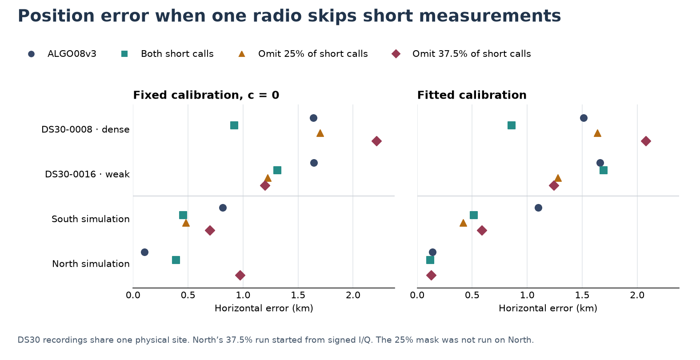

# Alternating short antenna calls on public North

The target receiver reproduced the independent saved-mask detector packet **exactly after canonical JSON serialization** from original signed I/Q. Both ALGO08v3 and the new receiver produced a fix, 137 grid points and all eight verified PNGs. The new pipeline finished in **11.087 s** against **16.203 s** for v3, a **1.46× speedup**. Its fixed-zero horizontal error grew by **867 m**, despite a 15 m improvement with fitted calibration. This simple alternating rule fails the geographic accuracy requirement. [Frozen comparison](stereo-lane-raw-protocol.md) · [Binding, sealed timings and scores](measurements/stereo-lane-raw-north.json.gz)

| Measured outcome | ALGO08v3 | Candidate with 37.5% short-lane target |
|---|---:|---:|
| Launch to detector document | 8.592 s | 5.622 s |
| Launch through publication and exit | 16.203 s | 11.087 s |
| CPU through exit | 16.197 s | 11.076 s |
| Horizontal error, fixed zero / fitted | 0.106 / 0.141 km | 0.973 / 0.126 km |
| RF residual RMS, fixed zero / fitted | 5.406 / 5.167 Hz | 12.497 / 8.941 Hz |

On weak DS30-0016, both masks improved horizontal error in both arms. On dense DS30-0008, the target mask worsened fixed-zero/fitted errors from **0.919/0.857 km** to **2.213/2.077 km** against the same fully measured mixed receiver. Both dense candidate fits returned positions. South’s target also returned a position in each arm. These three cases used signed saved receiver outputs and freshly reran the solver with the reduced observations. [Saved comparisons](stereo-mask.md) · [Budget on the original DS30 rosters](receiver-mask-budget.md) · [Figure reproduction](stereo_lane_figure.py)

The raw receiver kept all **304 full-anchor calls**. It issued **1,312 short calls** and omitted **784**, split exactly 392 per antenna. Each of the 1,200 admitted stereo visits kept at least one measured antenna. The 2,400 original probe records, 713 signed factors, analysis binding and complete detector document match the previously frozen offline transform at SHA-256 `0ab06052211e6f60d7a705147d24b5e85f9366078026196e228f4be0161bdf63`. The estimate therefore exposes an effect of changing the measurement roster that can be reproduced without reading more I/Q. On the earlier unfiltered, fully measured short packet the fixed-zero/fitted errors were 0.390/0.121 km. [Full-short North controls](north-causal-transfer.md)

The candidate ran first on CPU 2 at nice 15 and best-effort I/O priority 7, under the single shared benchmark lock. Both processes began with all 385,609 compressed source pages in tmpfs resident. The candidate incurred 1,216 process input blocks and the comparator zero, with zero major faults. Authenticated candidate acquisition itself took 4.622 s. This pair includes all work from original input through process exit. North is a previously scored simulation and this experiment used its containing offer. The fixed-zero error and the timing both miss the promotion requirements. [Raw entry](unified_short_bootstrap.py) · [Receiver](stereo_lane_receiver.py) · [Independent comparison runner](stereo_lane_raw_trial.py) The retained preflight assignment inherited a stock-first order label from the older North study. The two launch timestamps and commands establish the actual candidate-first order. The trial driver now records and checks the order explicitly.
