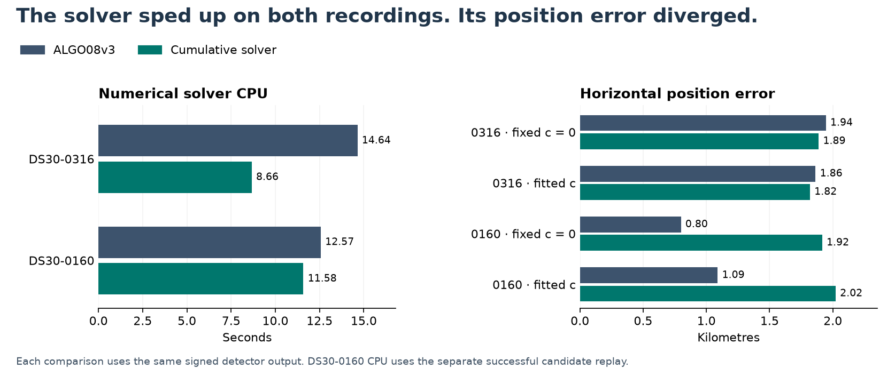

# Where the next 2× could come from

The target is half the elapsed time of installed ALGO08v3 on one core, from the original signed recording through publication and process exit. Both the median of paired elapsed ratios and the ratio of total times must reach 0.500. Accuracy is evaluated on both the fixed-zero and fitted calibration, alongside fix coverage, false fixes on omitted regions and the eight required figures.

## Where time actually went

| Case and measured boundary | v3 → candidate | Interpretation |
|---|---:|---|
| DS30-0227, original I/Q through exit, warm | 1.296 → 0.437 s | Both withheld. The graph could prove there was insufficient evidence before loading the full solver. |
| DS30-0016, same raw boundary, warm | 10.813 → 8.638 s | Both fixed. Horizontal error was 1.644 → 1.311 km with zero calibration and 1.661 → 1.694 km with fitted calibration. |
| DS30-0057, saved receiver outputs through publication | 13.289 → 10.509 s | A 1.26× downstream gain on a medium physical case. The two pipelines consumed their own saved receiver outputs. |
| DS30-0316, identical saved v3 receiver output through publication | 18.358 → 11.946 s | A 1.54× downstream gain. Both arms improved horizontal error by 44–57 m, retained all original owners and produced eight verified figures. |

The two matched raw cases total **12.108 → 9.075 s**, or **1.33×**. The paired median ratio was **0.568** and the ratio of totals was **0.750**. To meet the total-time gate on these two cases, the remaining gap is **3.021 s**. The prospective DS30-0316 solver measurement was 8.659 CPU s. A model using three recording sizes predicted 8.901 s, while transferring the dense timing fraction directly predicted 5.652 s. Recording size and which branches execute matter. All four physical cases come from one roof. [Raw pair](unified-short-layout.md) · [Medium publication](cumulative-medium.md) · [Prospective solver and timing budget](prospective-0316-solver.md)

A separate, complete run on the public **North simulation** now verifies the short-policy selector from original signed I/Q. Stock v3 ran first at **16.761 s** and the candidate finished in **12.023 s (1.39×)**. Each had the same fully resident source and incurred zero block reads. The candidate made one authenticated acquisition, chose history in 44 ms, and ran one solve. Fixed-zero / fitted errors were **106/141 m → 128/113 m**. Both produced their 137-point grids and eight verified PNGs. This is a known development simulation. Its timing stays separate from the physical DS30 pair. [Sealed raw pair and geographic scores](north-held-anchor-pair.md)

On the weak fix, **3.392 s** went to authenticated acquisition, **2.617 s** to solving, **1.132 s** to rendering, and **1.498 s** to everything else. Holding the withdrawal at 0.437 s leaves **5.617 s** for the fix. Even making the whole weak solver free would leave the pair about **0.404 s** over its summed budget. At the other end, the earlier dense acquisition spent **32.403 s CPU and 60.449 s elapsed** before it handed off detections. Elapsed savings from a warm receiver kernel cannot account for a cold recording's wait time. [Raw stage partition](warm-recording-budget.md) · [Dense clock attribution](dense-ingress-attribution.md)

The previously numbered **#1, #2 and #4** addressed losing receiver hypotheses, repeated solver layouts and regional pruning during recovery. Even making all three enclosing operations free would save an estimated **12.34 CPU s** against the **54.55 CPU s** needed to halve dense v3 CPU. A subsequent exact grid kernel saved 0.358 s on the grid but the dense complete saved publication ran 26.926 → 27.036 s. A same-library Huffman assembly switch also produced mixed whole-acquisition results. Keep these results as cost limits when comparing new ideas. [Three original ceilings](bounds-combined.md) · [Grid transfer](cumulative-grid-projection.md) · [Decoder comparison](zstd-assembly.md)

## Ten experiments ranked by what they could change

Ranks reflect the next decision each experiment would inform. The first proposal protects the quality of an already faster receiver. The next two target seconds of computation. Seconds from different inputs or measurement boundaries cannot be added.

| Rank | Proposed change | Smallest useful test and stop condition |
|---:|---|---|
| 1 | **Choose the short-receiver policy once per recording.** Keep regular full-length anchors. Use the two radios’ ability to predict erased anchors to choose whether to apply frequency-history filtering. Run the expensive solve once. | The frozen selector cost 6–24 ms on four saved cases. North fixed-zero error fell from 390 to 128 m. Weak and medium physical chose unfiltered. South chose history and paid 124/273 m versus unfiltered, although it beat v3 in both arms. On prospective dense DS30-0008 the selector took 161 ms CPU and chose unfiltered. The single 28.516 s saved publication reproduced both archived errors (919/857 m), 4,367 owners per arm and all eight PNGs. Next verify full original input and blind transfer. [Archived choices](anchor-cycle-route.md) · [Prospective dense publication](held-anchor-route-publication.md) |
| 2 | **Detect a track across visits before searching every visit.** Sum weak pilot evidence along candidate Doppler slopes for the same radio and RF. Run the existing local signed verifier only where a trajectory predicts a signal. Keep a route for new arrivals. | The first controlled synthetic-noise test at −9 dB original-wave/added-noise power put only 5 of 76 individual visits in the top four frequency hypotheses. Summing 19 visits on a supplied trajectory recovered 3 of 4 tracks. The optimistic blind catalogue search already cost 1.60 ms/lane before verification. Test a small bank predicted from previously measured full anchors, price rediscovery, then stop if the complete receiver still loses to ordinary short searches. This is frequency evidence on a simulation, with position impact open. |
| 3 | **Speed up the actual robust fit.** Temporarily grant the solver the correct satellite assignments and aliases. Keep its phase and uncertainty updates, regional check and all grid points. If removing discovery still leaves too much work, group repeated calls by row/column layout and compile the whole inner update. | With 2.40 s for acquisition and the current weak publication budget, only 0.588 s is available for numerical work. Compare that with the cost of the exact conditional path before building a cheaper assignment algorithm. On DS30-0316, start from the measured 8.659 s numerical budget. Even giving a cheap Gaussian substitute the correct identities, phase references and group precisions left 1.018/1.855 km errors on North versus 0.106/0.141 km on v3. [Solver comparison](prospective-0316-solver.md) · [Phase and precision experiment](centre-oracle-factorial.md) |
| 4 | **Use an approximate position surface to nominate basins for the exact fit.** Construct a regional surface from time-differenced Doppler within tracks. Differences can suppress constant receiver offsets. Keep alternatives that are indistinguishable within measurement uncertainty. | Check whether the incumbent basin survives using saved observations across widths, mirrored offers and a missing region. Repeat with clock drift and time-dependent bias. Charge construction and every exact retry. Reject the idea if it frequently needs the full geographic search. |
| 5 | **Allocate extra receiver time by how much it distinguishes competing fixes.** Two satellites or two candidate positions sometimes predict measurably different signed frequencies a few visits later. Spend full-length verification on those opportunities, retaining periodic independent anchors and guard coverage for new signals. | Give a retrospective selector access to the two contenders but withhold truth from its decision. Count informative visits that are still available in a single streaming pass or bounded buffer. Price the buffer and re-fit. Reject schemes that require an uncharged second traversal or sacrifice the weakest horizontal direction. |
| 6 | **Represent a track as several signed peaks with uncertainties.** Preserve the runner-up where the pilot measurement is ambiguous and defer the hard choice until another epoch separates the peaks. This could replace a whole second association or detector pass on ambiguous cases. | On saved ambiguous tracks, measure how often a second peak contains the full receiver’s solution, how many exact retries this could actually avoid, and how many spurious hypotheses it adds. Use the original rows for final scoring. Cap branching before opening other locations. |
| 7 | **Write all eight PNGs from a compact drawing description.** Produce ticks, transforms, labels, series and markers once per figure and exercise a smaller raster backend on the real web templates. | Start with the weak publication, whose render cost 1.132 s and whose imports outside solver and renderer cost about 0.93 CPU s. Measure draw, encode, dependency load and decoded-image verification separately. Compare all eight visible products, dimensions, values and sidecars. These costs overlap in proposed implementations. [Weak publication profile](saved-overhead.md) · [Current renderer](one-pass-web-png.md) |
| 8 | **Process different RF streams at different observation lengths under a single compute budget.** Estimate each stream’s incremental detection yield from independent, regularly scheduled long observations. Preserve exploration in every stream. | Simulate changing the allocation using paired short/full arms, measure receiver operations avoided and include exact recovery. Distance, station identity and surveyed errors stay outside the scheduler. Take it forward only if it improves the weak, medium and simulated workloads beyond the simpler recording-wide selector. |
| 9 | **Overlap useful solve preparation with blocked storage reads.** On one core, schedule already-needed orbit/track preparation for validated epochs while the next byte range is outstanding. Bound memory and preserve authentication before publication. | Use a saved trace to intersect idle read intervals with ready work whose inputs really are final. This intersection is the ceiling. Then test a few naturally admitted original members with both run orders. Include all work through exit. Earlier prefetch won 8.92 s through detections and finished 4.21 s later on a cold physical pair. [Cold pair](successor-physical-triage.md) |
| 10 | **Change the capture representation for future scans.** Evaluate independently verifiable visit chunks and a signed compact pilot product alongside the original I/Q, so a subsequent selective verifier can read specific windows. | Prototype on one saved member. Measure recorder CPU, acquisition latency, extra storage and the cost to reproduce detections and recover from corruption. Report capture-to-fix and archival raw-replay timings independently. The DS30 gate charges conversion from the existing originals. [Original authentication coverage](authenticated-input-coverage.md) |

## How the measurements change the priorities

| Priority now | Direction | Decision experiment |
|---:|---|---|
| 1 | **Repair and resume the current solve when orbit history is incomplete.** The exact recovery dispatcher paid for 7.239 s of a cumulative attempt before it handed off. Preserve intermediate work only while all its orbit and observation dependencies still match. | Inject a missing earlier orbit at different points in saved cases. Compare both arms, ownership, paths and images against independent clean restarts. Measure the cost on ordinary successful inputs as well. This primarily protects an infrequent but large quality loss. |
| 2 | **Price adaptive sampling by position ambiguity.** On dense data, saving 0.390 ms across each of 11,834 short calls would amount to 4.616 s. Sporadic positives between quiet anchors rule out simply skipping quiet intervals. | Before building a scheduler, use saved alternate observations to find a best-case budget. Preserve independent discovery on both radios. Ask if enough visits can be shortened while preserving geometry, assignments and the resulting position under each calibration. Charge every repeated verification. |
| 3 | **Replace repeated full data passes inside the robust fit with incremental updates.** Salvage usually changes only part of the observation roster. Record which observations, weights, orbit evaluations and nuisance columns truly change between two iterations. | With the same seed, time the reusable and changed work separately. Update only unchanged-design contributions whose inputs can be verified, and compare with a fresh exact calculation at each accepted iterate. Stop if the price of verifying reuse absorbs the savings. |
| 4 | **Use a short list of competing position and satellite hypotheses to request evidence.** A predicted carrier alone failed to give accurate sample timing on most directed tests. Spend a bounded set of full searches where the rivals predict distinguishable frequencies or timing, alongside ordinary discovery visits. | On saved cases where the two best hypotheses disagree, count discriminating visits available before a decision, their measured cost, and the resulting position. Include geographic offers that omit the correct region and cases where neither proposed hypothesis is right. |
| 5 | **Share more web drawing work, then test the whole build.** Two direct residual charts saved 0.290 s through exit on a weak fix. The other six already have a verified visual reference. | Profile the remaining six templates, prototype the most expensive, and test a short fix and a dense fix with and without the option. Preserve plotted numbers, scales and labels, and report any visual differences. |
| 6 | **Hide verified I/O waits with useful single-core work.** On one dense acquisition, 60.449 s elapsed while CPU usage was 32.403 s. Preparation can overlap only while its required authenticated inputs are available. | From a timestamped saved trace, first measure the intersection of actual stalls and ready work. Pursue overlap only when that intersection can cover several seconds. Measure the final process exit and retain storage and residency evidence. |

Two previous results narrow these experiments. With a third of the antenna opportunities, the hindsight eight-second epoch selector kept 85.68% of the dense case’s nominal information in its weakest horizontal direction. On South it kept 90.55%, yet its containing-region fix missed the accuracy screen. The proposed receiver experiment therefore has to price actual positions on replay. Static solver layout reuse was worth at most about 0.77 CPU s after its overhead on dense DS30-0008. Even the faster robust-update kernel ran the full dense short-packet solve in 26.27 CPU s versus the earlier control’s 25.57 s. Proposal 3 needs to remove entire repeated numerical passes in the current candidate to justify further work. [Epoch selection](radio-epoch.md) · [Layout reuse ceiling](incremental-layout.md) · [Robust solver on actual short detections](profiled-gamma-live.md)

The reserve ideas are a regional Doppler-difference surface, per-stream observation lengths, multiple signed peaks per track and a chunked format for future scans. A full rewrite of the Huffman decoder, another independent empty-lane threshold, and ranking fixes by in-sample RF residual have weaker evidence than the first six experiments. The exact-history recovery, weak renderer gain and modeled dense receiver target come from different cases and scopes.

## The next comparison

### Alternating short antenna measurements

On the first four enrolled recordings, the zero-wait model requires removing **36.6–37.8% of short-call CPU**, depending on whether remaining calls cost the measured dense or weak mean. The full-length dense test deliberately targeted that range, keeping both full anchors and at least one radio at every short visit. Its 4,435 omitted calls price at **4.735 CPU s**. Rebuilding the position increased fixed-zero/fitted horizontal error from **0.919/0.857 to 2.213/2.077 km**. The same rule improved both estimates on weak DS30-0016. The live normal raw entry reproduced the frozen North simulation packet exactly and produced its eight figures in **11.087 s** against v3’s **16.203 s**. North fixed-zero error grew from **106 to 973 m**. Dense fit quality and North accuracy rule out promoting the fixed schedule. [Figure and raw verification](stereo-lane-raw-north.md) · [Three saved cases](stereo-mask.md) · [Per-roster timing model](receiver-mask-budget.md)

The orbit-history census detected the genuine fault on DS30-0160 in **20.6 ms after 2.052 s of preparation**. With the same faulty catalogue an ordinary fit can succeed if it never uses that orbit. Early routing on catalogue health alone would reroute such valid fits. The earliest verified exact recovery point is the three-sample check on the actually selected set. [Conditional-failure control](early-causal-history.md)

A counterfactual identifies what the dense mask lost. Restoring exactly the **1,452 skipped observations used by the complete mixed fit** brought the dense errors down from **2.213/2.077 to 0.704/0.661 km**. The restored fit still reassigned observations, and its RF residual worsened in both calibration arms. Those 1,452 measurements spanned 123 tracks, 27 satellites, and all ten recording-time deciles. Their estimated cost leaves **3.185 CPU s** of receiver savings even with perfect hindsight and free selection. Another 1.431 s would be needed elsewhere to fund the 4.616 s dense design point. A live method must learn when to spend that measurement from already-paid observations and count the false trips. [Oracle construction, spent calls and saved dense position](target-owner-recovery.md)

The same-radio recent-positive rule used only earlier paid measurements to schedule extra work. On dense DS30-0008 it would have bought **1,625** short calls and found **707 of 1,452** original owned observations, versus **530** in an equal-count stratified uniform control. It missed the prespecified half-coverage screen, so its subsequent position test is exploratory. With the rule frozen, one saved publication lowered fixed-zero/fitted errors from **2.213/2.077 to 1.584/1.549 km**. The original fully measured mixed fit delivered **0.919/0.857 km**. Numerical solve CPU rose from **26.105 to 32.484 s** against that full control. Even crediting **2.992 s** of projected receiver savings leaves the acquisition-plus-solve estimate **3.39 s slower**. The fit accepted 638 restored measurements but still changed 344 satellite assignments among observations shared with the full control. [Causal selection and uniform comparison](causal-mask-recovery.md) · [Dense recovery publication](causal-mask-dense.md)

Four orbit plots now have a direct Cairo drawing option. On weak DS30-0016 it reduced all-eight render CPU from **0.879 to 0.506 s**, preserving both calibration arms, owners and grid. The corrected saved publication finished in **4.718 s** against an instrumented **5.169 s** control. Subtracting the control’s measured scene-export cost leaves **0.402 CPU s** difference. The full-length dense transfer established scientific and visual compatibility; its separate timings did not establish a whole-process gain. [Corrected plots and measurements](direct-orbit-figures.md)

On medium DS30-0057, fresh processes with neither scene export nor an audit renderer measured **1.170 → 0.976 CPU s** for the complete eight-figure render. Saved-input publication took **10.436 → 10.218 s** through exit. Both calibration fits, all 1,542 ownership rows per arm, the position path and 179 grid points matched. Four PNGs were byte-identical. Independent inspection of the four Cairo charts verified the 14 legend entries and at least 99.9986% bidirectional coverage of colored plot data within two pixels. The control incurred dependency input I/O, so the render interval is the stronger timing comparison. [Medium paired transfer](direct-orbits-medium.md)

### Follow-up measurements

On DS30-0160, one provisional position update recovered a 65-observation track that the cumulative solver had identified and then rejected at its old position. Every restored observation matched v3’s satellite and role. Fixed-zero/fitted errors fell from **1.915/2.022 to 0.823/1.337 km**, versus **0.798/1.089 km** for named v3. The trial cost 0.088 CPU s on this development case. The corrected fitted-arm position is still **248 m worse** than v3. On DS30-0316 the same rule tried an update, found no newly compatible observations and reverted to the previous result. The full terminal and all eight PNGs matched the previous candidate on that control. [Provisional fit, branch outcomes and clocks](provisional-salvage.md) · [Figure reproduction](saved_solver_transfer_figure.py)

On the full-length **DS30-0008** transfer, the frozen rule spent **0.791 CPU s** on the additional fit and check. Its objective improved and its trial position moved **1.670 km**, but none of the 563 observations in 16 rejected fragments became compatible. It reverted. Both errors (**0.919/0.857 km**), all 4,367 associated observations per arm, the grid, path and all eight figures matched the earlier candidate. The saved process ran in **28.038 s** versus **27.106 s** for the earlier control. Both consumed the same mixed 20/12 ms receiver output. This is the second triggering control where the refit correctly reverted and cost time. A geometry-based indication of when to try recovery needs an independent check before adopting it. [Dense trial, exact checks and timings](provisional-salvage-dense.md)

- **The physical DS30-0160 holdout changes the accuracy assessment.** On the same full named receiver packet, fixed-zero/fitted error went from **0.799/1.089 km** on v3 to **1.915/2.022 km** on the cumulative solver. The candidate dropped 114 of 1,037 v3 owners in each arm. All 923 retained observations kept their satellite and role. The first candidate process published its figures but exited with a research audit error after the installed orbit-history retry. A separate candidate-only run with corrected retry accounting exited successfully and reproduced the same position regression. Numerical CPU was **12.565 s** for the original named solve and **11.584 s** for the corrected candidate. The named dataset has only one completed history-support case across 100 assignments. This calls for a correctness fix before widening the benchmark. [Signed policy census](history-retry-roster.md) [Physical holdout and corrected audit](prospective-0160-solver.md) · [Exact row-level trace](owner-0160-audit.md)
- **Recovery can restore the original DS30-0160 fix.** Repairing one unavailable earlier orbit inside the named inference avoided restarting that fit. The named-only diagnostic used **7.694 CPU s for solving** and **11.120 s through exit** versus 15.999 s for the earlier named retry. The separate cumulative dispatcher waited for the actual orbit failure before handing off to a fresh named process. It reproduced both coordinates, all 1,037 owner rows per arm, the 179-point grid, the path and all eight original PNGs. Including the 7.239 s spent before handoff and the controller cost, the dispatcher took **20.428 s**, slower than the original. [Named-only recovery](named-history-once.md) · [Whole cumulative dispatch](cumulative-history-dispatch.md)
- **The quiet-visit hypothesis failed on physical data.** Three empty checks in a stream still enclosed 30 genuine short-lane positives on weak DS30-0016 and 86 on dense DS30-0008. A different waveform-based gate, evaluated on an authenticated physical clip subset, could skip none of 13 empty lanes with a common threshold that preserved all 55 positives. The causal trajectory receiver also supplied a carrier close to the measured one on all 83 directed tests on South, but only ten timing predictions fell within four samples. It retained 90 of 109 measured factors at 1.382 ms/lane against its 0.60 ms target. [Quiet cycles](quiet-cycle.md) · [Physical waveform screen](cyclic-presence.md) · [Causal trajectory receiver](verified-anchor-stack.md)
- **Occupancy can reverse the receiver choice at fixed simulated locations.** Applying one frozen dropout pattern to two saved observation rosters flipped both choices to unfiltered even when scored solely on untouched full observations. On masked North this decision improved fixed/fitted errors by **1.603/2.007 km** relative to choosing history. Its fixed-zero error still exceeded the allowance by 144 m. The same altered data and location underlie this comparison. [Occupancy control](selector-occupancy.md) · [Position comparison](selector-occupancy-position.md)
- **The renderer supplied the clearest new weak-recording speed gain.** Drawing two residual charts directly took the full saved publication from **5.118 to 4.828 s through exit** on one pair. All eight images and numerical products verified. The two new residual images kept their data and labels with a different rasterization. Pure compression changes lost their gains during verification and commit. Caching repeated UTC conversions separately saved **44.5 ms** in the weak forecast with exact scientific results. On the medium DS30-0057 saved input, a corrected forecast-plus-lazy-import process ran **10.206 s** versus the earlier cumulative control’s **9.964 s** under different cache conditions. [Complete renderer pair](direct-residual-entry.md) · [PNG codec timings](png-codec.md) · [Weak phase forecast](exact-phase-forecast.md) · [Medium transfer](cumulative-phase-forecast-DS30-0057.md)
- **The gate on full-length recordings needs several seconds.** The first four and sixteen frozen assignments all have approximately 6,770 issued windows. Under the earlier model, at the observed dense acquisition CPU rate with zero exposed input wait, a uniform net **4.616 s per adjustable recording** clears both first-four gates. The comparable first-sixteen figure is **2.735 s**. These sensitivities price opportunities. Only complete raw pairs measure the goal. [Case-by-case budget](roster-savings.md)

One guardrail for proposals 2, 5, 6 and 8 comes from the North trailing-frame test. Checking an independent piece of the waveform took only 126 ms for 600 disputed detections. The resulting fixed-zero RF residual fell from 69.40 to 6.91 Hz, yet horizontal error rose from 390 to 434 m against 106 m for v3. A receiver can select cleaner-looking measurements and leave the solver with worse geometry or different satellite assignments. Test the resulting position whenever the retained measurements change. [Full North intervention](tail-position.md)

There is a specific transfer question for proposal 1. History won on both public simulations, while unfiltered won on all three physical recordings tested. That pattern is compatible with the selector responding to differences between simulated and physical signal occupancy. A cheap next control is to hold simulated geometry fixed while varying dropped visits, noise and interference, then hold the signal impairment model fixed while changing location and regional offers. A physical recording from another surveyed location remains the strongest independent location check. [Four archived cases](anchor-cycle-route.md) · [Dense fifth case](held-anchor-route-publication.md)

The first cost check for proposal 3 already rules out a discovery-only rewrite under the 0.588 s weak solver allowance. Phase-history construction (0.249 s), forecasting (0.331 s), the 24-probe region check (0.114 s), the paired robust refit (0.085 s) and numerical evidence (0.202 s) total **0.981 CPU s**. This is a cross-receipt subtotal on the same weak input, assuming those stages keep their measured costs. It grants zero cost to finding satellite assignments, graph construction and other fitting. A promising implementation would also need to reduce the retained work or free time in acquisition and publication.

Start with the selector and a receiver proposal that could remove whole searches. In parallel, price the original robust solver and weak publication on saved packets. Use a shared budget to choose which to combine. For example, on the weak fix, stage targets of **2.70 + 1.50 + 0.70 + 0.70 = 5.60 s** would just fit. Those are illustrative budgets, with only 17 ms margin, rather than forecasts. On DS30-0316, holding the measured 8.662 s solve and 1.652 s render would leave only **9.871 s** for 3.744 GB of acquisition and all other work against its historical half-time. The implied minimum rate of **379 MB/s** assumes zero other overhead. This example illustrates why a receiver-only or solver-only benchmark can select the wrong design. [DS30-0316 calculation](prospective-0316-solver.md)

Freeze each rule before a new recording or location. Compare a fix, a withdrawal, and both sparse and dense workloads before widening the physical panel. Evaluate both calibration arms on the same inputs, count withheld recordings in the accuracy distribution denominator, and score containing and omitted offers separately. Both v3 and the two short routes returned false fixes just 100 m outside the public North and South offers and withheld 52.5 km outside. Rank accuracy by horizontal error and fix decisions. Report RF residual as a separate diagnostic. All Gauss work uses one low-priority benchmark slot. [Boundary evidence](geographic-jackknife.md) · [Matched route decisions](anchor-cycle-route.md)
