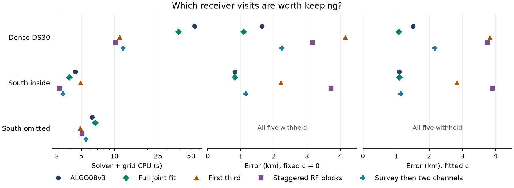

# A short receiver survey improved sparse fixes but missed v3 accuracy

The prototype surveyed all eight channels, then listened continuously to two. On dense DS30-0008 it needed **2,539 of 6,765 stereo receiver calls**. Its saved position solve took **11.96 CPU s** and returned a fix with **2.168 km** fitted error. Installed v3 took **54.51 CPU s** for the saved solve and returned **1.512 km** fitted error. The earlier first-third and staggered schedules gave 3.835 and 3.750 km, respectively. The new schedule reduced that error while still missing the prespecified 0.25 km tolerance. [Policy frozen before evaluation](survey-channels-protocol.md) · [Paired scores](measurements/survey-channels.json)



| Input and offered region | Paid visits / all | Candidate signals / full | Solver CPU s, survey / v3 | Error in km at fixed zero, survey / v3 | Error in km at fitted calibration, survey / v3 |
|---|---:|---:|---:|---:|---:|
| Dense DS30-0008 | 2,539 / 6,765 | 2,561 / 7,016 | 11.960 / 54.515 | 2.235 / 1.639 | 2.168 / 1.512 |
| Southern simulation, containing | 450 / 1,200 | 152 / 456 | 3.409 / 4.523 | 1.144 / 0.817 | 1.143 / 1.101 |
| Same southern simulation, far omitted | 450 / 1,200 | 152 / 456 | 5.518 / 6.387 | Both withheld | Both withheld |

The survey kept both antennas for the first sixth of the admitted visits, then kept one channel in each half of the observed RF range. It ranked channels by how consistently they delivered verified signals in each quarter of the survey. The membership calculation reads only the early signal outcomes. Both antennas on a retained channel have their full original history, including the survey, so the original signed detections can be replayed without imputing any signals. Both southern offers had identical packet and visit-set digests. The solver received the original causal orbit archive and the offered region. A separate scorer opened the geographic references after all three decisions were sealed. The full-coverage v3 and full signed controls come from archived matched solves. The figure reuses the published matched comparison of the two older schedules, whose control CPU clocks come from a separate run. [Signal selection and receipt runner](survey_channels.py) · [Original numerical receipts from this trial](measurements/survey-channel-solves.json.gz)

On the dense recording, the survey fit assigned 1,407 observations in each arm. RF RMS fell from 129.70 / 129.66 Hz with v3 to 125.47 / 125.52 Hz. Position error rose in both arms. On the southern containing offer the survey retained 152 assigned observations and RF RMS rose from 6.50 / 6.39 to 6.97 / 6.97 Hz. The fixed-zero error increased 327 m and exceeded the tolerance, even though the fitted error increased only 42 m. The far-offer run completed its exterior check and withheld. [Full RF and position scores](measurements/survey-channels.json)

## Dense CPU budget

Using the measured **21.623 CPU s** outside detector callbacks and charging the 2,539 retained calls at the full-recording mean gives **35.64 CPU s** for acquisition. Adding the measured **11.96 CPU s** for the solver and numerical evidence gives **47.60 CPU s** before figure rendering and exit. The historical warm half-time CPU budget is **55.54 s**. More active channels may take longer per call, skipped visits still require empty-probe handling, and storage waits affect elapsed time. This estimate assumes unchanged outside work and excludes selector overhead. The run failed the accuracy screen and stopped before a raw replay. [Full acquisition timers](acquisition-split.md) · [Historical warm clocks](single-core-target.md)

Applying the dense stage fractions to the archived four- and sixteen-recording schedules gives a separate check on the two end-to-end gates. This scenario transfers the **0.6044 acquisition CPU fraction to elapsed time**, transfers the measured **0.2194 solve elapsed fraction**, and charges original publication elapsed. The single unsplit failure in the 16-case roster retains its original full cost. At four recordings the projected median paired and summed elapsed ratios are **0.4860 and 0.4809**. At sixteen they are **0.5002 and 0.5265**. Even with the dense solve speed everywhere, the sixteen-case acquisition fraction would have to reach **0.5610** to meet both gates. The model reads archived clocks. It provides no timing verdict on either panel. [Projection receipt](measurements/survey-budget.json) · [Budget calculation](survey_budget.py)

In dense CPU units, the 0.5610 acquisition allowance is **33.08 s**, leaving a **2.56 s** gap to the survey estimate. Holding the 21.62 s outside the callbacks constant, that gap amounts to about **18%** of the survey's projected detector CPU. Paying for more full receiver calls would increase this gap.

## Reproduction

Use a checkout containing the signed solver trials, the installed release and the existing saved DS30 and southern receipts. The per-case commands run serially on the shared low-priority Gauss core. The scoring and plot use the research checkout.

```bash
release=/opt/leo-algo08/bdb869682a2ea63af4b198a920b763a4c6a78c4c
payload=/opt/leo-algo08/algo08v3/payload
runner="$PWD/reports/ALGO08/v3"
destination=$(mktemp -d)
bench() {
  flock -x /tmp/leo-algo08v2-2x-bench/gauss.lock ionice -c2 -n7 nice -n15 taskset -c 2 \
    env OPENBLAS_NUM_THREADS=1 OMP_NUM_THREADS=1 MKL_NUM_THREADS=1 NUMEXPR_NUM_THREADS=1 BLIS_NUM_THREADS=1 "$@"
}
for case in DS30-0008 south-containing south-far; do
  bench env PYTHONPATH="$runner:$payload:$release/src:$release" "$release/venv/bin/python" -BPs \
    "$runner/survey_channels.py" "$case" "$destination/$case.json" || exit 1
done
bench env PYTHONPATH="$runner:.:src" python3 "$runner/rf_block_score.py" --label survey \
  "$destination" "$destination/survey-channels.json" "$destination/survey-channel-solves.json.gz"
bench env MPLBACKEND=Agg python3 "$runner/thirds_figure.py" --survey "$destination/survey-channels.json" \
  "$destination/comparison.png"
```

The last command plots the freshly scored survey results alongside the four archived comparisons.
