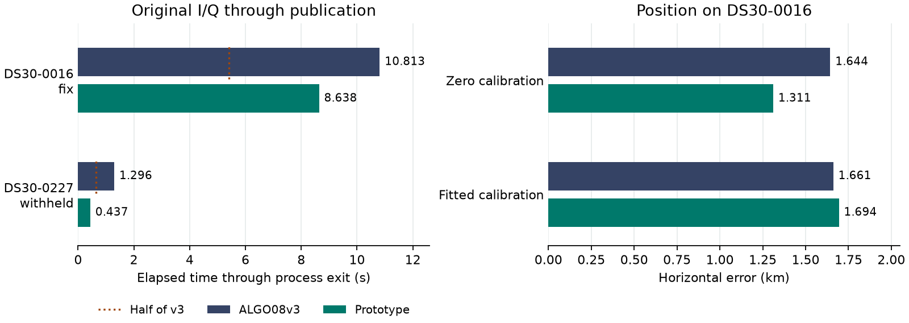

# Cumulative short receiver, exact graph proof and explicit web layout

The same research CLI with `--prove-empty-graph --one-pass-web-png` took **0.437 s** on the tiny withhold and **8.638 s** on the weak complete fix. The paired elapsed median ratio was **0.568** and the summed ratio was **0.750**. Both exceed the 0.500 target. This is the measured result of the combined candidate, including launch, original signed I/Q, either decision path, the standard store's writes and synchronization on tmpfs, verification, and process exit. [Protocol](unified-short-layout-protocol.md) · [Raw paired receipt](measurements/unified-short-layout.json.gz)

| Warm original I/Q | Named v3 → cumulative elapsed | Named v3 → cumulative CPU | Decision, both |
| --- | ---: | ---: | --- |
| DS30-0227, candidate first | 1.295895 → 0.437077 s | 1.294376 → 0.434737 s | Withheld |
| DS30-0016, named v3 first | 10.812561 → 8.638297 s | 10.809384 → 8.629740 s | Complete |

The two cases took 12.108 s on named v3 and 9.075 s on the cumulative CLI, a 3.033 s reduction. The observed half-time sum was 6.054 s, leaving 3.021 s to close on these workloads. The first qualification used separate recorded timings for the bootstrap, proof and saved renderer. These new clocks charge their combined real execution. The stage effect of layout alone was measured in saved matched renders, with median CPU 1.434 → 1.188 s. The raw active rendering boundary was 1.132 CPU s. [Prior unified and exact graph evidence](unified-short-bootstrap.md) · [Visual and same-artists qualification](one-pass-web-png.md) [Figure from the paired receipt](unified_short_layout_figure.py)

## Publication verification

DS30-0227 retained the original 18 visits and 14 admitted stereo visits. Named v3 had zero selected factors. The cumulative CLI published all 13 previously verified short factors with the same receiver, channel, timing and signed CFO values. These fell into eight physical lane groups with at most two observations each, below the installed graph minimum of eight. The candidate's full detections, inventory, scan report, terminal and withheld sidecar bytes matched its prior unfiltered short run. Both arms withheld their locations with the original `no_active_curvature` policy. The candidate made one authenticated raw traversal, handed off its packet once and never imported the solver or renderer.

DS30-0016 retained the same 808 issued and 713 admitted stereo visits. Named v3 repeated its original 440 selected factors, 109 owned observations per calibration arm and all eight original encoded and decoded PNGs. The candidate repeated its original 475 selected factors, 116 owned observations per arm, both terminal solutions, all original scientific path and grid values and the 179-point completed grid. It ran the ordinary optimized solver because its installed graph admitted input support. The candidate's eight encoded PNGs and decoded RGBA digests each matched the sealed explicit-layout render from the independently checked artist inventory. That check covered the original labels, axis limits, line, scatter and bar data, legend placement, image size, mode and DPI. The raw run used all reviewed templates with zero layout fallbacks. The layout adapter retains the installed renderer and pays its work when a template is unsupported. [Opt-in CLI](unified_short_bootstrap.py) · [Reviewed layout](one_pass_web_png.py)

The old and new position-grid and path documents differed in their runtime metadata and actual position-image content pointer. Each pointer was independently checked against its own decoded and SHA-verified PNG. All remaining numeric content and provenance fields matched. The receipt records separate digests for the original short-layout, explicit-layout and named-v3 artifacts.

| Calibration | Named v3 → cumulative horizontal error | Named v3 → cumulative RF RMS |
| --- | ---: | ---: |
| `c = 0` | 1.644 → 1.311 km | 109.375 → 121.526 Hz |
| fitted `c` | 1.661 → 1.694 km | 109.479 → 120.291 Hz |

## Resource admission and reproduction

Gauss reported 45.64% full I/O pressure over 10 s at admission. The driver checked that all enrolled original compressed pages were resident before starting any arm and again before each launch, 5,090 pages over one member on the tiny input and 242,128 over thirteen on the weak input. The trial copied no recording, warmed no missing compressed page and evicted no page. Both outputs and private temporaries used tmpfs. The global I/O number and the low per-process dependency input counts are in the receipt. The run used Gauss's shared exclusive lock, CPU 2, nice 15, best-effort I/O 7 and one numerical thread. These warm recordings support the reported comparison. Cold end-to-end results and broader qualification remain open.

Invoke `unified_short_bootstrap_trial.py` in the installed release environment with `root`, `short`, `geographic`, `regional` and `block` paths from the receipt, plus `--layout-receipt`, `--layout-receipt-sha256` and `--prior-unified`. The layout gate uses saved qualification commit `92ef1c5d8` and digest `223b2331a193dcb7778b1d5b792d14367e20e5916e531c8ad64aa58a92483a2a`. The prior unified raw receipt is `8a48cc5d32756ecf616444108f31d151cb92381bf746e9b5ffd1fe327c77c9fd`. The measured cumulative receipt decompresses to SHA-256 `d1eee8981f1be7e09c79019b7c3e0dbf2136cebaa453e2ae0ff5440d222ace7e`. The direct path is opt-in. Eighteen focused tests passed, including the installed-renderer fallback.
