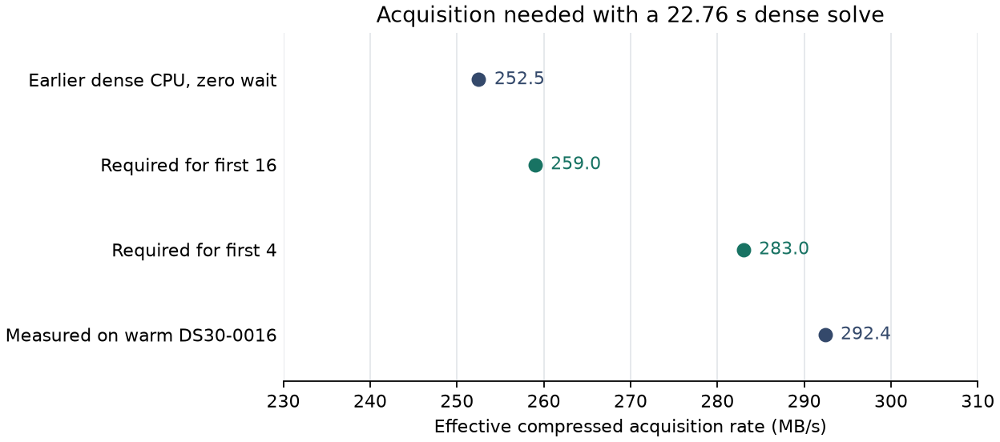

# What a complete warm physical recording says about the 2× budget

The cumulative 20/12 ms receiver traversed **991,734,597 compressed bytes across 13 members in 3.386 s** on DS30-0016, an effective **292.87 MB/s** through the instrumented acquisition callback. This was the previously measured complete, warm, single-core run that published a position in 8.638 s. The numerator comes from the two original signed segment manifests bound to its actual detector packet. The callback covers both radios, all 808 issued opportunities, 713 admitted stereo visits and 475 selected factors. Including the immediately enclosing acquisition checks gives **3.392 s and 292.39 MB/s**. No original waveform was reread to reconstruct these rates. [Complete raw receipt](measurements/unified-short-layout.json.gz) · [Bound member sizes](measurements/unified-raw-member-sizes.json) · [Manifest reader and coverage checks](late_prefix_stop.py)

| Complete physical input | Compressed MB | Decoded MB | Members | Admitted stereo visits | Callback elapsed s | Compressed MB/s |
|---|---:|---:|---:|---:|---:|---:|
| DS30-0016 | 991.735 | 1,292.800 | 13 | 713 | 3.386 | 292.87 |
| DS30-0227 | 20.848 | 27.131 | 1 | 14 | 0.094 | 222.22 |

The timed runs started with all waveform pages resident. These logical rates include decoding, authentication and signed detection. Storage service can be very different on a cold scan. Earlier measurements on two cold private dense members with prefetch reached 224.74 and 248.29 MB/s. On six resident public North simulation members, prefetch reached 294.84 and 297.31 MB/s, with the same original 768 probes and 359 detections as serial demand. Prefetch won by 73 ms in one order and lost by 5 ms in reverse. Verification with DSP omitted reached 595.12 MB/s on that simulation. [Cold physical prefix](physical-short-prefetch.md) · [Six-member public acquisition and storage accounting](warm-six-prefetch.md)

## Where the weak fix needs to improve

The fixed two-recording summed target leaves **5.617 s** for the weak fix once the measured 0.437 s withdrawal is charged. The current weak acquisition consumes **3.392 s**, the numerical solve **2.617 s**, layout and PNG encoding **1.132 s**, and everything else from launch through exit **1.498 s**. These elapsed intervals partition the measured 8.638 s. If acquisition stayed fixed, only **2.225 s** would remain for solving, rendering and the rest of publication. The present numerical solve alone exceeds that allowance. Even a free native detector would remove only its **1.772 CPU s** on this warm run, before considering any change to solver workload. [Clocks, outputs and cache admission](unified-short-layout.md)

For scale, apply the observed **292.87 MB/s** to every physical recording in the existing roster model, keep its 2.063 s common overhead and the dense unfiltered solve at 26.105 CPU s, and charge prior unsplit failures in full. The resulting first-four median/summed elapsed ratios are **0.515 / 0.481**. At this rate the dense solve must fall to **24.07 s** to clear both gates. The first-sixteen ratios would be **0.467 / 0.484**. These are sensitivity calculations. The whole dense recording previously achieved only 135 MB/s under different cache and storage conditions. The observed measurement is one warm physical fix; qualifying both gates requires new paired raw recordings at the appropriate stage. [Roster model](regional_dense_budget.py) · [Original dense timing](dense-full-short-raw.md)

## What the exact graph changes do to the acquisition budget

The dense cumulative saved pair subsequently measured **23.769 → 22.756 CPU s** for the numerical solve and **27.912 → 27.093 CPU s** for the complete saved process. Graph preparation itself saved 0.528 CPU s. The paired build shared the full eight-chart layout, both calibrated positions, all owners and every numerical grid point. The rest of the observed timing difference includes single-order variation. [Paired results and exact product checks](cumulative-dense-graph.md)

Using the new 22.756 s solve and both historical elapsed gates gives the following conditional acquisition requirements. The uniform-rate assumption applies to all instrumented scans. The 292.39 MB/s sensitivity uses the wider acquisition boundary measured on the physical weak recording. For the dense 8,182 MB recording, the earlier complete acquisition took 32.403 CPU s. Retaining that CPU cost sets the maximum effective dense rate at **252.51 MB/s even with zero wait**.

| Enrolled roster | Required uniform acquisition rate | Dense acquisition elapsed allowance | Minimum dense CPU saving at zero wait | Median / summed at 252.51 MB/s | Median / summed at 292.39 MB/s |
|---|---:|---:|---:|---:|---:|
| First 4 | 282.99 MB/s | 28.913 s | 3.490 s | 0.534 / 0.507 | 0.491 / 0.462 |
| First 16 | 258.99 MB/s | 31.592 s | 0.811 s | 0.499 / 0.507 | 0.454 / 0.468 |

The dense CPU observation used the earlier raw receiver with the same aperture schedule. The current receiver's whole dense cost with prefetch has yet to be measured. Against the observed dense CPU, every second of exposed I/O or scheduling wait increases the needed CPU saving by another second under this model. This is why the next receiver experiment is looking for at least **3.5 CPU s** on dense acquisition before a large raw comparison. [Reproduce the calculations](cumulative_graph_budget.py) · [Timing inputs](measurements/dense-measured-budget.json)
