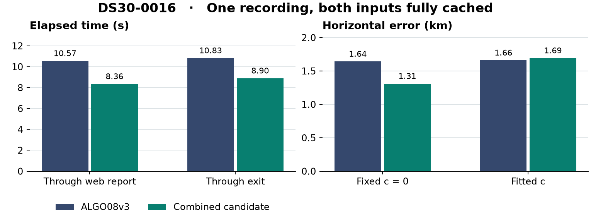

# Complete raw comparison on one weak DS30 recording

On DS30-0016 the combined candidate took **8.901 s** from launch through exit, versus **10.831 s** for the named ALGO08v3 launcher on Gauss. Both started with **all 242,128 input pages resident**. This is a **1.217×** speedup on one physical development recording. Halving elapsed time would require another **3.485 s** here. [Scored receipt, per-arm clocks and artifact digests](measurements/weak-combined-raw.json)

| Same recording and supplied region | ALGO08v3 | Combined candidate |
|---|---:|---:|
| Complete process elapsed / CPU (s) | 10.831 / 10.797 | 8.901 / 8.878 |
| Through the standard web report write (s, approximate) | 10.567 | 8.357 |
| Horizontal error, fixed / fitted calibration (km) | 1.644 / 1.661 | 1.311 / 1.694 |
| RF residual RMS, fixed / fitted (Hz) | 109.375 / 109.479 | 121.526 / 120.291 |
| Positions returned / recordings | 1 / 1 | 1 / 1 |
| Numerical grid points / verified web PNGs | 179 / 8 | 179 / 8 |

The standard report timestamp follows publication of the grid, position path and eight web PNGs. Its clock begins at the end of the input-residency observation just before launch. The complete process timer uses a monotonic clock. The research launcher verifies its figures and writes diagnostics before exit. Comparing through the standard report gives **1.264×**. Candidate RF residual increased in both arms despite the improvement in the fixed-calibration position. This pair passed the 250 m per-arm development tolerance. The wider pipeline still has known near-boundary false fixes on other development offers. [Regional tests](full-short-transfer.md)

## Which parts still cost time

The candidate used a full two-scan search on the first visit in each group of eight per RF, channel and edge. It ran the signed 12 ms primary on both antennas at every intervening visit. It used the installed track graph, fused geographic projection, full cold catalogue with row reuse, and full diagnostic grid with phase-state reuse. Both launchers processed the same 713 admitted stereo visits, retained the same 95 input exclusions and read the same causal archive. The candidate regenerated its signed detector packet exactly. Each arm matched its corresponding saved science reference, including grid scores, terminal estimates, ownership, position path and all eight encoded and decoded images. [Combined saved-input check](measurements/grid-phase-entry.json)

| Candidate work within the 8.878 CPU s | CPU s |
|---|---:|
| Native waveform search across both antennas | 1.664 |
| Other authenticated acquisition | 1.695 |
| Numerical solve including geographic checks and the full grid | 2.605 |
| Other work through exit, including publication, startup and verification | 2.914 |

The measured acquisition took 3.359 s elapsed. Even removing that entire span for free leaves **5.542 s**, above the **5.415 s** process target. Conversely, removing the numerical solve for free also leaves more than the target. These additive bounds hold the other stages fixed. Reaching half time here requires reducing work across stage boundaries.

An initial candidate launch with zero input pages resident took **12.451 s elapsed / 9.154 CPU s**. Its acquisition took **6.757 s elapsed / 3.504 CPU s**. Its terminal, owners and figure hashes matched the warm candidate. A preflight initially passed a list to the cache checker, which required a tuple. After that correction the first stock attempt exited during path resolution because the named launcher requires a pre-created output directory. The cold candidate remains a standalone observation. The completed stock-first pair ran under one uninterrupted lock with a shared font cache, one pinned core, nice 15 and best-effort I/O priority 7. All results use the original archives. [Frozen procedure and correction](weak-combined-raw-protocol.md)

## Reproduction on Gauss

From the pinned research checkout, provide a fresh output path writable by the recording account. Use the same shared low-priority lock and numerical environment as the [original small raw pair](full-short-physical.md). Run the [pair driver](weak_combined_raw.py) with arguments `OUTPUT GEOGRAPHIC_SO --stock-first`. Run the [scorer](weak_combined_score.py) with `OUTPUT SAVED_COMBINED_PUBLICATION ARCHIVED_WEAK_PAIR_SCORE NEW_SCORE_JSON`. Its optional `--cold-root` includes the separate cold launch. The published receipt records both full commands, input bindings, cache counts and the scientific checks. The [plot script](weak_combined_figure.py) reads that receipt.
