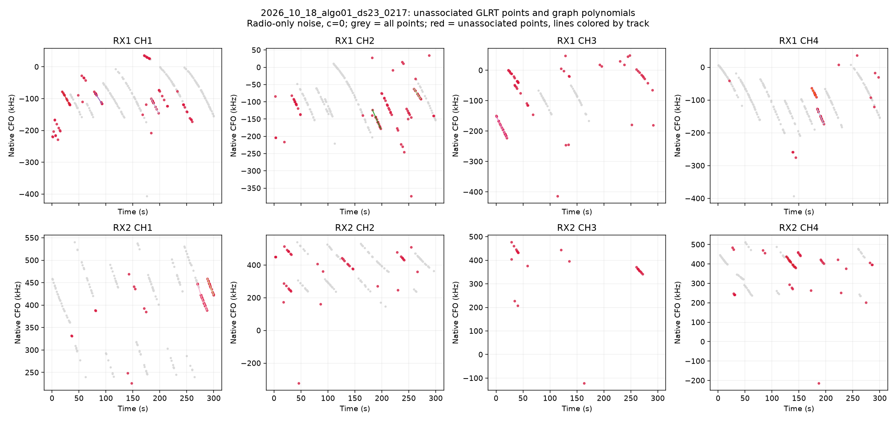
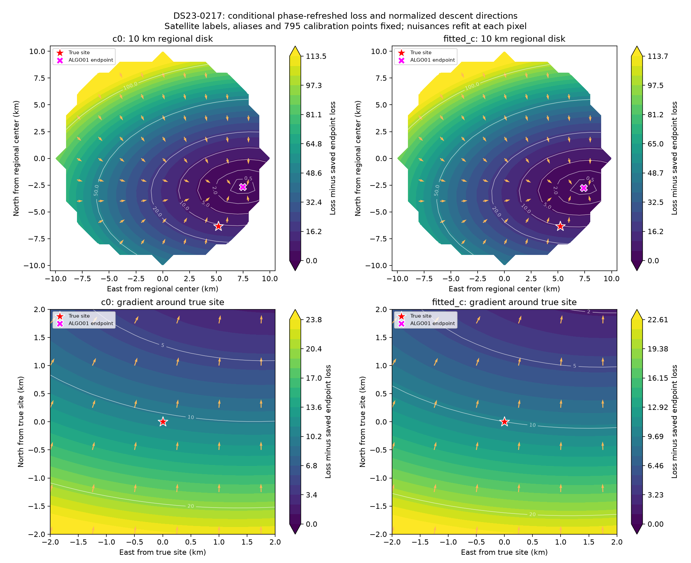
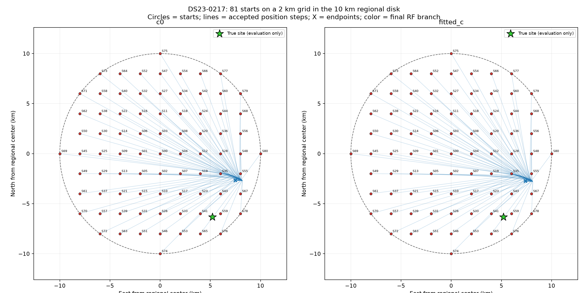

# DBG01 — standard localization debug analysis and figures

DBG01 is the reusable diagnostic procedure for a named dataset, scan and
algorithm version. It documents **why a position estimate or missing track
occurs**, without silently changing the benchmark algorithm. The first complete
example is [ALGO01 on DS23-0217](../2026_10_18_algo01_ds23_0217/README.md).
The algorithm specification remains [ALGO01](../ALGO01/README.md).

An instruction such as **“Run DBG01 on DS23-0217 with ALGO01”** means perform
the analysis below and deliver the standard figures, machine-readable evidence
and a Markdown explanation. State omissions or unavailable inputs explicitly.
DBG01 is a diagnostic specification, not a new estimator or a claim that the
current case-specific scripts are already a generic production API.

## 1. Freeze and replay the case

Record dataset/recording identity, scan cutoff and UTC anchor, algorithm/source
hashes, graph and noise configuration, input authority hashes, candidate-bank
contents, selected RF nomination branch, aliases, calibration masks, parameter
priors and numerical budgets. Preserve original benchmark inputs and outputs.

Replay the saved endpoint objective and residuals before explaining it.
Default replay tolerance is absolute loss difference below1e−5; record actual
differences. Keep measured GLRT CFO unchanged modulo integer alias periods.
Count unique physical observation identities, distinguishing original winners,
additional resolved peaks, alias replicas and interpolated plot samples.

Only pre-observation TLE epochs **and collection timestamps** are eligible.
Use genuine earlier epochs separated by at least1second for ALGO01's causal
phase uncertainty. Record missing-history fallbacks. No following TLE, true
satellite list or GPS-selected branch enters inference.

Use the declared regional box unchanged. The current ALGO01 default is a
**25×25 km square centered at37.906,−122.545**. GPS is used for evaluation and
explicitly labeled oracle diagnostics only. If a scan has another declared
region or reference, record that configuration rather than inheriting this
example's coordinates.

## 2. Standard figures

Every figure identifies scan, algorithm version, c arm, evidence denominator,
position/association conditioning and any display-only frequency transform.

### A. Associated GLRT and tracks — `associated_GLRT.png`

Use one panel per RX/channel, native measured CFO Hz or kHz against device-time
seconds. Gray shows all winning GLRT observations. Color accepted observations
and graph/piecewise-polynomial tracks by satellite hypothesis, retaining track
IDs in a companion table. Show all receivers/channels, not only successes.
Do not display a polynomial prediction as an observed measurement.

### B. Unassociated GLRT and tracks — `unassociated_GLRT.png`

Use the same panels and axes. Gray shows all observations; red shows
unassociated GLRT marks; lines colored by track show unassociated graph
polynomials. Use exact accepted observation IDs, including partial masks:
an accepted suffix must not turn its rejected prefix gray by track-key alone.

Break down unassociated points into (i) graph-owned but satellite-unassociated,
(ii) outside graph tracks, and (iii) ambiguous/secondary evidence if available.
Provide per-track point count, duration and active-curvature eligibility.
Unassociated does not mean noise. A failure of the existing graph to recover a
curve is not proof that no physical curve is present.

### C. Residual overview — `track_residuals.png`

Plot satellite residual RMS against duration, sized by point count and colored
by gate status; include the RMS threshold. Provide mean, slope, quadratic/BIC,
step, autocorrelation, maximum independent-radio-standardized residual, alias,
visibility and multi-owner support diagnostics where applicable. Distinguish
polynomial residual checks from satellite residual checks.

### D. Loss and gradient — `loss_gradient_10km.png`

Default upper panels sample a **1 km grid in a10 km radius** around the regional
center. Default lower panels sample a **0.25 km grid over±2 km** around the
supplied true site, explicitly labeled as an evaluation-centered zoom. Clip all
evaluations to the original search box and disclose any clipped area.

At each pixel retain the same observed calibration points, satellite labels
and alias integers, and refit nuisance coefficients and robust noise variables.
For ALGO01, perform five absolute-prior phase-reference refreshes at that fixed
position. Persist pixel scores, RMS and final reference changes. This is a
**conditional phase-profiled loss surface**, not a full acquisition/graph/
association pipeline run at every pixel and not a normalized probability map.

Plot loss relative to the saved RF-selected endpoint, mark the true site and
endpoint, and overlay normalized negative-gradient directions. Explicitly
state if arrow length encodes direction only. Also report actual 50 m central
difference gradients at the true site and endpoint in loss/km. Do not imply
that an off-panel endpoint appears within a local zoom.

### E. Regional restart convergence — `convergence_10km.png`

Default starts are all **81 points on a2 km grid inside the same10 km disk**.
Mark and label every start, actual accepted position iterates, phase-round
boundaries when useful, and final endpoints. Persist a start/endpoint CSV.
Lines must represent recorded solver steps; label any mere displacement arrows
as such. Report endpoint spread, branch switches, numerical stop reasons,
gradients and phase convergence, not only geographic error.

Enable satellite/alias branch reselection using a declared same-scan causal RF
hypothesis pool. For the current implementation, build the pool from **13 cold
RF discoveries on a5 km grid**, plus the original RF branches; deduplicate
identities/aliases and discard learned positions, phases and receiver state.
Use only discrete nomination hypotheses as shared proposals. Rescore the
finite pool after each accepted c=0 position step. Clearly disclose that this
does not exhaust arbitrary satellite combinations or rescreen every TLE at
every trial. Record whether changes were allowed and whether any occurred.

For the c ablation, use the c=0-selected branch schedule for fitted c so each
pair has matched final identities, aliases, observations and other priors.
Label this policy; fitted c does not get a separate GPS-selected branch.
If instead running completely independent discovery at each of81starts, label
that separate experiment and do not conflate its paths with shared-pool runs.

### F. Influence and controls — `influence_and_controls.png`

Refit after removing each satellite family and each curved track individually,
in both c arms. Preserve the original nuisance-prior design for controlled
influence comparisons; disclose this rather than silently changing orbital
support. Never rank raw scores from different observation masks. Report
geographic error/endpoint shifts as diagnostics, not a GPS-based rejection rule.

Use a declared small set of generic prior/noise sensitivities, with matched
observations, candidate sets, starts and search budgets. The initial ALGO01
set is baseline, phase floor3s, doubled causal phase widths capped at15s,
fragment-constant prior300Hz, receiver mean-drift prior1Hz/s, physical orbit
modes×3, and the existing150Hz/10s correlated-noise control. These are
sensitivities, not automatically recommended settings. Subsequent mechanisms
must be recorded as follow-up experiments, not relabeled as predeclared.

### G. Objective decomposition — `loss_decomposition.png`

Compare the fitted endpoint with a fixed true-site fit that re-estimates
nuisances and phases. Report RMS, weighted data quadratic, nuisance-prior
blocks, grouped-noise/Gamma terms, integrated log-volume and visibility terms.
Verify that differences add to the actual objective difference. Keep full
normalizations when comparing different noise models.

Locating a preference in a loss component does not establish an implementation
defect. For example, a dominant Gamma-term difference motivates a fixed-noise
precision ablation, not an immediate decision to remove robust inference.
Separate frequency-fit improvements from position accuracy.

## 3. Mandatory targeted review of an obvious missing curve

When the user or a figure identifies a visible curve, trace it through **each
stage** before calling it clutter or a polynomial failure:

1. Plot a native-CFO zoom with original winning GLRT marks, every available
   gate-passing candidate rank, current track ownership and the requested time
   interval. Use device counters plus within-visit probe offsets; verify these
   reproduce the persisted observation times.
2. Distinguish loss before graph discovery (one-winner filtering), lack of a
   graph path, polynomial/support rejection, ownership arbitration, common
   finalization, calibration ineligibility and satellite-association rejection.
3. Instrument graph paths, scores, point counts, gaps and minimum edge cadence.
   Check cadence assumptions against the actual probe stride. Trace the first
   failed condition numerically; later gates were not reached if no path was
   proposed. Inspect both the full lane and the unresolved subset.
4. For a proposed curve, compare supported polynomial degrees on identical
   observations under frozen radio noise and complexity penalties. Do not
   remove a boundary point or raise a threshold merely to pass a plot.
5. If one-winner filtering obscures simultaneous signals, reopen the already
   archived GLRT candidates. Deduplicate alias/peak replicas per probe, retain
   resolved signals separately, and enforce unique peak ownership and at most
   one peak per physical track/probe. Report original-winner coverage separately
   from additional peaks. Do not silently change benchmark denominators.
6. Label restricted-window fits, altered discovery thresholds or alternative
   graph proposals as diagnostics. Successful recovery still needs independent
   calibration, active curvature and satellite gates before voting on position.

If a change is proposed, test its causal mechanism against a matched control,
add component-owned tests for implementation changes, and propagate it to
position before claiming better localization. Preserve the original benchmark.

## 4. Standard report contents and conclusions

Deliver a `README.md` with all figures and tables, input/source hashes, exact
commands/configuration, machine-readable memberships and scores, per-start CSV,
interventions CSV, and `validation.json`. Minimum summary:

| Topic | Required values |
|---|---|
| Evidence | All GLRT, graph-owned, associated, unassociated, calibration points/tracks |
| Position | c=0/fitted-c error, endpoint, regional box and actual initialization |
| Stability | Start count, endpoint spread, modes/switches, stop reasons and gradients |
| True-site diagnostic | Profiled loss gap, RMS, passing gates, gradient and decomposition |
| Influence | All single-family/track effects; no GPS-picked production deletion |
| Approximation | Phase convergence; exact joint-SGP4 versus tangent where available |
| Missing curve | Exact loss stage, failed threshold/value, candidate-rank/cadence evidence |
| Uncertainty | Supported conclusions, unresolved physical causes and scope limits |

A stationary endpoint or agreement across starts does not certify the true
position. Passing residual gates does not certify satellite identity or
unbiased location information. Local Hessian scales are not validated
confidence intervals. State the strongest supported explanation and what
remains unresolved; distinguish an optimizer failure, a conditional model
minimum and an exhausted identity search.

## 5. Current implementation and example artifacts

The current case-specific implementation is
[investigate_algo01_ds23_0217.py](source_snapshot/tools/investigate_algo01_ds23_0217.py),
with [reporting/figures](source_snapshot/tools/report_algo01_ds23_0217.py) and
[owned tests](source_snapshot/tests/analysis/test_algo01_0217_tool.py). Adapt case/input
bindings explicitly for another scan; do not assume editing a directory name
alone changes all imported case bindings.

Use the repository `.venv`, `PYTHONPATH=src:tools`,
`OPENBLAS_NUM_THREADS=1`, `OMP_NUM_THREADS=1`, and bounded subprocess workers.
No new RF collection is part of DBG01. QNAP inputs remain read-only.

The archived [source-overlay instructions](source_snapshot/README.md) explain
how to combine these additions with ALGO01's frozen source tree in an isolated
replay workspace. Snapshot files are evidence, not a runtime dependency.

The [RX1 CH1 missing-fragment example](../2026_10_18_algo01_ds23_0217_rx1_ch1_tail/README.md)
demonstrates the mandatory visible-curve audit, including an exact graph replay,
candidate-rank inspection, polynomial residual zoom and threshold evidence.
The [scan-217 improvement experiments](../2026_10_18_algo01_0217_improvements/README.md)
extend the example with confidence weights, receiver/channel residual transfer,
simultaneous whole-family replacements and exclusive secondary-peak recovery.

Example execution order: `prepare` figure/surface request; explicit diagnostic
`audit`; `discover` indices0–12; `bank`; `restart` indices0–80; `grid` chunks0–7;
`family` and `track` interventions; declared `prior` controls; reporting
`surfaces`, `restarts`, `details`; final source/link/provenance validation.
GPS-centered diagnostics must be labeled and kept separate from inference.

Example figures:

## 6. Diagnostic addendum, 2026-10-19 UTC

The [DS23 uncertainty study](../2026_10_19_ds23_uncertainty_study/README.md)
adds the following controls for subsequent DBG01 investigations. They supplement
the published figures above; they do not replace the original frozen examples.

Report the recorded UTC anchor and its complete host bracket. A midpoint is an
estimate, not exact sample UTC. For a clock sensitivity control, shift one shared
UTC value inside those recorded bounds, query ECEF geometry at the shifted UTC,
and keep elapsed device times unchanged for receiver drift/smooth corrections.
Freeze the TLE cutoff at the original earliest bound. Keep satellite phase
adjustments separate from UTC, and hold data/labels/aliases fixed across the
clock grid. Report both RF loss and position effects. A boundary optimum on a
nearly flat profile does not identify a precise clock correction.

When nuisance uncertainty could explain the error, report local Schur position
information and oracle controls freezing receiver, satellite phase/orbit and
fragment terms at their fitted values. State which noise/prior precisions are
conditioned on, check derivative steps, and label these as local generalized
widths. They are not new position estimates, calibrated coverage or a fundamental
CRLB. Do not infer that reducing an oracle width is an available algorithmic fix.

If an identity decision appears driven by the approximate integrated objective,
an optional fixed-position importance audit can test its approximation gap.
Preserve the same data, prior and normalization, and report sample count,
effective sample size and Monte Carlo uncertainty. Poor sampling is inconclusive.
Keep a c0-only objective audit separate from paired-c localization comparisons.

## 7. Confidence and evidence addendum, 2026-10-19 UTC

The [association-evidence study](../2026_10_19_ds23_association_evidence/README.md)
adds fixed-observation confidence ablations, broader simultaneous family changes
and secondary-peak recovery. Keep the original retained mask for soft weighting
comparisons; report hard confidence selection separately. An invalid trial must
stay in the denominator with an explicit failure/fallback rule. Conditional
identity scores are not calibrated correctness probabilities. Do not compare
generalized losses with different observation powers as model evidence.

Compare residuals across all same/different receiver, band and satellite-family
strata using unique matched physical observations. State available bands and
pair counts. Residuals conditioned on the joint fit can reveal remaining shared
structure but cannot prove that a receiver or orbit caused the position bias.
Illustrate a family observed on both receivers; do not select only striking
examples by eye or pool dependent track pairs as independent significance tests.

For joint identity debugging, include changes to several complete families and
retain alternatives that fail in isolation. Record the finite beam, proposal
anchors, candidate catalogue, optimization budgets and all failed attempts.
Distinguish cheap proposal fits from fully refined paired finalists. A finalist
must improve the same normalized radio objective and satisfy the original
physical gates; being geographically closer to the reference is not a selection
criterion. A radio-preferred replacement can still increase position error.

For secondary peaks, preserve the public adapter's canonical physical-probe ID
and time authority for each recording format. Match that identity set against
the frozen winning observations before recovery. Use at most one selected peak
per probe and each chosen peak's own radio-noise estimate. Exclude incumbent
calibration and already-associated output points when claiming new evidence.
Test new curves individually before joint addition; retain all original points.
Report local model-conditional information separately from actual position error.

The [curvature/shape study](../2026_10_19_ds23_curvature_shape_study/README.md)
also distinguishes statistically supported weaker curvature from a fixed
amplitude threshold. A higher polynomial degree alone is insufficient. Report
noise-weighted departure from affine, a complexity penalty and residual screens.
New calibration points may already have been associated as output tracks and
must not be counted again as association gains.

## 8. Predictive calibration and measurement controls, 2026-10-19 UTC

The [clock/measurement report](../2026_10_19_ds23_clock_measurement_controls/README.md)
adds reciprocal receiver/family prediction. Omit one satellite family's curves
on one RX while retaining its opposite-RX evidence and other satellite families.
Refit position from the regional center and calibration from training data only.
Predict the omitted full CFO vector with position/nuisance uncertainty; do not
refit omitted fragment constants or group noise. State that frozen identities,
alias integers and radio-noise proxies make this a conditional calibration
test, not independent blind satellite identification. Restore all original
points for the final matched c=0/fitted-c comparison. Do not accept more receiver
freedom merely because the in-sample residual decreases.

Before adopting an apparent time-tag correction, use matched opposite chirps
with the same known pilot envelope and phase. Separate CFO-versus-chirp response
from off-grid static CFO bias and retain peak-selection switches as exceptions.
A local sensitivity is not always a physically meaningful measurement instant.

For native measurement qualification, pin binary and build-receipt hashes and
distinguish that proof from identity of the actual capture binary. Test physical
delay/Doppler, independent code/carrier rates and off-grid frequency cases.
The tested500Hz FFT/magnitude-parabola interpolator has a template-predictable
noise-free bias; a mathematical inverse validated on those cases is not yet a
qualified noisy-data correction. Canonical GLRT CFO must be used before alias
lifting, since the frequency alias period is not an integer multiple of500Hz.
Keep the original persisted GLRT contract immutable and GPS outside calibration.

For bounded archived-IQ qualification, see the [seven-curve refinement study](../2026_10_19_ds23_raw_pilot_refinement/README.md). Select complete original curves using radio-only criteria, preserve every selected observation, verify declared manifests and window hashes through the public read port, and retain unresolved score replays. Compare fixed-epoch and joint carrier/epoch/code-rate fits using the degree selected on the original CFO. Record search boundaries, exact/control margins, odd/even frame behavior and effective times. Report boundary-inclusive radio diagnostics separately from boundary-fallback position trials. Update canonical CFO by observation ID while preserving integer aliases; leave unrefined points and the original persisted contracts unchanged. Independently report matched c=0/fitted-c position error: the large RX2 RMS reduction in these two diagnostic scans gives only a small position change under the old uncertainty law. Do not treat a lower polynomial residual or experimental native-library replay as proof of an unbiased measurement or the identity of the capture binary.

The [precision/family-reentry controls](../2026_10_19_ds23_refined_precision/README.md) show why every point-level intervention needs exact active-ID intersections. A cleaner curve can be entirely masked. Distinguish conditional residual rejection from the independent-owner cascade: eccentricity fixed scan 202's residual gate, but a second original channel companion was required for family support. Reconsider whole originally accepted companions with matched c arms, retain all incumbent points, and preserve failures rather than weaken a gate. Restore below-40Hz uncertainty only in an explicit research model with consistent normalization and unchanged noise for every other observation. Compare complexity by normalized RF evidence on the same observations; do not choose the more accurate GPS endpoint when RF prefers the simpler model. Report that legacy 75Hz floors may be insensitive to structure at newly measured 10Hz precision.

After restoring previously masked observations or changing their precision, repeat broad causal identity competition; the old masked-data ranking is insufficient. The [scan-202 follow-up](../2026_10_19_ds23_refined_catalogue/README.md) uses a shared phase across family curves, all-catalogue proposal screening and matched full physical fits. It reverses an apparent fixed-identity position gain. Report the closest geographic candidate even when RF rejects it, but never select it using GPS. Separate legacy gates from precision-scaled conditional diagnostics. For a loss map, identify actual samples, box/radius clipping, fixed identities and nuisance-refresh rounds; mark gradient arrows as directions with arbitrary display length, not descent trajectories. At the known site and RF endpoint, decompose the normalized objective exactly and compare finite-difference gradients at two step sizes before attributing bias to an optimizer stall or one satellite.

## 9. Dense measurement and uncertainty-consistent gates, 2026-10-19 UTC

The [dense RX2 and causal-shape report](../2026_10_19_ds23_dense_rx2_and_causal_shape/README.md)
keeps every original active calibration point. Recompute radio-only noise from
local measured-CFO scatter rather than treating a whole-polynomial PRESS error
as measurement variance. Report leverage, original masked-ID intersections,
whole-curve prediction error, local scatter, split-frame floor and boundary
fallbacks separately. A tail already excluded from calibration can still
distort whole-curve noise learning. Never hide that by deleting active points
or learning noise from satellite/GPS residuals.

With heterogeneous pointwise sigmas, evaluate GLS profile residuals and weighted
mean/slope/step tests, quadratic structure and whitened correlation. Preserve
physical RMS/bias limits, aliases, visibility and independent-owner support.
Keep the old rejection and revised development outcome side by side. Require
uniform-noise parity, mixed-noise false-rejection controls and sensitivity to
real slopes/discontinuities before interpreting a gate change. Exact saved-fit
replay must show that no refit or observation deletion was used to pass it.
Passing a pooled structure gate does not certify iid Gaussian residuals;
illustrate individual large standardized residuals and noisy fallback prefixes.

Keep causal mean and covariance qualification separate: the signed full-state
forecast selected zero on scan 202, while a zero-mean Student diagonal shape
prior improved historical innovation density. A later historical TLE remains
a proxy, not true orbit error. Split by publication events and require RF-age
qualification before generalizing next-publication results. Report both c arms,
RF-ranked identity alternatives, unchanged denominators and actual position
accuracy. A six-identity inherited shortlist retest is not a fresh all-bank
rescreen under changed data. Update RX/band/family residual comparisons with
the same unique-time matching rules after measurement interventions; keep
conditional correlation distinct from causal attribution.
