Research report · 16 October 2026 · saved evidence snapshot

# Recovering three unassociated trajectories in one fast scan

Scan `fast8-auto-20261016-161535-99008d35-1-lower`

Run `fast-9571943d3dccdf4f327e1346d1bf34b8` · RX1 = receiver 0; RX2 = receiver 1. All plotted times are seconds from scan origin.

**Result:** coherent-track initialization recovered the first two trajectories. The third has a strong satellite candidate and a satellite/band correction that transfers to the other receiver. Its physical cause is still unresolved.

Whole-scan association coverage rose from **34.3% to 55.6%** across these experiments: 1,023 additional associated observations, or 21.3 percentage points. These are frequency-fit and association results. No ground-truth position accuracy has been established for this scan, and these diagnostic changes have not been deployed.

## 1. Recovery progression

| Stage | Associated / 4,797 | Coverage | RMS on associated observations | Interpretation |
| --- | --- | --- | --- | --- |
| Original production, Hugging Face elements | 1,643 | 34.3% | 164.87 Hz | Published baseline |
| Isolated Space-Track pipeline rerun | 2,150 | 44.8% | 137.87 Hz | Different element source and selected candidate set |
| Track-informed initialization | 2,627 | 54.8% | 134.90 Hz | Same Space-Track objective; inspected tracks initialize timing |
| Experimental tighter-prior + band correction | 2,666 | 55.6% | 134.23 Hz | Hand-selected correction for 69522 / CH1–4, shared by receivers |

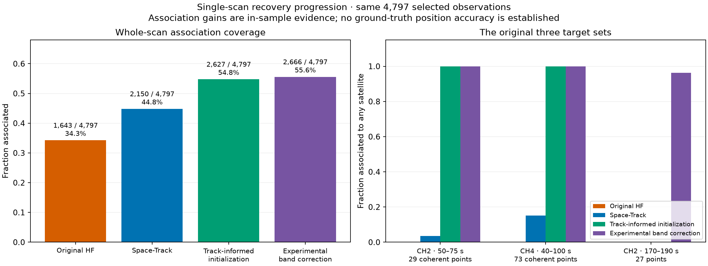

*All stages use the same 4,797 selected observations. Stage differences include TLE source/candidate selection, initialization, priors and the experimental correction; this is a progression, not a one-factor ablation.*

Sources: [comparison.json](evidence/comparison.json), [track_seed_report.json](evidence/track_seed_report.json), [shared_band_timing_result.json](evidence/shared_band_timing_result.json).

## 2. What happened to each original trajectory?

The early CH2 set contains 29 coherent descending points selected from 34 originally unassociated points (35 total observations in that interval). The other five unassociated points were excluded as a separate structure. CH4 contains 73 coherent originally unassociated points from 86 total interval observations. Keeping these target definitions fixed prevents unrelated points from obscuring the recovery.

| Target | Candidate | Original → final association | Final all-target RMS | Finding |
| --- | --- | --- | --- | --- |
| RX1 CH2, 50–75 s | 69433 | 0/29 → 29/29 to 69433 | 116.24 Hz | Timing/association local optimum; coherent trajectory provides a useful start |
| RX1 CH4, 40–100 s | 69333 | 0/73 → 73/73 associated; 72 to 69333 | 129.88 Hz against 69333 | Coherent-track start recovers the long track; one final point chooses another satellite |
| RX1 CH2, 170–190 s | 69522 | 0/27 → 26/27 to 69522 | 146.11 Hz against 69522 | Lower-band trajectory conflicts with shared timing preferred by upper-band observations |

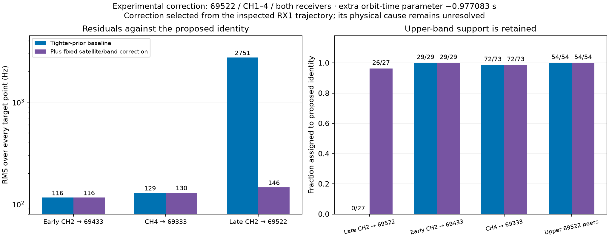

*RMS is computed over every point in each fixed target set, including points the model leaves unassociated. “Associated” and “assigned to the proposed satellite” are different quantities.*

The unchanged-objective track-seeded fit associated all 73 CH4 points with 69333 at 116.88 Hz RMS and all 29 early CH2 points with 69433 at 117.33 Hz RMS. Their timing parameters were approximately −2.19 s and −2.30 s. The later tighter-prior branch retained the trajectories while changing the CH4 fit slightly. This is why the strongest individual CH4 fit and the final experimental branch have different RMS values.

## 3. Root cause established for the first two: optimization and weak timing constraints

Before track-informed initialization, the selected Space-Track solution used 69433 and 69333 for scattered observations at unsuitable timing solutions. Coherent-track starts moved these satellites into solutions that explain the long trajectories and lower the same objective: **58,410 → 56,313**, with unpenalized NLL **57,879 → 55,857**. All reported fits passed the saved convergence/replay audit; passing that audit establishes numerical consistency, not satellite identity or geographical accuracy.

The original relative satellite timing prior had a 2 s standard deviation; the common timing prior was 3 s. Accepted total satellite shifts could extend to ±20 s. Simply tightening the prior did not reliably escape the existing timing basin. Compressing initial total shifts to ±3 s, then fitting under the original final bounds, exposed a much more compact timing solution.

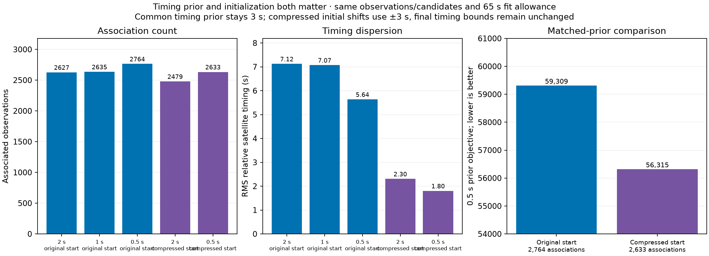

*The 0.5 s prior has a better objective from the compressed start despite fewer associated points than the uncompressed start. Association count alone cannot select a model; objectives with different priors must not be compared directly.*

Under the matched 0.5 s prior, the compressed-start objective is **56,315** versus **59,309** from the original start. Relative timing RMS falls to **1.80 s**, maximum absolute relative timing to **3.31 s**, with 2,633 associations. The same-start 0.5 s branch has 2,764 associations but remains at 5.64 s timing RMS and 17.56 s maximum. These are conditional local refits with the same data, candidate set and 65 s allowance.

Sources: [timing_prior_comparison.json](evidence/timing_prior_comparison.json), [timing_compressed_comparison.json](evidence/timing_compressed_comparison.json).

## 4. The late CH2 trajectory: genuine signal support, unresolved physical cause

The 27-point seed was extended to 38 points using continuity in the measured trajectory, without satellite predictions. That selection is exploratory. At the tighter-prior baseline, candidate 69522 explains the upper-band observations but the lower trajectory has approximately **+2.74 kHz mean residual**. Moving the satellite's single shared timing parameter improves the lower track while damaging its upper-band support.

A fixed extra orbit-time parameter of **−0.977083 s**, applied only to 69522 in CH1–4, fits the lower trajectory while retaining all 54 selected RX1 upper-band matches in the final comparison. It was learned on the original RX1 seed, then kept fixed for the shared-receiver refit. It is an empirical prediction adjustment; the experiment does not establish a one-second recording-clock error.

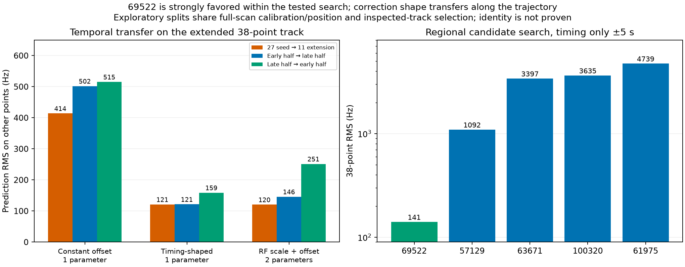

*A timing-shaped correction predicts the extension and temporal halves more consistently than a constant frequency offset. RF-scale plus offset is competitive on one split but uses an extra parameter and is less stable across the temporal halves.*

The regional search tested 1,035 Space-Track candidates with ±5 s timing at the fixed tested position. On the extended 38-point lower trajectory, timing-only RMS is **141 Hz for 69522** versus **1,092 Hz for the next candidate**. This is strong evidence within that search, with residual identity/orbit ambiguity still possible.

Allowing a blanket lower-band delay damages hundreds of other associations. With position, calibration and individual satellite timings fixed, an RX1 lower-band −1 s shift reduces that group's associated observations from 877 to 368. The evidence therefore does not support a scanner-wide one-second lower-band delay.

Sources: [late_track_extension.json](evidence/late_track_extension.json), [late_explanation_comparison.json](evidence/late_explanation_comparison.json), [extended_lower_full_search.json](evidence/extended_lower_full_search.json), [rx1_band_time_profile.json](evidence/rx1_band_time_profile.json).

## 5. Cross-receiver replay: the discrepancy is present in RX2 too

Using the recorded IQ, RX1 frame epochs and calibrated physical CFO branches guided a search in simultaneous RX2 windows. **20 of 38** windows passed margin ≥0.025 and circular CFO difference below 1,000 Hz. Three independent already-associated counterpart controls were recovered 3/3. Physical-frequency branch handling includes three 227,272.727 Hz alias periods; omitting them initially produced misleading non-detections, which were corrected before these reported results.

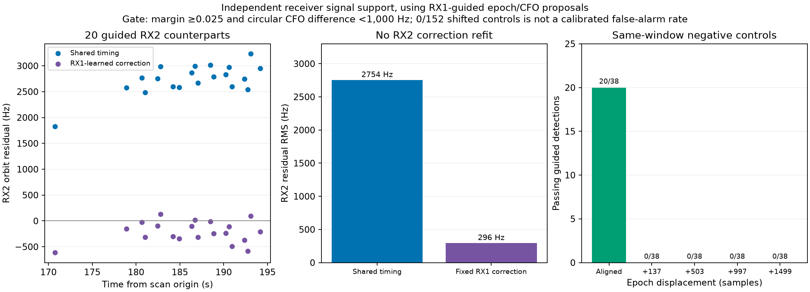

*The RX1-derived correction reduces RMS of the 20 guided RX2 detections from 2,754 Hz to 296 Hz. No correction was fitted to RX2. Guidance, shared calibration and shared position limit independence.*

Of the 20 RX2 counterparts, 12 lie within 250 Hz and 18 within 500 Hz after correction. Four displaced-epoch controls (137, 503, 997 and 1,499 samples) yielded **0/152** passing detections using the same windows. These are targeted negative controls, not a calibrated global false-alarm probability or a proof of satellite identity.

**Why the production candidate list missed them:** none of the 20 counterpart signals had a stored matching candidate within the tested epoch/CFO tolerances. Their physical CFOs span approximately 479–546 kHz, outside the original acquisition half-width of 429.6875 kHz. At the strongest example, widening to ±600 kHz, retaining more candidates, refining the coarse grid or densifying anchors still failed to retain the target. A wider frequency domain alone is insufficient; cross-receiver guidance provides a promising proposal mechanism.

Sources: [rx2_counterpart_summary.json](evidence/rx2_counterpart_summary.json), [rx2_timing_transfer.json](evidence/rx2_timing_transfer.json), [rx2_guidance_control_summary.json](evidence/rx2_guidance_control_summary.json), [rx2_candidate_retention.json](evidence/rx2_candidate_retention.json), [acquisition_counterpart_audit.json](evidence/acquisition_counterpart_audit.json), [acquisition_domain_audit.json](evidence/acquisition_domain_audit.json), [acquisition_anchor_audit.json](evidence/acquisition_anchor_audit.json), [acquisition_coarse_audit.json](evidence/acquisition_coarse_audit.json).

## 6. Measurement and scaling checks

| Hypothesis / check | Evidence | Conclusion within tested scope |
| --- | --- | --- |
| Stored CFO peak is biased by kilohertz | Continuous replay of all 38 RX1 probes: median change +53.81 Hz; max absolute change 157.92 Hz; mean orbit residual remains +2,837.72 Hz | Does not explain the discrepancy |
| Probe/sample timing is misbound | All 38 acquisition start counters match the stored probe support; raw chunks are digest verified | No support for the tested binding error |
| RF frequency tag or Doppler scale is wrong | RF-only fit transfers poorly; RF-scale + offset can fit but requires two parameters. Canonical channel-center substitution worsens the centered residual | No supported simple RF-tag repair |
| Within-frame sampling/time-scale mismatch | Three real probes: best warp changes CFO by about +0.05, −4.36 and +2.90 Hz relative to continuous zero-warp replay. Synthetic +2,000 ppm control recovers carrier within 0.5 Hz | Does not explain a kilohertz error in those three probes |
| Frame timing directly proves the orbit | Cross-band frame-phase curvature has related structure, but the late trajectory follows the negative rather than positive geometric-delay curvature under the tested convention | Frame-clock behavior needs its own model; do not treat phase as a validated range observation |

Sources: [raw_cfo_replay_summary.json](evidence/raw_cfo_replay_summary.json), [late_rf_scale_check.json](evidence/late_rf_scale_check.json), [late_within_frame_scale.json](evidence/late_within_frame_scale.json), [within_frame_scale_control.json](evidence/within_frame_scale_control.json), [frame_range_consistency.json](evidence/frame_range_consistency.json).

## 7. The remaining two point-level exceptions

A fixed-fit audit explains the difference between fitting a trajectory and hard-assigning every point. At **172.513 s in late CH2**, candidate 69522 has a +402.98 Hz residual, beyond that point's 377.39 Hz satellite/clutter crossover under the 125 Hz frequency width. Its satellite probability is 0.3455 versus 0.6545 clutter. Exact raw-CFO replay changes the residual only to +402.75 Hz; neighboring target residuals are −59.72 and +5.45 Hz. This remains a local frequency outlier and should not be forced into an association.

At **70.396 s in CH4**, 69333 fits the point at −20.02 Hz while competitor 100320 fits at +27.47 Hz. The frequency likelihood slightly favors 69333, but the competitor's detection-prior odds are 1.17169 times larger. The final probabilities are 0.4618 for 69333, 0.5350 for 100320 and 0.00325 clutter. Thus all 73 CH4 points are frequency-compatible with 69333, while 72 are hard-assigned to it. This crossing is a pointwise ambiguity that trajectory-level association could address.

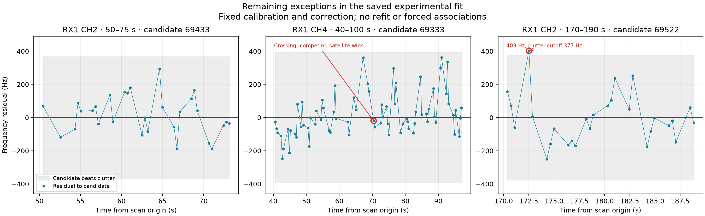

*Point-level audit of the final saved research fit. The late CH2 exception is a frequency outlier; the CH4 exception is a near-tied crossing decided by the detection prior.*

Source: [three_track_exception_audit.json](evidence/three_track_exception_audit.json).

## 8. Next debugging goal and model implications

**Proposed investigation goal:** explain and reproducibly recover the three original trajectories without hand-selected satellite exceptions, while preserving the upper-band fits; identify which parts are optimizer failure, acquisition loss, or missing satellite/band signal physics. Qualify the resulting mechanism on excluded observations before considering a production change.

1. **Track-aware initialization:** generate coherent-trajectory proposals before final association, compare several timing starts, and retain the numerical audit. The first two tracks provide direct evidence for this improvement.
2. **Hierarchical satellite/band residual model:** compare a tightly regularized frequency offset, a timing-shaped term and a low-dimensional frequency-evolution term. Learn correction parameters on one trajectory segment, score excluded segments and receivers, and retain a clutter option.
3. **Guided acquisition:** use simultaneous receiver evidence to propose epoch/CFO hypotheses, with explicit physical alias branches and negative controls. Measure candidate recall separately from downstream association.
4. **Physical root cause of 69522:** distinguish band/beam-specific transmitted frequency behavior, orbit inadequacy, and residual identity ambiguity using additional already-recorded tracks and independent element snapshots. A fit parameter must not become a literal clock explanation without timing evidence.

The main unresolved details include the physical origin of the isolated late-CH2 frequency outlier, 69522's lower/upper disagreement, and whether the correction generalizes beyond this selected scan. The CH4 swap now has an identified pointwise prior/likelihood explanation.

## 9. Scientific and provenance limits

- All localization comparisons here use fitted RF-dependent calibration coefficient `c`, as explicitly requested for this investigation. This report does not add a `c = 0` experiment.
- Associated-point RMS compares changing subsets. The target RMS figure keeps each target's full denominator. Neither is a substitute for position error against independent ground truth.
- Space-Track and Hugging Face reruns use the same tracking input but different selected satellite sets (59 versus 46). This does not isolate TLE age as the sole cause of the gain.
- The late-band correction and target selection were developed after inspecting this scan. Temporal and receiver transfer tests still share full-scan calibration/position; they are not an independent localization evaluation.
- The extra 20 RX2 detections are raw-IQ diagnostic evidence and have not been added wholesale to the 4,797-observation shared-fit denominator.
- Only existing on-disk data were used. No production code, RF collection or deployment was performed for this report.

### Additional diagnostic figures

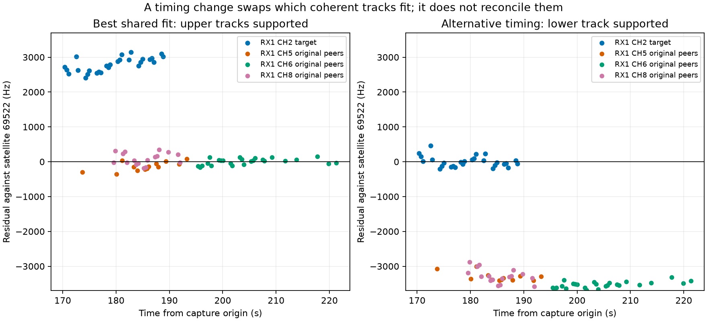

*The original lower/upper timing conflict for 69522.*

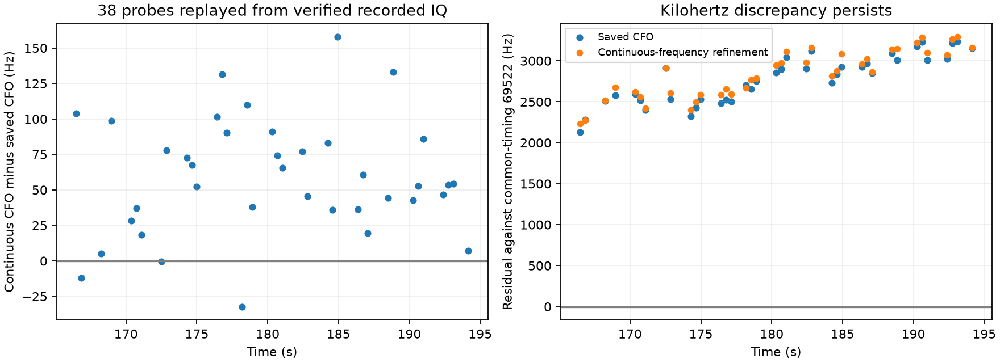

*Continuous raw-IQ CFO replay of the extended lower trajectory.*

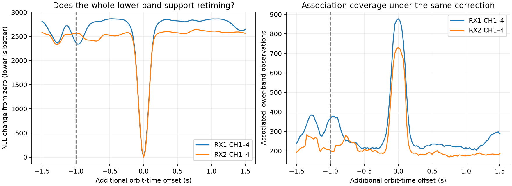

*Conditional blanket lower-band orbit-time profiles for each receiver.*

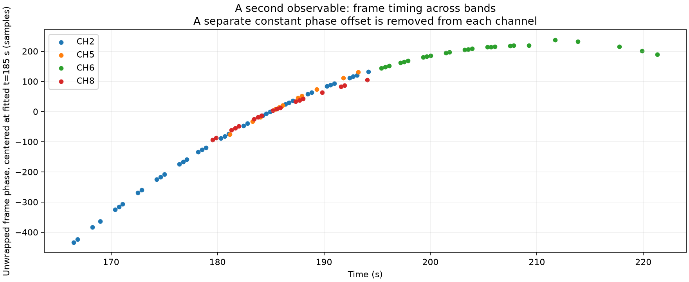

*Cross-band frame phases after separate phase constants are removed; offsets are not compared directly.*

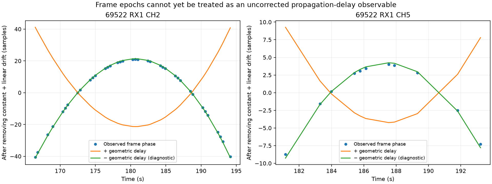

*Exploratory detrended frame-phase versus positive/negative geometric delay. This is not a validated range estimator.*

### Evidence bundle

The adjacent [manifest](manifest.json) records hashes for copied JSON evidence, figures and reproduction scripts. The scripts preserve the original diagnostic context and may reference the deployment/input locations; this bundle is a durable evidence snapshot, not a self-contained raw-IQ replay dataset. [Input and Space-Track snapshot identifiers](evidence/comparison_manifest.json) are retained. The standalone HTML embeds its figures and can be opened without a server.

Prepared from saved evidence on 2026-10-16 18:47 UTC. Report artifacts only; no production changes.
